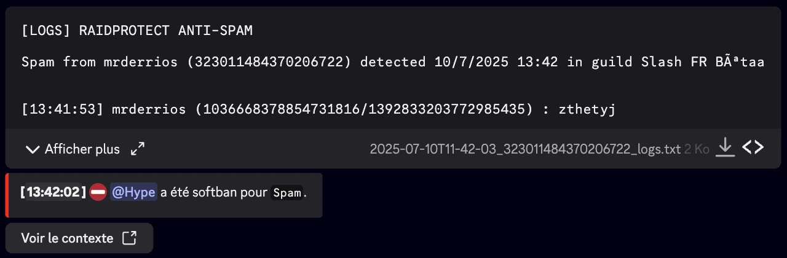
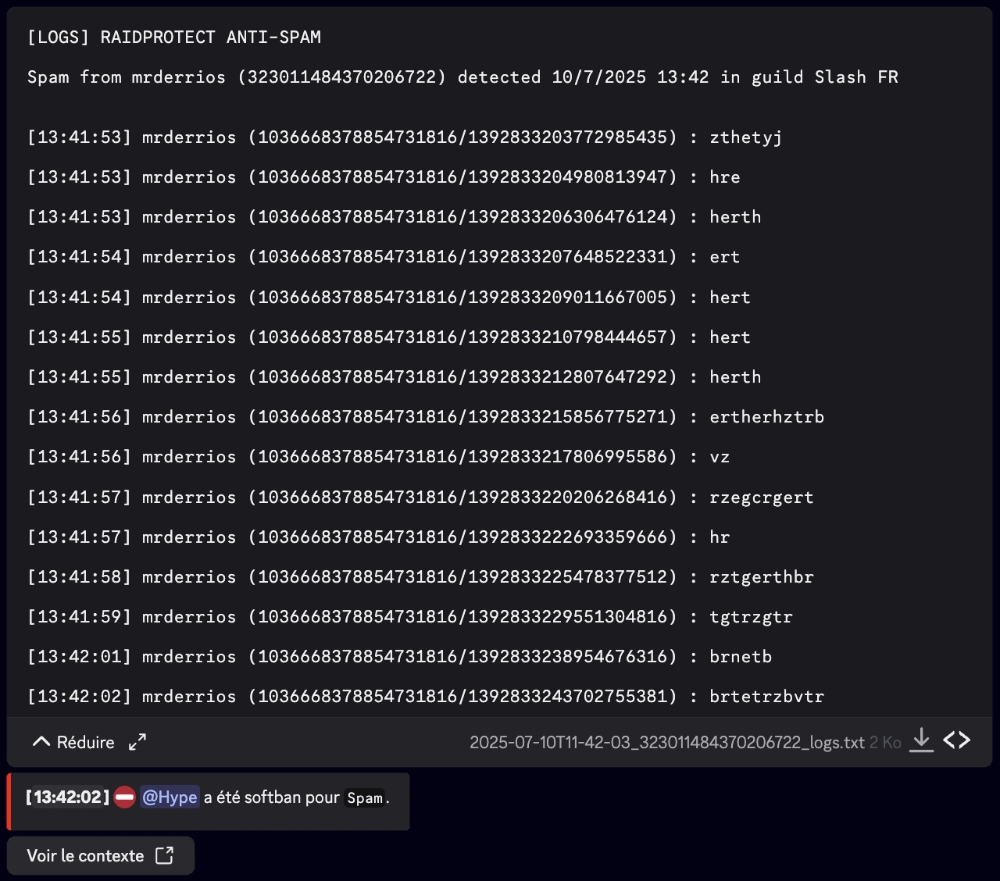

import AntiSpamMockup from '@site/src/components/DiscordMessage/mockups/anti-spam';
import Settings, { SettingsModal } from '@site/src/components/DiscordMessage/mockups/v2';

import SeparatedBox from '@site/src/components/SeparatedBox';
import Tabs from '@theme/Tabs';
import TabItem from '@theme/TabItem';

<AntiSpamMockup />

L'**anti-spam** de RaidProtect détecte et sanctionne automatiquement le [spam](/learn/spam-discord) sur votre serveur Discord : messages en rafale, écran inondé, copier-coller, liens, mentions massives, [selfbots](/learn/self-bot) et spam réparti sur plusieurs salons. Une fois activé, il s'occupe de tout sans qu'un modérateur ait à intervenir.

## ❓ Comment fonctionne l'anti-spam ? {#working}

Nous analysons chaque message en le comparant aux messages récents de son auteur, sur plusieurs fenêtres de temps (de quelques secondes à quelques minutes), dans le salon courant et à l'échelle du serveur.

- **Dix déclencheurs** : chaque type de spam a son propre déclencheur (spam, flood, fichiers, duplicatas, liens, mentions, selfbot, commandes externes, messages bloqués par l'AutoMod, multisalon). Le détail est dans le [tableau des déclencheurs](#triggers).
- **Quatre familles** : les déclencheurs sont regroupés par nature (**Excès**, **Spam**, **Automatisé** et **Spam multisalon**), ce qui permet de régler les sanctions en quelques clics.
- **La sanction la plus sévère l'emporte** : quand un spam franchit plusieurs déclencheurs à la fois, nous appliquons la sanction la plus forte.
- **Un message seul ne déclenche jamais** : il faut une répétition. Les messages publiés avant une sanction ne sont plus comptés ensuite.
- **Doublons approximatifs** : deux messages presque identiques (un mot ou un emoji changé, des lettres remplacées par des chiffres) comptent comme des doublons.
- **Motif détaillé** : la raison de la sanction précise ce qui a été mesuré, par exemple « Spam (9 messages en 15 secondes dans #général) ».
- **Logs** : chaque sanction est envoyée dans votre salon de logs avec les messages supprimés (voir [les logs](#logs)).

L'anti-spam est **désactivé par défaut**. Il s'active pendant la [commande `/setup`](../setup.md) si vous le cochez, ou à tout moment depuis `/settings`.

## 🛡️ Configuration de l'anti-spam {#config}

L'anti-spam se trouve dans l'onglet “**Protection**” de `/settings`. Son écran regroupe l'interrupteur, les sanctions, le préréglage, les exemptions et la simulation.

<Settings start="antispam" />

### Activer ou désactiver l'anti-spam {#toggle}

1. Faites la [commande `/settings`](../setup.md#settings).
2. Ouvrez l'onglet “**Protection**”.
3. Cliquez sur “**Configurer**” à côté de “**Anti-spam**”.
4. Cliquez sur “**Activer**” (ou “**Désactiver**”) en haut à droite de l'écran.

### Choisir un préréglage {#presets}

Le plus simple pour régler l'anti-spam est de choisir un **préréglage**. Il fixe d'un coup la sanction de chaque famille :

| Préréglage | Excès | Spam | Automatisé | Spam multisalon |
|---|---|---|---|---|
| **Souple** | Avertissement | Timeout | Softban | Expulsion |
| **Standard** *(par défaut)* | Timeout | Softban | Bannissement | Jail |
| **Strict** *(non recommandé)* | Softban | Bannissement | Bannissement | Bannissement |

1. Faites la [commande `/settings`](../setup.md#settings).
2. Ouvrez l'onglet “**Protection**”.
3. Cliquez sur “**Configurer**” à côté de “**Anti-spam**”.
4. Choisissez un préréglage dans le sélecteur “**Choisir un préréglage**”.

Le sélecteur affiche “**Personnalisé**” quand vos réglages ne correspondent à aucun préréglage. Dans ce cas, appliquer un préréglage écrase vos réglages : nous vous demandons de confirmer en cochant “**J'ai compris, appliquer le préréglage**”. Les durées propres à certains déclencheurs repartent alors sur la [durée par défaut](#duration).

<SettingsModal name="antispamPreset" />

### Gérer les salons, rôles et membres ignorés {#ignore}

Vous pouvez exclure certains salons, rôles ou membres de la surveillance anti-spam.

1. Faites la [commande `/settings`](../setup.md#settings).
2. Ouvrez l'onglet “**Protection**”.
3. Cliquez sur “**Configurer**” à côté de “**Anti-spam**”.
4. Choisissez vos exemptions dans les sélecteurs “**Salon(s) ignoré(s)**”, “**Rôle(s) ignoré(s)**” et “**Membre(s) ignoré(s)**” (25 au maximum chacun).

Le sélecteur de salons accepte les **catégories** (tous leurs salons sont alors ignorés), ainsi que les salons vocaux, les scènes et les forums. Les fils suivent leur salon parent.

:::info Qui est ignoré automatiquement ?
- Les salons dont le nom contient “**spam**” (pour un fil, c'est le nom du salon parent qui compte).
- Les membres que RaidProtect ne peut pas modérer (rôle plus haut que le sien).
- Le **staff** (permission `Administrateur`, `Gérer le serveur` ou `Gérer les messages`), **tant qu'aucun rôle ni membre n'est ignoré**. Dès que vous ajoutez un rôle ou un membre à la liste, seule cette liste compte : les membres du staff qui n'y figurent pas peuvent alors être sanctionnés.
:::

### Configurer les sanctions par déclencheur {#triggers}

Le détail des sanctions s'ouvre depuis l'écran de l'anti-spam.

1. Faites la [commande `/settings`](../setup.md#settings).
2. Ouvrez l'onglet “**Protection**”.
3. Cliquez sur “**Configurer**” à côté de “**Anti-spam**”.
4. Cliquez sur “**Voir les détails**” à droite de “**Sanctions**”.
5. Cliquez sur “**Modifier**” à côté de la famille à régler, puis choisissez la “**Sanction**” et, si besoin, la “**Durée**”.

<Settings start="antispamSanctions" />

Chaque famille regroupe des déclencheurs de même nature. Voici les déclencheurs que nous détectons, avec leur sanction par défaut (préréglage **Standard**) :

| Famille | Déclencheur | Ce qui est détecté | Sanction par défaut |
|---|---|---|---|
| **Excès** | Spam | Trop de messages en peu de temps. Les emojis, stickers et messages en charabia (caractère répété, mots en boucle) comptent aussi. | Timeout |
| **Excès** | Flood (écran rempli) | Messages qui remplissent l'écran : longs textes, images, aperçus de liens, stickers | Timeout |
| **Excès** | Spam de fichiers | Envoi massif de fichiers ou d'images | Timeout |
| **Spam** | Spam de duplicatas | Messages copiés-collés ou presque identiques | Softban |
| **Spam** | Spam de liens | Envoi massif de liens. Un lien déjà posté compte double. Les GIF Tenor et Giphy et les liens Discord ne comptent pas. | Softban |
| **Spam** | Spam de mentions | Mentions massives. `@everyone` et `@here` comptent pour 5 mentions quand ils notifient vraiment. | Softban |
| **Automatisé** | Spam avec selfbot | Utilisation de [selfbots](/learn/self-bot) pour spammer | Bannissement |
| **Automatisé** | Spam de commandes externes | Utilisation de [commandes externes](/learn/server-raidable) pour spammer | Bannissement |
| **Automatisé** | Spam de messages bloqués (AutoMod) | Messages à répétition bloqués par l'[AutoMod de Discord](#automod) | Bannissement |
| *(à part)* | Spam multisalon | Le même message posté dans plusieurs salons en peu de temps | Jail |

:::info Spam multisalon
Le **Spam multisalon** est particulier : sa sanction remplace celle du déclencheur d'origine quand le spam touche plusieurs salons, uniquement si elle est plus sévère. Il se déclenche dès 3 salons en 30 secondes, ou dès 2 salons si le message est long ou contient un lien ou une mention. Le désactiver coupe aussi toute la surveillance à l'échelle du serveur.
:::

Voici les **[sanctions disponibles](/learn/discord-sanctions)** pour chaque famille ou déclencheur :

- **Avertissement (Warn)** : envoie un avertissement au membre.
- **Timeout** : rend le membre muet pendant une durée définie (28 jours au maximum, limite de Discord).
- **Mute** : donne le [rôle Mute](./sanctions.mdx#mute) configuré sur votre serveur.
- **Jail** : donne le [rôle Jail](./sanctions.mdx#jail) configuré sur votre serveur.
- **Expulsion (Kick)** : expulse le membre du serveur.
- **Softban** : bannit puis débannit immédiatement le membre, ce qui supprime ses messages.
- **Bannissement (Ban)** : bannit le membre.
- **Désactiver** : coupe complètement le déclencheur, aucune sanction n'est appliquée.

:::info
Un **Jail** ou un **Mute** sans rôle configuré devient un **Timeout** : l'écran l'indique avec “**→ Timeout**”. Pensez à régler ces rôles dans l'onglet “**Modération**”, module “**Sanctions**”.
:::

Pour remettre toutes les sanctions par défaut, cliquez sur “**Réinitialiser**” en haut à droite de l'écran des sanctions.

#### Mode avancé : régler chaque déclencheur {#advanced}

Si vous voulez une sanction différente pour un seul déclencheur (par exemple bannir le spam de liens mais garder un Softban pour les mentions), passez en mode avancé.

1. Faites la [commande `/settings`](../setup.md#settings).
2. Ouvrez l'onglet “**Protection**”.
3. Cliquez sur “**Configurer**” à côté de “**Anti-spam**”.
4. Cliquez sur “**Voir les détails**”, puis sur “**Mode avancé**”.
5. Choisissez un ou plusieurs déclencheurs dans “**Sélectionner les déclencheurs à modifier**”, puis réglez leur sanction et leur durée.

<SettingsModal name="antispamFamily" />

Le mode avancé reste affiché tant qu'une famille a des réglages différents selon le déclencheur. Pour revenir au mode simple, cliquez à nouveau sur “**Mode avancé**” et cochez “**J'ai compris, aligner les familles**” : chaque déclencheur prend alors la sanction et la durée du premier déclencheur de sa famille.

#### Durée des sanctions {#duration}

Les sanctions qui ont une durée (mute, timeout, jail) utilisent la **durée par défaut**, fixée à 1 heure. Vous pouvez la changer pour tout l'anti-spam, ou donner une durée propre à une famille ou à un déclencheur.

**Durée par défaut :**

1. Faites la [commande `/settings`](../setup.md#settings).
2. Ouvrez l'onglet “**Protection**”.
3. Cliquez sur “**Configurer**” à côté de “**Anti-spam**”.
4. Cliquez sur “**Voir les détails**”.
5. Choisissez une durée dans le sélecteur “**Durée par défaut**” (Permanent, 5 minutes, 1 heure ou 1 jour), ou “**Valeur personnalisée**” pour saisir la vôtre (par exemple `30m`, `2h`, `7d`).

**Durée propre à une famille ou à un déclencheur :** dans la fenêtre ouverte par “**Modifier**” (ou par le mode avancé), choisissez une “**Durée**”, ou saisissez une “**Durée personnalisée**”. L'option “**Par défaut (durée globale)**” revient à la durée par défaut.

:::info
- Une durée personnalisée doit faire **5 minutes minimum**.
- “**Permanent**” sur un Timeout est ramené à 28 jours, le maximum autorisé par Discord.
- La durée est ignorée pour les sanctions qui n'en ont pas (avertissement, expulsion, softban, bannissement).
- Quand le spam multisalon prend le relais, c'est sa durée qui s'applique.
:::

### Message public de sanction (Premium) {#public-message}

Par défaut, chaque sanction de l'anti-spam est annoncée par un **message public** dans le salon (par exemple « membre a été mute »). Les serveurs [Premium](/premium) peuvent le masquer pour une modération plus discrète.

1. Faites la [commande `/settings`](../setup.md#settings).
2. Ouvrez l'onglet “**Protection**”.
3. Cliquez sur “**Configurer**” à côté de “**Anti-spam**”.
4. Cliquez sur “**Voir les détails**”.
5. Cliquez sur “**Désactiver**” à côté de “**Message public de sanction**”.

:::info
Ce réglage est partagé avec le [filtre d'images ScamLens](./scam-images.md) : le désactiver masque aussi les annonces des images d'arnaque supprimées.
:::

## 🔎 Simuler un spam {#simulation}

Un membre a spammé sans être sanctionné, ou au contraire un membre a été sanctionné à tort ? La **simulation** vous dit si l'anti-spam se déclencherait dans une situation précise, et pourquoi.

1. Faites la [commande `/settings`](../setup.md#settings).
2. Ouvrez l'onglet “**Protection**”.
3. Cliquez sur “**Configurer**” à côté de “**Anti-spam**”.
4. Cliquez sur “**Simuler**”.
5. Choisissez le “**Membre à tester**”, le “**Salon à tester**” et le “**Type de spam**”.

<SettingsModal name="antispamSimulate" />

Nous vérifions ensuite, point par point :
- que RaidProtect a les permissions de modération nécessaires ;
- que l'anti-spam est activé ;
- que le membre est en dessous de RaidProtect dans la hiérarchie des rôles ;
- que le membre n'est pas exempté (rôle ou membre ignoré, ou permissions de modération) ;
- que le salon n'est pas ignoré ;
- que la sanction de ce type de spam est active.

Le résultat indique aussi le **pic de la dernière heure** pour ce membre, en pourcentage du seuil, puis le verdict et la sanction qui serait appliquée.

:::warning Permissions requises
L'anti-spam ne sanctionne personne si RaidProtect n'a pas à la fois les permissions `Bannir des membres`, `Expulser des membres` et `Exclure temporairement des membres`.
:::

## 🤖 AutoMod de Discord {#automod}

RaidProtect travaille avec l'**AutoMod de Discord** :

- **Spam de messages bloqués** : quand un membre enchaîne les messages bloqués par vos règles AutoMod, le déclencheur “**Spam de messages bloqués (AutoMod)**” le sanctionne (famille **Automatisé**). Pour cela, la règle AutoMod doit envoyer ses **alertes** dans un salon que RaidProtect peut voir : c'est grâce à ces alertes que nous repérons les messages bloqués.
- **Avertissement à chaque message bloqué** : si les sanctions sont actives sur votre serveur, chaque message bloqué par une règle AutoMod est enregistré comme un avertissement dans l'historique du membre, sauf si la règle applique déjà un timeout. Le membre ne reçoit pas de message privé pour cet avertissement. Plus de détails sur la page des [sanctions](./sanctions.mdx).

## 🐢 Slowmode préventif {#slowmode}

Pour calmer un salon très actif sans sanctionner personne, le [slowmode préventif](./slowmode.md) (Premium, en expérimentation avec la Shield Update) ajuste automatiquement le mode lent de vos salons selon leur débit de messages.

## 📑 Logs de l'anti-spam {#logs}

Chaque sanction est envoyée dans votre salon de logs, avec le motif détaillé. Pour toutes les sanctions sauf l'avertissement, un fichier contenant les messages supprimés est joint : vous pouvez le télécharger ou le déplier.

<SeparatedBox>
<Tabs>
  <TabItem value="animator" label="Réduit" default>

  </TabItem>
  <TabItem value="moderator" label="Dépliés">

  </TabItem>
</Tabs>
</SeparatedBox>

## Questions fréquentes {#faq}

### L'anti-spam fonctionne-t-il sans configuration ?

Il suffit de l'activer, pendant la commande `/setup` ou dans `/settings`, onglet Protection. Il utilise alors le préréglage Standard, qui convient à la plupart des serveurs. Vous pouvez ensuite changer de préréglage ou ajuster chaque famille.

### L'anti-spam a-t-il des niveaux de sécurité (haut, moyen, bas) ?

Pas de niveau de sensibilité : l'anti-spam s'active ou se désactive. En revanche, trois préréglages de sanctions sont proposés (Souple, Standard et Strict), et chaque famille ou déclencheur peut recevoir sa propre sanction.

### Peut-on exclure certains salons ou membres de l'anti-spam ?

Oui, vous pouvez ignorer des salons, des catégories, des rôles ou des membres précis. Les salons dont le nom contient « spam » sont ignorés automatiquement. Le staff (Administrateur, Gérer le serveur, Gérer les messages) est ignoré tant que vous n'avez ajouté aucun rôle ni membre à la liste.

### Peut-on choisir la sanction appliquée au spam ?

Oui. Choisissez un préréglage, réglez la sanction de chaque famille, ou passez en mode avancé pour régler chaque déclencheur, de l'avertissement au bannissement. Vous pouvez aussi désactiver complètement un déclencheur et donner une durée propre à chacun.

### Pourquoi un membre n'a-t-il pas été sanctionné ?

Utilisez la [simulation](#simulation) : elle vérifie les permissions de RaidProtect, la hiérarchie des rôles, les exemptions, le salon et la sanction du type de spam, puis indique le pic d'activité du membre par rapport au seuil.
