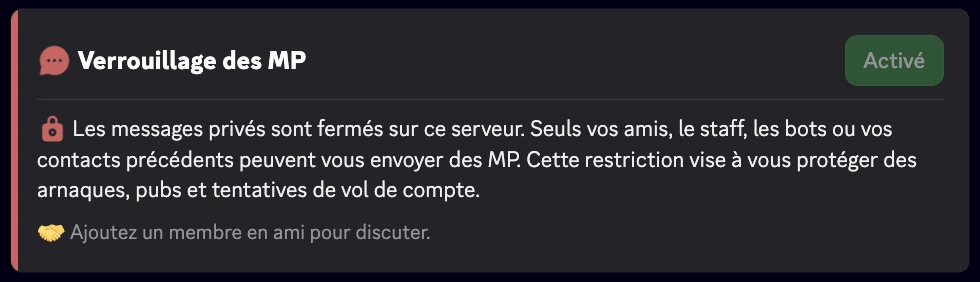
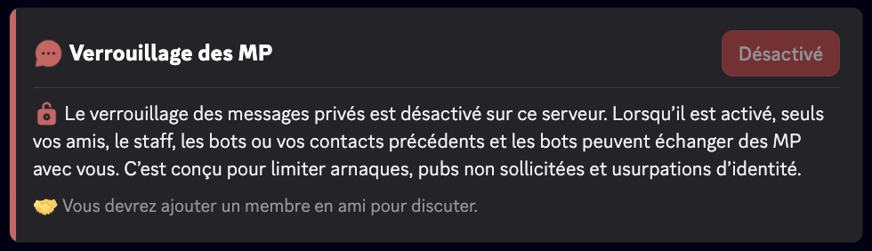

import Settings, { SettingsModal } from '@site/src/components/DiscordMessage/mockups/v2';

import DmLockMockup from '@site/src/components/DiscordMessage/mockups/dm-lock';

<DmLockMockup />

import SeparatedBox from '@site/src/components/SeparatedBox';
import Tabs from '@theme/Tabs';
import TabItem from '@theme/TabItem';

La fonctionnalité **Fermeture des MP** de RaidProtect permet de fermer l’accès aux messages privés (MP) envoyés depuis le serveur de façon permanente, surpassant ainsi la limitation native de Discord qui ne permet ce blocage que pour 24 heures via l'action de cybersécurité "Mettre les MP en pause".

## 🚦 Cas d’usage et recommandations {#recommendations}

- **Serveurs exposés au spam ou au harcèlement :** La Fermeture des MP est particulièrement recommandée pour les communautés publiques ou à forte audience, où les risques d’abus par MP sont accrus.
- **Événements temporaires ou périodes sensibles :** Lors de lancements, annonces importantes, ou périodes de forte affluence (ex. : concours, promotions), activer la Fermeture des MP permet de prévenir les tentatives de [phishing](/learn/token-grabber) ou d’arnaque.
- **Communautés avec un jeune public :** Pour les serveurs comptant un grand nombre de mineurs, limiter les MP peut renforcer la sécurité et prévenir les comportements inappropriés.
- **Protection continue :** Grâce à l’automatisation, il n’y a pas de fenêtre de vulnérabilité liée à l’oubli du renouvellement manuel.

## ❓ Fonctionnement de la Fermeture des MP {#working}

RaidProtect renouvelle automatiquement le blocage des MP avant son expiration, sans période de vulnérabilité.

:::info
Il reste possible d'envoyer et de recevoir des messages avec :
- ses amis
- les bots
- le staff
:::
:::warning
Les fonctions communautaires de Discord sont indispensables au bon fonctionnement de la Fermeture des MP. [Suivez notre guide pour vérifier l'activation de la communauté sur votre serveur.](../guides/community.md)
:::

## 🚩 Configuration de la Fermeture des MP {#config}

1. Faites la [commande `/settings`](../setup.md#settings).
2. Ouvrez l'onglet “**Protection**”.
3. Cliquez sur “**Modifier**” à côté de “**Fermeture des MP**”.
4. Dans la fenêtre qui s'ouvre, cochez ou décochez “**Fermer les messages privés du serveur**”, puis validez.

<SettingsModal name="dmlock" />

### Commande /dmlock {#dmlock}

Vous pouvez aussi utiliser la commande : ```/dmlock```

Elle ouvre l'écran “**Configuration des MP fermés**”, avec un interrupteur pour activer ou désactiver la protection. Si un prérequis manque (mode Communauté ou permission “**Gérer le serveur**”), un encart vous l'indique et le bouton “**Actualiser**” vous permet de vérifier de nouveau après correction. La commande est réservée aux membres qui ont la permission “**Gérer le serveur**”.

<Settings start="dmlockCommand" />

## ℹ️ Commande /dmlock-info {#info}

La commande `/dmlock-info` permet d’informer les membres sur l’état actuel de la **Fermeture des MP** sur le serveur. Elle affiche un message clair qui indique si la restriction est **activée** ou **désactivée**, accompagné d’une explication pédagogique sur son utilité.

**Objectif :**
- Expliquer pourquoi les MP sont limités (lutte contre le spam, arnaques, phishing).
- Réduire la confusion et les questions récurrentes des nouveaux membres.
- Rappeler les conditions pour continuer à échanger en MP (amis, staff, bots, anciens contacts).

**Exemple d'affichage**
<SeparatedBox>
<Tabs>
  <TabItem value="enable" label="Activé" default>



  </TabItem>
  <TabItem value="disable" label="Désactivé">



  </TabItem>
</Tabs>
</SeparatedBox>

### ⚙️ Bonnes pratiques

- Invitez les membres actifs à utiliser `/dmlock-info` pour répondre aux questions des nouveaux membres.
- Affichez-le régulièrement ou épinglez-le dans vos salons d’accueil.
- Combinez-le avec vos règles ou annonces pour rappeler la politique anti-spam du serveur.

## Questions fréquentes {#faq}

### Où activer la Fermeture des MP ?

Dans `/settings`, onglet Protection, en cliquant sur “Modifier” à côté de “Fermeture des MP”, puis en cochant “Fermer les messages privés du serveur”. La commande `/dmlock` ouvre aussi un écran dédié.

### Pourquoi ne puis-je pas activer la Fermeture des MP ?

Il manque un prérequis : le mode Communauté de Discord doit être activé sur votre serveur, et RaidProtect doit avoir la permission “Gérer le serveur”.

### Combien de temps les MP restent-ils fermés ?

Tant que la protection est active. Discord limite son action de sécurité à 24 heures, et nous la renouvelons automatiquement jusqu'à ce que vous désactiviez la Fermeture des MP.

### Les membres peuvent-ils encore s'écrire en MP ?

Oui, s'ils sont amis ou ont déjà échangé. Les bots et le staff peuvent aussi toujours envoyer des MP.

### Le DISCON active-t-il la Fermeture des MP ?

Oui, à partir du niveau 3 du [DISCON](./discon.md). En redescendant, nous ne la désactivons que si c'est le DISCON qui l'avait activée.
