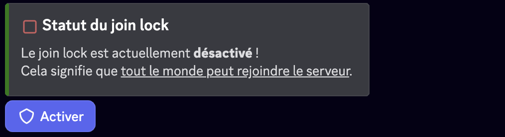

import JoinLockMockup from '@site/src/components/DiscordMessage/mockups/join-lock';

{/* <JoinLockMockup /> : masquée pour le moment */}

La fonctionnalité **Fermeture des Jointures** (ou join lock) de RaidProtect ferme l'accès aux nouvelles arrivées sur le serveur jusqu'à ce que vous la désactiviez, surpassant ainsi la limitation native de Discord qui ne permet ce blocage que pour 24 heures via l'action de cybersécurité "Mettre les arrivées en pause".

## 🚦 Cas d'usage et recommandations {#recommendations}

- **Serveurs privés et fermés :** La Fermeture des Jointures est particulièrement recommandée pour les serveurs qui doivent rester privés et ne souhaitent aucune nouvelle arrivée (serveurs d'entreprise, équipes restreintes, groupes privés).
- **Serveurs de staff :** Pour les serveurs dédiés à l'équipe de modération ou d'administration, où seuls les membres autorisés doivent avoir accès.
- **Serveurs d'entreprise ou professionnels :** Pour les organisations qui utilisent Discord en interne et veulent garantir que seuls les employés actuels peuvent accéder au serveur.
- **Communautés à taille limitée :** Pour les serveurs qui ont atteint leur taille maximale souhaitée et ne veulent plus accepter de nouveaux membres de façon permanente.

## ❓ Fonctionnement de la Fermeture des Jointures {#working}

Tant que la Fermeture des Jointures est active, RaidProtect applique aux arrivants l'[action pendant le raid](./raid-mode.md#action) que vous avez choisie pour l'Auto RaidMode. Contrairement à la fonctionnalité native de Discord qui nécessite un renouvellement manuel toutes les 24 heures, le blocage dure sans intervention jusqu'à ce que vous le désactiviez.

| Action pendant le raid | Effet de la Fermeture des Jointures |
|---|---|
| “**Bloquer les invitations**” (par défaut) | Les invitations du serveur sont désactivées : personne de nouveau n'entre. |
| “**Expulser les arrivants**” ([Premium](/premium)) | Chaque arrivant est expulsé et reçoit un message privé lui indiquant que les arrivées sont fermées. |
| “**Envoyer au captcha**” | Les arrivants **peuvent entrer après avoir résolu le [captcha](./captcha.md)** : le serveur n'est donc pas fermé. |
| “**Captcha gelé pendant le raid**” | Les arrivants attendent derrière le captcha tant que la Fermeture des Jointures est active. |

:::warning
Pour un serveur qui doit rester vraiment fermé, choisissez “**Bloquer les invitations**”, “**Expulser les arrivants**” ou “**Captcha gelé pendant le raid**”. Avec “**Envoyer au captcha**”, la Fermeture des Jointures se contente d'imposer le captcha aux arrivants.
:::
:::info
Les membres déjà présents sur le serveur restent actifs et peuvent continuer à utiliser le serveur normalement. Le [message de bienvenue](./onboarding.md#welcome-message) se tait tant que la Fermeture des Jointures est active.
:::
:::warning
Avec l'action “**Bloquer les invitations**”, les fonctions communautaires de Discord sont indispensables à la Fermeture des Jointures. [Suivez notre guide pour vérifier l'activation de la communauté sur votre serveur.](../guides/community.md) Les autres actions fonctionnent sans la communauté.
:::

## 🚩 Configuration de la Fermeture des Jointures {#config}

Utilisez la commande : ```/joinlock [status]```

- Sans option, la commande affiche l'état de la Fermeture des Jointures avec un bouton “**Activer**” ou “**Désactiver**”.
- Remplacez `[status]` par **True** pour l'activer ou **False** pour la désactiver directement.



La commande demande la permission **Gérer le serveur**, et un message est posté dans le salon de logs à chaque changement d'état.

:::info
La commande `joinlock` est [utilisable par préfixe](../guides/prefix.md). Tant que la Fermeture des Jointures est active, la [commande `/raidmode`](./raid-mode.md#enable) est indisponible : désactivez d'abord la Fermeture des Jointures.
:::

## Questions fréquentes {#faq}

### Quelle différence avec le mode raid ?

Le [mode raid](./raid-mode.md) est temporaire (24 heures au maximum) et peut s'activer tout seul pendant une vague. La Fermeture des Jointures s'active à la main et reste en place jusqu'à ce que vous la désactiviez.

### Faut-il activer la communauté Discord ?

Seulement si l'action pendant le raid de l'Auto RaidMode est “**Bloquer les invitations**”. Avec les autres actions, la Fermeture des Jointures fonctionne sans la communauté.

### Les nouveaux membres peuvent-ils encore entrer ?

Non avec “**Bloquer les invitations**”, “**Expulser les arrivants**” ou “**Captcha gelé pendant le raid**”. Avec “**Envoyer au captcha**”, ils entrent après avoir résolu le captcha.
