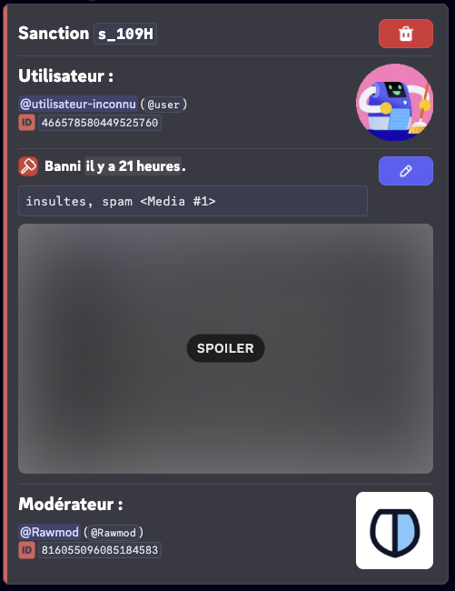
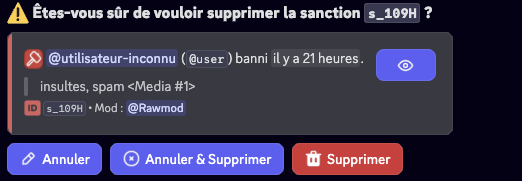
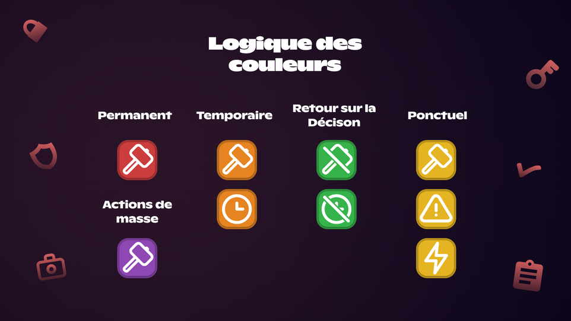

import Settings, { SettingsModal } from '@site/src/components/DiscordMessage/mockups/v2';

import SanctionsMockup from '@site/src/components/DiscordMessage/mockups/sanctions';

{/* <SanctionsMockup /> masqué temporairement : mockup à améliorer */}

import Icon from "@site/src/components/Icon";

L'historique des sanctions de RaidProtect vous permet de suivre et de gérer toutes les [sanctions](/learn/discord-sanctions) appliquées sur votre serveur. Ce système centralise toutes les actions de modération dans une base de données consultable et modifiable, facilitant ainsi le travail de votre équipe de modération.

## ❓ Fonctionnement de l'historique {#working}

L'historique des sanctions enregistre automatiquement toutes les actions de modération effectuées sur votre serveur :

- **Sanctions manuelles** : toutes les [commandes de modération](./moderation.mdx) (`/ban`, `/tempban`, `/kick`, `/mute`, `/jail`, `/warn`…) sont enregistrées dans l'historique.
- **Sanctions automatiques** : les sanctions appliquées par nos modules de protection ([anti-spam](./anti-spam.mdx), [HoneyPot](./honeypot.md), [ScamLens](./scam-images.md)…) sont également ajoutées à l'historique.
- **Bannissements, expulsions et timeouts** : les sanctions appliquées sans passer par RaidProtect sont ajoutées à l'historique.
- **AutoMod de Discord** : les timeouts posés par l'AutoMod de Discord sont enregistrés. Chaque message bloqué par une règle AutoMod crée aussi un **avertissement** au nom de “**Discord Automod**”, silencieux (aucun MP), sauf si la règle applique déjà un timeout. Il n'est pas donné non plus quand le membre reçoit une sanction plus lourde (timeout, mute, jail, expulsion, softban, bannissement, quarantaine) dans les 10 secondes autour du blocage, par exemple par le [HoneyPot](./honeypot.md) ou l'[anti-spam](./anti-spam.mdx) pour le même message. Ce warn est activé par défaut et se coupe avec “**Warn des messages bloqués par l'AutoMod**” : faites la [commande `/settings`](../setup.md#settings), onglet “**Modération**”, “**Sanctions**”.
- **Notifications des sanctions** : les membres sanctionnés reçoivent un message privé les informant de la sanction et de sa raison. Le bot envoie également un accusé de réception détaillé confirmant le statut de l'envoi : **reçu**, **MP fermés**, **expiré** ou **silencieux** (lorsque l'option `[--silent]` est utilisée). Pour les kicks, softbans et bans temporaires, ce message contient également un **bouton avec une invitation au serveur** afin que le membre puisse revenir une fois la sanction terminée.

:::info
Toutes les sanctions enregistrées contiennent : l'utilisateur sanctionné, le modérateur responsable, la raison (jusqu'à 512 caractères), la date et l'heure, ainsi que le type de sanction et si l'utilisateur a été prévenu.
:::

## 🔍 Rechercher des sanctions {#search}

La commande `/sanctions search` vous permet de rechercher des sanctions dans l'historique selon différents critères.

Utilisez la commande : ```/sanctions search [utilisateur] [modérateur] [type] [raison] [date] [statut] [type_modérateur]```

- `[utilisateur]` : rechercher toutes les sanctions d'un utilisateur spécifique. Si ce compte fait partie d'un groupe de [doubles comptes](./alt-accounts.md), les sanctions des comptes liés apparaissent aussi.
- `[modérateur]` : rechercher toutes les sanctions appliquées par un modérateur spécifique.
- `[type]` : filtrer par type de sanction (Bannissement, Débannissement, Expulsion, Emprisonnement, Libération, Quarantaine, Timeout, Untimeout, Mute, Unmute, Avertissement).
- `[raison]` : filtrer par raison (correspondance partielle).
- `[date]` : filtrer par date de la sanction.
- `[statut]` : filtrer par statut de la sanction (Active, Expiré, Annulé).
- `[type_modérateur]` : filtrer par type de modérateur (Actions humaines, Actions Automatisées, Actions de RaidProtect, Actions de Discord, Antispam, Expiration, Antiscam, HoneyPot, Discord Automod, Discord Expiration).


:::tip
Vous pouvez combiner plusieurs critères pour affiner votre recherche. Par exemple, rechercher tous les bannissements effectués par un modérateur spécifique.
:::

## ℹ️ Consulter une sanction {#info}

La commande `/sanctions info` vous permet d'obtenir des informations détaillées sur une sanction spécifique.

Utilisez la commande : ```/sanctions info (id)```

Remplacez `(id)` par l'identifiant de la sanction que vous souhaitez consulter.



## ✏️ Modifier une sanction {#edit}

La commande `/sanctions edit` vous permet de modifier la raison ou la durée d'une sanction existante, utile pour corriger une erreur ou ajouter des détails.

Utilisez la commande : ```/sanctions edit (id) [raison] [durée]```

Remplacez `(id)` par l'identifiant de la sanction à modifier, `[raison]` par la nouvelle raison (maximum 512 caractères) et `[durée]` par la nouvelle durée (ex. : `1d 2h`).


:::warning
La modification d'une sanction met à jour l'enregistrement dans l'historique mais ne change pas la sanction appliquée sur Discord (par exemple, un utilisateur banni restera banni).
:::

## 🗑️ Supprimer une sanction {#delete}

La commande `/sanctions delete` vous permet de supprimer une sanction de l'historique. Cette action est irréversible.

Utilisez la commande : ```/sanctions delete (id) [raison]```

Remplacez `(id)` par l'identifiant de la sanction à supprimer. Le paramètre `[raison]` permet de **justifier la suppression**, qui sera enregistrée dans les logs.



## Statuts des sanctions {#status}

Les sanctions peuvent avoir différents statuts :

| **Status**    | **Émojis**                                                                                                                  | **Significations**                                        |
| ------------- | ----------------------------------------------------------------------------------------------------------------------------| --------------------------------------------------------- |
| `Active`      | <Icon src="/img/icons/SanctionStatusACTIVE.svg" alt="icon SanctionStatusACTIVE" title=":iconSanctionStatusACTIVE:"/>        | La sanction est en cours.                                 |
| `Expiré`      | <Icon src="/img/icons/SanctionStatusEXPIRED.svg" alt="icon SanctionStatusEXPIRED" title=":iconSanctionStatusEXPIRED:"/>     | La sanction est expirée.                                  |
| `Annulé`      | <Icon src="/img/icons/SanctionStatusCANCELED.svg" alt="icon SanctionStatusCANCELED" title=":iconSanctionStatusCANCELED:"/>  | La sanction a été annulée par un modérateur.              |
| `Échoué`      | <Icon src="/img/icons/SanctionStatusFAILED.svg" alt="icon SanctionStatusFAILED" title=":iconSanctionStatusFAILED:"/>        | La sanction a échoué (manque de permissions).             |

### Gestion des doublons {#duplicates}

Lorsqu'une sanction active et antérieure est trouvée, vous pouvez :

- **Fusionner** les deux sanctions : les durées seront additionnées si possible et les raisons seront concaténées.
- **Annuler** la sanction active et créer une nouvelle sanction.
- **Ecraser** la sanction active avec les informations de la sanction tapée.


## ⚙️ Configuration des sanctions {#config}

Tous les réglages des sanctions se trouvent sur un même écran :

1. Faites la [commande `/settings`](../setup.md#settings).
2. Ouvrez l'onglet “**Modération**”.
3. Cliquez sur “**Configurer**” à côté de “**Sanctions**”.

<Settings start="sanctions" />

### Désactiver les sanctions {#disable}

Vous pouvez **désactiver complètement le système de sanctions** sur votre serveur. Lorsque les sanctions sont désactivées, RaidProtect n'enregistre plus aucune sanction dans l'historique et les commandes liées sont indisponibles.

1. Faites la [commande `/settings`](../setup.md#settings).
2. Ouvrez l'onglet “**Modération**”.
3. Cliquez sur “**Configurer**” à côté de “**Sanctions**”.
4. Cliquez sur “**Désactiver**” à droite du titre de l'écran (ou “**Activer**” pour le rallumer).

### Jail {#jail}

Configurez la **Jail** afin d'activer une sanction de modération par rôle, plus restrictive qu'un mute classique. Une fois configuré, ce rôle permet d'isoler un membre avec des permissions fortement limitées et débloque l'utilisation des commandes [`/jail`](./moderation.mdx#jail) et [`/tempjail`](./moderation.mdx#tempjail).

1. Faites la [commande `/settings`](../setup.md#settings).
2. Ouvrez l'onglet “**Modération**”.
3. Cliquez sur “**Configurer**” à côté de “**Sanctions**”.
4. Cliquez sur “**Modifier**” à côté de “**Jail**”.
5. Choisissez un rôle existant dans le sélecteur, ou cliquez sur “**En créer un pour moi**”.

<Settings start="jail" />

Le bouton “**En créer un pour moi**” ouvre une fenêtre dans laquelle vous nommez le rôle (par défaut `Emprisonné`) et configurez le **salon d'informations** destiné aux membres en jail :

- **Sélectionner un salon existant** : il garde sa visibilité actuelle.
- **Créer un nouveau salon** en renseignant un nom (par défaut `accès-restreint`).

Nous retirons au rôle la permission de voir les salons du serveur. Dans le salon d'informations, les membres en jail peuvent lire le message et l'historique, mais pas écrire, réagir ni créer de fil. Ce salon correspond à l'emplacement réservé dans les [panneaux d'information](./display.mdx), automatiquement géré par la configuration Jail.

:::info
Si un rôle Jail est déjà configuré, vous pouvez changer le salon d'informations avec le bouton “**Modifier le salon**” de l'écran Jail.
:::

:::warning
Si le rôle Jail laisse encore voir certains salons, l'écran Jail les liste dans un encart : refusez-lui la permission `Voir le salon` dans ces salons, ou créez un nouveau rôle avec “**En créer un pour moi**”. Tant que des sanctions actives s'appuient sur le rôle Jail ou Mute, vous ne pouvez pas en changer : levez ces sanctions ou attendez qu'elles expirent.
:::

:::info
Sans rôle Jail, les commandes `/jail` et `/tempjail` sont indisponibles. Les modules automatiques ([anti-spam](./anti-spam.mdx), [HoneyPot](./honeypot.md), [faux signaleurs](./reports.md#bad-reporters)) proposent quand même Jail et Mute, avec la mention “**Pas configuré, retombe sur Timeout**” : la sanction appliquée est alors un timeout.
:::

#### Rôles lors du jail {#jail-roles}

Dans l'écran Jail, le sélecteur “**Gestion des rôles lors du jail**” contrôle ce que RaidProtect fait des rôles du membre quand il est emprisonné. Deux modes :

- “**Ajouter le rôle de jail**” *(par défaut)* : le membre garde ses rôles, le rôle de jail est ajouté.
- “**Remplacer tous les rôles**” : nous **retirons tous les rôles du membre** le temps de l'emprisonnement et les lui restaurons à sa libération. Plus strict, cela évite qu'un rôle avec des permissions explicites ne contourne les restrictions du rôle Jail.

### Quarantaine Discord synchronisée {#discord-quarantine}

L'AutoMod de Discord peut mettre en quarantaine un membre dont le profil enfreint une règle (pseudo, tag de serveur). Avec ce réglage, nous suivons cette quarantaine : le membre reçoit le **rôle de jail** et une sanction **Quarantaine** est enregistrée dans l'historique. Il en sort dès que Discord lève la quarantaine.

1. Faites la [commande `/settings`](../setup.md#settings).
2. Ouvrez l'onglet “**Modération**”.
3. Cliquez sur “**Configurer**” à côté de “**Sanctions**”.
4. Cliquez sur “**Activer**” à côté de “**Quarantaine Discord synchronisée**”.

:::info
Ce réglage exige un [rôle Jail](#jail). Le désactiver libère les quarantaines qu'il a posées.
:::

### Suppression des messages au bannissement {#ban-delete}

Dans l'écran “**Sanctions**”, le sélecteur “**Suppression des messages au bannissement**” fixe l'historique supprimé par défaut quand vous bannissez avec `/ban`, `?ban` ou `/tempban` sans préciser `--delete-messages`. Choisissez “**Aucune suppression**” (par défaut), 1 heure, 6 heures, 12 heures, 1 jour, 3 jours ou 7 jours. Une valeur donnée dans la commande l'emporte.

### Mute {#mute}

Configurez le **rôle Mute** afin d'utiliser une sanction par rôle à la place du timeout Discord pour les durées prolongées. Lorsque la durée du mute dépasse le seuil défini, le bot attribuera automatiquement le rôle Mute au membre concerné au lieu d'appliquer un timeout Discord.

1. Faites la [commande `/settings`](../setup.md#settings).
2. Ouvrez l'onglet “**Modération**”.
3. Cliquez sur “**Configurer**” à côté de “**Sanctions**”.
4. Cliquez sur “**Modifier**” à côté de “**Mute**”.
5. Choisissez un rôle existant dans le sélecteur “**Role Mute**”, ou cliquez sur “**En créer un pour moi**” (nous créons le rôle `Muet` et lui retirons l'écriture dans tous les salons).

#### Seuil de Mute {#mute-threshold}

Le **seuil de mute** se règle sur le même écran que le rôle. Il définit à partir de quelle durée le bot utilise le rôle Mute au lieu du timeout Discord.

1. Sur l'écran Mute, ouvrez le sélecteur “**Seuil de Mute**”.
2. Choisissez “**Tout le temps**”, “**1 heure**” (par défaut), “**1 jour**”, “**Timeout étendu (=28 jours)**” ou “**Valeur personnalisée**” (de 0 à 28 jours, ex. : `3j 1h 15m`).

“**Tout le temps**” (une valeur de 0) n'utilise jamais le timeout Discord : chaque mute passe par le rôle.

:::info
La limite de 28 jours pour le timeout est imposée par Discord. Au-delà de cette durée, le rôle Mute est systématiquement utilisé s'il est configuré. L'option `[--force-timeout]` de la [commande `/mute`](./moderation.mdx#timeout) force le timeout Discord malgré le seuil.
:::

:::info
Les **timeouts appliqués par l'AutoMod de Discord** sont automatiquement convertis en mute par rôle si leur durée dépasse le seuil configuré, pour assurer une cohérence avec vos sanctions manuelles.
:::

### Confidentialité des Sanctions {#sanctions-privacy}

Configurez le niveau de confidentialité des sanctions afin de contrôler les informations auxquelles les membres peuvent accéder concernant **leurs propres sanctions**, via la commande [`/mes-sanctions`](./utilities.mdx#my-sanctions) ou le bouton **Consulter mes sanctions**.

1. Faites la [commande `/settings`](../setup.md#settings).
2. Ouvrez l'onglet “**Modération**”.
3. Cliquez sur “**Configurer**” à côté de “**Sanctions**”.
4. Cliquez sur “**Modifier**” à côté de “**Confidentialité des Sanctions**”.
5. Dans la fenêtre, choisissez le “**Niveau d'accès**” souhaité :

| **Niveau**                           | **Description**                                                                                     |
| ------------------------------------ | --------------------------------------------------------------------------------------------------- |
| Désactivé *(par défaut)*             | Les utilisateurs ne peuvent pas consulter leurs sanctions.                                          |
| Sanctions uniquement                 | Les utilisateurs peuvent uniquement consulter leurs sanctions et le temps restant, si applicable.   |
| Avec les raisons                     | Les utilisateurs peuvent consulter leurs sanctions et la raison, sans l'identité du modérateur.     |
| Avec les raisons et les modérateurs  | Les utilisateurs peuvent tout consulter sur leurs sanctions.                                        |

<SettingsModal name="sanctionsPrivacy" />

:::note
Quel que soit le niveau sélectionné, **les modérateurs conservent un accès complet** à l'historique des sanctions via les outils de modération.
:::

### Afficher les médias {#show-medias}

Configurez l'affichage des médias dans les raisons de sanctions. Lorsque cette option est désactivée (par défaut), les liens contenant les extensions suivantes sont automatiquement retirés des raisons de sanctions lors de l'affichage aux membres (via [`/mes-sanctions`](./utilities.mdx#my-sanctions) ou les notifications de sanctions) :

`png`, `jpg`, `jpeg`, `gif`, `webp`, `webm`, `mp4`

1. Faites la [commande `/settings`](../setup.md#settings).
2. Ouvrez l'onglet “**Modération**”.
3. Cliquez sur “**Configurer**” à côté de “**Sanctions**”.
4. Cliquez sur “**Activer**” ou “**Désactiver**” à côté de “**Afficher les médias**”.

## ✨ Noms des sanctions <span className="badge-premium">Premium</span> {#custom-names}

Avec la version [Premium](/premium), vous pouvez personnaliser le nom de chaque type de sanction pour l'adapter au vocabulaire de votre serveur. Les noms personnalisés remplacent les noms par défaut dans les logs, les recherches et les menus. Pour chaque type, vous pouvez configurer :

- **Nom** : remplacez le nom par défaut par celui de votre choix, jusqu'à 32 caractères (ex. : “Avertissement” → “Carton Jaune”).
- **Verbe** : définissez le verbe utilisé dans les messages, jusqu'à 32 caractères (ex. : “cartonné”). Si laissé vide, le nom est utilisé.
- **Mode DM** : choisissez la formulation du message privé envoyé au membre sanctionné :
  - “Vous avez été [verbe]” (par défaut)
  - “Vous avez reçu un [nom]”

Les types de sanctions personnalisables sont : Bannissement, Softban, Débannissement, Expulsion, Emprisonnement, Libération, Timeout, Untimeout, Mute, Unmute et Avertissement.

1. Faites la [commande `/settings`](../setup.md#settings).
2. Ouvrez l'onglet “**Modération**”.
3. Cliquez sur “**Configurer**” à côté de “**Sanctions**”.
4. Cliquez sur le bouton “**Noms des sanctions**”.
5. Choisissez le type de sanction à personnaliser dans le sélecteur, puis renseignez le nom, le verbe et le mode DM dans la fenêtre.

<Settings start="sanctionNames" />

Les boutons “**Exporter**” et “**Importer**” de l'écran permettent de sauvegarder vos noms dans un fichier JSON puis de les recoller (champ “**Collez le contenu JSON**”), par exemple pour les reprendre sur un autre serveur.

:::tip
Laissez les champs vides pour réinitialiser un type de sanction à son nom par défaut. Le bouton “**Réinitialiser tout**” remet tous les noms à zéro.
:::

## 📨 Lien d'appel <span className="badge-premium">Premium</span> {#appeal}

Le **lien d'appel** permet aux membres sanctionnés de contester leur sanction : un bouton vers votre lien est ajouté aux MP de toutes les sanctions, sauf les avertissements.

1. Faites la [commande `/settings`](../setup.md#settings).
2. Ouvrez l'onglet “**Modération**”.
3. Cliquez sur “**Configurer**” à côté de “**Sanctions**”.
4. Cliquez sur le bouton “**Lien d'appel**”.
5. Collez votre lien dans la fenêtre, ou videz le champ pour le retirer.

Plateformes acceptées : Discord, Google Forms, appeal.gg, Appy, DraftBot et FlaviBot.

:::info
Le bouton “**Lien d'appel**” n'apparaît que sur les serveurs [Premium](/premium).
:::

## 🔗 Doubles comptes <span className="badge-experiment">Expérimentation</span> {#alt}

En expérimentation avec l'Identity Update (bêta publique [Premium](/premium)), les comptes qu'une même personne utilise peuvent être liés avec la commande `/alt` : bannir l'un bannit les autres, et chaque sanction s'étend au groupe selon vos réglages. Tout est expliqué sur la page [Doubles comptes](./alt-accounts.md).

## 📊 Logs des sanctions {#logs}

Pour une meilleure organisation, vous pouvez configurer un salon de logs dédié spécifiquement aux sanctions, séparé de vos logs généraux.


### Configurer le salon de logs des sanctions {#config-logs}

1. Faites la [commande `/settings`](../setup.md#settings).
2. Ouvrez l'onglet “**Modération**”.
3. Cliquez sur “**Configurer**” à côté de “**Sanctions**”.
4. Cliquez sur “**Modifier**” à côté de “**Logs**”.
5. Choisissez le salon dans lequel les logs des sanctions seront envoyés, ou utilisez le bouton “**En créer un pour moi**”.

Vous retrouvez le même réglage, avec les autres salons de logs, dans l'écran “**Logs**” de l'onglet “**Modération**” (voir les [logs de modération](./moderation.mdx#logs)). Sans salon dédié, les logs des sanctions vont dans le salon de logs général.

:::note
La bascule “**Logs de modération passives**” (activée par défaut) choisit si RaidProtect journalise aussi les actions effectuées sans passer par le bot (ban depuis Discord, AutoMod de Discord…).
:::

### Logique des couleurs {#logs-color}



## 📦 Importer / Exporter des sanctions {#import-export}

RaidProtect vous permet d'importer ou d'exporter l'historique des sanctions de votre serveur. Les boutons “**Exporter**” et “**Importer**” de l'écran Sanctions vous orientent vers notre [serveur support](https://raidprotect.bot/discord) : contactez-nous en indiquant l'invitation de votre serveur et, pour un import, le ou les bots de modération que vous utilisiez.

## Questions fréquentes {#faq}

### Pourquoi la commande /jail est-elle indisponible ?

Elle exige un rôle Jail. Configurez-le dans `/settings`, onglet “**Modération**”, “**Sanctions**”, puis “**Modifier**” à côté de “**Jail**”, ou laissez RaidProtect en créer un.

### Que se passe-t-il si un module automatique doit emprisonner un membre sans rôle Jail ?

La sanction retombe sur un timeout. Il en va de même pour le Mute sans rôle Mute.

### Un membre peut-il voir ses propres sanctions ?

Oui, si vous réglez la [confidentialité des sanctions](#sanctions-privacy) sur un autre niveau que “**Désactivé**”. Il les consulte alors avec `/mes-sanctions`.

### Les messages bloqués par l'AutoMod de Discord comptent-ils comme des sanctions ?

Oui, par défaut : chaque message bloqué crée un avertissement silencieux au nom de “**Discord Automod**”, sauf si la règle applique déjà un timeout ou si le membre reçoit au même moment une sanction plus lourde. Vous pouvez couper ce warn avec “**Warn des messages bloqués par l'AutoMod**” dans `/settings`, onglet “**Modération**”, “**Sanctions**”. Ces avertissements ne sont journalisés que si les logs de modération passives sont activés.
