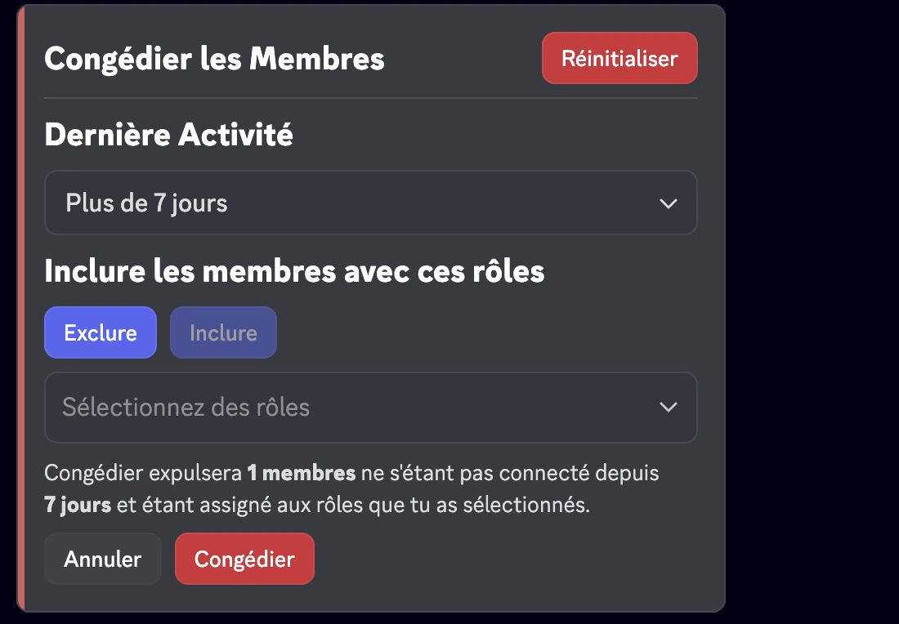
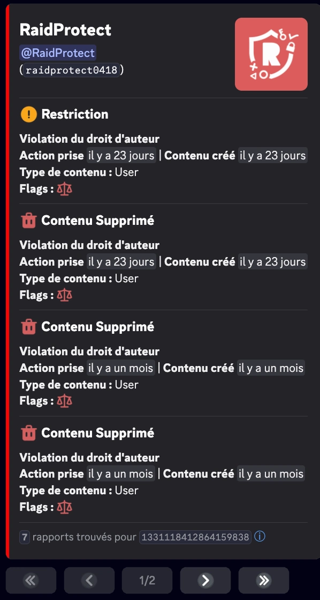
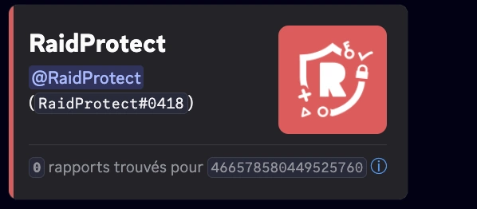

import SeparatedBox from '@site/src/components/SeparatedBox';
import Tabs from '@theme/Tabs';
import TabItem from '@theme/TabItem';
import Icon from "@site/src/components/Icon";
import Settings from '@site/src/components/DiscordMessage/mockups/v2';

Des fonctionnalités supplémentaires pour simplifier la gestion de votre serveur. 🔧

En plus des fonctionnalités principales comme le captcha, l'anti-spam ou l'anti-raid, RaidProtect propose plusieurs outils secondaires qui peuvent rendre la gestion de votre serveur encore plus fluide.

## 📋 Dupliquer un Salon {#channel-duplicate}

La commande `/channel duplicate` vous permet de dupliquer entièrement un salon, y compris tous ses paramètres, permissions et configurations. Surpassant ainsi la fonction native de Discord ne permet pas de dupliquer **les catégories** et **certains paramètres spécifiques** comme les tags des salons forums.

Utilisez la commande : ```/channel duplicate (#salon)```

Remplacez `(#salon)` par la mention ou l'[identifiant](../guides/id.mdx) du salon à dupliquer.

### 🎯 Fonctionnalités {#duplicate-features}

Cette commande duplique l'ensemble des éléments suivants :

- **Nom du salon**
- **Permissions** (rôles et utilisateurs)
- **Type de salon** (texte, vocal, forum, etc.)
- **Paramètres spécifiques** selon le type de salon
- **Position** dans la catégorie (si applicable)

### ⚙️ Configurations RaidProtect {#duplicate-config}

Lorsque vous dupliquez un salon qui possède des configurations internes à RaidProtect, le bot vous propose automatiquement de :

- **Remplacer** la configuration existante pour utiliser le nouveau salon
- **Dupliquer** la configuration pour conserver les deux salons configurés

**Exemple** : Si vous dupliquez le salon de logs, RaidProtect vous proposera de mettre à jour sa configuration pour que le nouveau salon devienne le salon de logs, ou de garder les deux salons configurés selon votre préférence.

## 🗑️ Supprimer et re-créer un Salon {#channel-clear}

La commande `/channel clear` vous permet de supprimer un salon et de le re-créer à l'identique, en conservant ses paramètres, permissions et configurations RaidProtect.

Utilisez la commande : ```/channel clear (#salon)```

Remplacez `(#salon)` par la mention ou l'[identifiant](../guides/id.mdx) du salon à re-créer.

:::warning
Les messages et les webhooks du salon seront définitivement supprimés. Une confirmation vous sera demandée avant l'exécution.
:::

## 🧹 Congédier des Membres {#prune}

La commande `/prune` vous permet d'expulser les membres inactifs de votre serveur via un menu interactif.

Utilisez la commande : ```/prune [durée]```

Remplacez `[durée]` par le nombre de jours d'inactivité souhaité, de 1 à 30. Le bot affiche un menu interactif vous permettant de :
- Sélectionner la durée d'inactivité
- Inclure ou exclure des rôles spécifiques
- Voir le nombre de membres concernés avant confirmation

Le texte de confirmation indique qui partira réellement :

| Mode | Sans rôle sélectionné | Avec des rôles sélectionnés |
|---|---|---|
| **Inclure** | Seuls les membres inactifs **sans aucun rôle** | Les membres inactifs qui n'ont **aucun rôle en dehors** de ceux sélectionnés |
| **Exclure** | Tous les membres inactifs, **quels que soient leurs rôles** | Les membres inactifs qui n'ont **aucun des rôles** sélectionnés |

:::info
La commande `/prune` est réservée aux administrateurs. Seuls les 100 rôles les plus bas sont proposés ; les membres qui ont un rôle plus haut sont exclus d'office.
:::



## 🚫 Bloquer des Utilisateurs {#block}

La commande `/block` vous permet d'empêcher un utilisateur d'utiliser certaines fonctionnalités de RaidProtect sur votre serveur (par exemple, envoyer des signalements ou recevoir le rôle de tag).

Lors du blocage ou du déblocage, RaidProtect vous propose de choisir les fonctionnalités concernées :

| Type | Effet |
|---|---|
| **Toutes les interactions** | Bloque toutes les interactions avec le bot |
| **Reports** | L'utilisateur ne pourra plus faire de [signalement](./reports.md) |
| **Rôle de Tag** | L'utilisateur ne pourra plus recevoir le [rôle de tag](./tag-role.md) |

### Bloquer un utilisateur {#block-add}

Utilisez la commande : ```/block add [@utilisateur] [raison]```

### Débloquer un utilisateur {#block-remove}

Utilisez la commande : ```/block remove [@utilisateur] [raison]```

### Lister les utilisateurs bloqués {#block-list}

Utilisez la commande : ```/block list```

## 📢 Panneaux d'information {#display}

Consultez la [page dédiée aux panneaux d'information](./display.mdx) pour en savoir plus sur les commandes `/display public` et [`/display staff`](./display.mdx#staff).

## 📜 Mes Sanctions {#my-sanctions}

La commande `/mes-sanctions` permet aux membres de consulter leurs propres sanctions sur le serveur, selon le [niveau de confidentialité](./sanctions.mdx#sanctions-privacy) configuré par les administrateurs.

Utilisez la commande : ```/mes-sanctions```

:::info
Cette commande est également accessible via le bouton **Consulter mes sanctions** sur les [panneaux d'information](./display.mdx) si la fonctionnalité est activée.
:::

## 🏠 Informations du serveur {#serverinfo}

La commande `/serverinfo` affiche les **informations du serveur courant** : nom, propriétaire, date de création, nombre de membres, niveau de boost, fonctionnalités activées, etc.

Utilisez la commande : ```/serverinfo```

:::info
La commande `serverinfo` est [utilisable par préfixe](../guides/prefix.md) (alias `ginfo`). Elle ne fonctionne que sur un serveur où RaidProtect est installé.
:::

## 🔗 Informations d'une invitation {#inviteinfo}

La commande `/inviteinfo` analyse une invitation Discord avant que vous ne cliquiez dessus : utile pour vérifier un partenariat, une publicité ou un lien reçu en MP.

Utilisez la commande : ```/inviteinfo (invitation)```

Remplacez `(invitation)` par le code ou le lien de l'invitation (par ex. `discord.gg/raidprotect`).

Pour une invitation de serveur, nous affichons notamment :

- **Le serveur** : nom, badge et tag, identifiant, nombre de membres et de membres en ligne, niveau de vérification, palier et boosts.
- **L'invitation** : salon de destination (textuel, vocal ou conférence), créateur, nombre d'utilisations, date d'expiration, rôles attribués à l'arrivée.
- **Les thèmes et jeux** mis en avant par le serveur (les jeux sont cliquables).
- **Un profil d'activité** : heures de pic et de creux, régularité.
- Un bouton “**Rejoindre le serveur**”.

Les invitations d'ami, de groupe privé, d'activité et de live sont aussi reconnues.

:::info
Sur un serveur, la réponse est éphémère et la commande demande par défaut la permission “**Gérer les messages**”. Si vous ajoutez RaidProtect à votre compte Discord, vous pouvez aussi utiliser `/inviteinfo` en MP et dans les groupes privés : la réponse est alors visible dans la conversation. La commande `inviteinfo` est [utilisable par préfixe](../guides/prefix.md) (alias `ii`).
:::

## 🔐 Vos données sur ce serveur {#privacy}

La commande `/privacy` affiche ce que RaidProtect conserve sur votre serveur. Elle est ouverte à tous les membres et la réponse n'est visible que par vous.

Utilisez la commande : ```/privacy```

- **Toujours** : la configuration choisie dans `/settings` (gardée tant que RaidProtect est sur le serveur) et les sanctions (membre, modérateur, motif et dates) pour l'historique de modération.
- **Selon vos réglages** : les messages (une heure par salon, en mémoire vive, jamais écrits en base) si l'anti-spam, les signalements ou la [mise en cache des messages](#message-cache) sont actifs ; les signalements (auteur, motif et copie du message signalé) s'ils sont activés.

La réponse renvoie vers notre politique de confidentialité, qui détaille les durées, le partage et vos droits.

## 🗂️ Mise en cache des messages {#message-cache}

La mise en cache garde **une heure de messages par salon en mémoire vive**, jamais écrits en base. Elle alimente la commande [`/snipe`](./moderation.mdx#snipe) et la partie snipe de `/modview`. Sans elle, ces commandes ne trouvent aucun message supprimé.

1. Faites la [commande `/settings`](../setup.md#settings).
2. Ouvrez l'onglet “**Utilitaires**”.
3. Cliquez sur “**Activer**” à côté de “**Mise en cache des messages**”.

<Settings start="home:utilities" />

:::info
La mise en cache est **désactivée par défaut**. Elle est activée d'office, et ne peut pas être coupée, quand l'[anti-spam](./anti-spam.mdx) ou les [signalements](./reports.md) sont actifs : ces fonctionnalités ont besoin de lire les messages. Le bouton apparaît alors grisé.
:::

## 💬 Donner son avis {#feedback}

La commande `/feedback` permet de **partager un avis, une suggestion ou un signalement de bug** directement depuis Discord, sans avoir à rejoindre le serveur support. Sur un serveur, elle demande par défaut la permission “**Gérer les messages**” ; elle fonctionne aussi en MP avec RaidProtect.

Utilisez la commande : ```/feedback```

Choisissez le type de retour, puis remplissez la fenêtre qui s'ouvre :

- **Suggestion** : nous vous redirigeons vers la page de suggestions.
- **Signaler un bug** : choisissez la catégorie (anti-spam, anti-raid, captcha, sanctions, Authentication Manager, configuration, commandes, logs, autre) ; votre signalement est transmis à notre équipe.
- **Retour général** : notez votre expérience de 1 à 5.
- **Compliment**.

## 🎮 Accueil RaidProtect {#activity-home}

Le bouton “**Launch**” de RaidProtect ouvre l'**accueil RaidProtect** dans l'Activity Discord. Il fonctionne sur votre serveur, en MP avec le bot, et depuis RaidProtect ajouté à votre compte Discord. Rien n'est posté dans le salon.

- **Démos** : nos protections en action dans un salon Discord miniature (anti-spam, anti-raid, captcha et salon piège du [HoneyPot](./honeypot.md)).
- **Mini-jeux** : Pare-feu, où vous défendez l'icône de votre serveur contre des vagues de robots, Snek, Ban Hammer et Tri express.
- **Classements** : pour chaque jeu, les dix meilleurs joueurs de votre serveur et de tous les serveurs, avec votre place.

## 👤 Informations Utilisateur {#userinfo}

La commande `/userinfo` vous permet d’obtenir des informations détaillées sur un utilisateur.

Utilisez la commande : ```/userinfo [utilisateur]```

Remplacez `[utilisateur]` par la mention ou l’identifiant souhaité.

:::info
La commande `userinfo` est [utilisable par préfixe](../guides/prefix.md) (alias `ui`). Si vous ajoutez RaidProtect à votre compte Discord, vous pouvez aussi l'utiliser en MP et dans les groupes privés.
:::

### 📋 Informations affichées {#displayed-userinfo}

- **Date de création du compte** Discord
- **Photo de profil** de l’utilisateur
- **Bannière de profil**
- **Badges de profil**
  - Les badges Nitro, Booster, Quête et Ancien nom ne sont pas affichés.


### 🎭 Informations sur un membre du serveur {#displayed-memberinfo}

Si la cible est un membre du serveur, les infos supplémentaires incluent :

- **Date d’arrivée sur le serveur**
- **Pseudo sur le serveur**
- **Nombre de rôles** et **liste des 6 premiers rôles**
- **Catégorie de permissions** (visible seulement par les modérateurs) :
<SeparatedBox>
<Tabs>
  <TabItem value="animator" label="Animateur" default>

    La catégorie **Animateur** est affiché si le membre possède **au moins une** des permissions suivantes :

    - `MANAGE_EXPRESSIONS`
    - `CREATE_GUILD_EXPRESSIONS`
    - `MANAGE_EVENTS`

  </TabItem>
  <TabItem value="moderator" label="Modérateur">

    La catégorie **Modérateur** est affiché si le membre possède **au moins une** des permissions suivantes :

    - `KICK_MEMBERS`
    - `BAN_MEMBERS`
    - `MODERATE_MEMBERS`
    - `MANAGE_MESSAGES`
    - `MUTE_MEMBERS`
    - `DEAFEN_MEMBERS`
    - `MOVE_MEMBERS`
    - `MANAGE_THREADS`

  </TabItem>
  <TabItem value="manager" label="Responsable">

    La catégorie **Responsable** est affiché si le membre possède **au moins une** des permissions suivantes :

    - `MANAGE_GUILD`
    - `MANAGE_ROLES`
    - `MANAGE_CHANNELS`
    - `VIEW_AUDIT_LOG`
    - `MANAGE_WEBHOOKS`
    - `MANAGE_SERVER_EXPRESSIONS`

  </TabItem>
  <TabItem value="admin" label="Administrateur">

    La catégorie **Administrateur** est affiché dans **deux cas possibles** :

    1️⃣ Possède la permission :
    - `ADMINISTRATOR`

    2️⃣ Possède les **trois permissions suivantes en même temps** :
    - `MANAGE_GUILD`
    - `MANAGE_ROLES`
    - `MANAGE_CHANNELS`

  </TabItem>
  <TabItem value="owner" label="Propriétaire">

    **Condition** : Le membre est le **propriétaire du serveur**.

  </TabItem>
</Tabs>
</SeparatedBox>

- **Flags de membre** (visible seulement par les modérateurs) :

| **Flags**                                | **Émojis**                                                                                                             | **Significations**                                                |
| ---------------------------------------- | ---------------------------------------------------------------------------------------------------------------------- | ----------------------------------------------------------------- |
| `DID_REJOIN`                             | <Icon src="/img/icons/MemberDidRejoin.svg" alt="icon MemberDidRejoin" title=":MemberDidRejoin:"/>                      | L'utilisateur a quitté et rejoint à nouveau le serveur.           |
| `IS_GUEST`                               | <Icon src="/img/icons/MemberIsGuest.svg" alt="icon MemberIsGuest" title=":MemberIsGuest:"/>                            | Membre invité (invitation temporaire ou accès invité).            |
| `COMPLETED_ONBOARDING`                   | <Icon src="/img/icons/OnboardingCompleted.svg" alt="icon OnboardingCompleted" title=":OnboardingCompleted:"/>          | A terminé le processus d'accueil (onboarding) du serveur.         |
| `STARTED_ONBOARDING`                     | <Icon src="/img/icons/OnboardingStarted.svg" alt="icon OnboardingStarted" title=":OnboardingStarted:"/>                | A commencé le processus d'accueil.                                |
| `COMPLETED_SERVER_GUIDE`                 | <Icon src="/img/icons/ServerGuideCompleted.svg" alt="icon ServerGuideCompleted" title=":ServerGuideCompleted:"/>       | A terminé le guide du serveur si activé.                          |
| `STARTED_SERVER_GUIDE`                   | <Icon src="/img/icons/ServerGuideStarted.svg" alt="icon ServerGuideStarted" title=":ServerGuideStarted:"/>             | A commencé le guide du serveur.                                   |
| `AUTOMOD_QUARANTINED_NAME`               | <Icon src="/img/icons/MemberQuarantined.svg" alt="icon MemberQuarantined" title=":MemberQuarantined:"/>                | Mis en quarantaine par l'automodération pour le nom d'utilisateur.|
| `AUTOMOD_QUARANTINED_GUILD_TAG`          | <Icon src="/img/icons/MemberQuarantined.svg" alt="icon MemberQuarantined" title=":MemberQuarantined:"/>                | Mis en quarantaine par l'automodération pour le tag ou pseudo.    |
| `BYPASSES_VERIFICATION`                  | <Icon src="/img/icons/BypassVerification.svg" alt="icon BypassVerification" title=":BypassVerification:"/>             | L'utilisateur peut passer outre la vérification du serveur.       |
| `SPAMMER`                                | <Icon src="/img/icons/UnusualAccountActivity.svg" alt="icon UnusualAccountActivity" title=":UnusualAccountActivity:"/> | Compte marqué comme spammeur ou activité inhabituelle détectée.   |

## 🎨 Informations d'un rôle {#roleinfo}

:::info Expérimentation : Logging Update
`/roleinfo` fait partie de la **Logging Update**, prévue pour la version 3.8.0. En attendant sa sortie, la commande est en expérimentation, en bêta publique pour les serveurs [Premium](/premium).
:::

La commande `/roleinfo` affiche la fiche d'un rôle du serveur.

Utilisez la commande : ```/roleinfo [rôle]```

- **Nom**, mention et identifiant
- **Couleur** ou dégradé, **icône** ou emoji
- **Date de création** et **position** dans la liste des rôles
- **Affiché séparément** et **mentionnable**
- **Origine** : rôle d'un bot, d'une intégration, des boosts, d'un abonnement ou rôle lié
- **Nombre de membres** (pour `@everyone`, tous les membres du serveur)
- **Permissions sensibles** : oui ou non pour tout le monde, le détail seulement pour les modérateurs

Les [logs du serveur](./logs.md) liées à un rôle (rôle créé ou modifié, rôle ajouté ou retiré à un membre) ont un bouton “**Rôle**” qui ouvre cette fiche.

:::info
La commande `roleinfo` est [utilisable par préfixe](../guides/prefix.md) (alias `ri`), sur un serveur seulement.
:::

## ⚖️ Sanctions Discord {#discord-sanctions}

La commande `/discord-sanctions` vous permet de visualiser les **sanctions émises par Discord** à l’encontre d’un utilisateur, conformément à la [réglementation européenne](https://transparency.dsa.ec.europa.eu/).

Utilisez la commande : ```/discord-sanctions [@utilisateur]```

Remplacez `[@utilisateur]` par la mention ou l'identifiant souhaité. La commande est aussi accessible d'un clic droit sur un profil, via **`Applications`** puis **`Discord Sanctions`**. Sans utilisateur, elle affiche les statistiques globales de sécurité de Discord sur les 7 derniers jours (onglets “**Catégories**”, “**Détection**” et “**Application**”).

### 📋 Informations affichées {#displayed-sanctions}

- **Type de sanction** :

| **Sanctions**                            | **Émojis**                                                                                                             | **Significations**                                                |
| ---------------------------------------- | ---------------------------------------------------------------------------------------------------------------------- | ----------------------------------------------------------------- |
| `CONTENT_DELETED`                        | <Icon src="/img/icons/ContentDeleted.svg" alt="icon ContentDeleted" title=":iconTrash:"/>                              | Du contenu posté par l'utilisateur a été supprimé.                |
| `RESTRICTED`                             | <Icon src="/img/icons/AccountRestricted.svg" alt="icon AccountRestricted" title=":iconRestricted:"/>                   | Le compte utilisateur a été restreint.                            |
| `ACCOUNT_SUSPENDED`                      | <Icon src="/img/icons/AccountSuspended.svg" alt="icon AccountSuspended" title=":iconSuspended:"/>                      | Le compte utilisateur a été suspendu.                             |
| `ACCOUNT_TERMINATED`                     | <Icon src="/img/icons/AccountTerminated.svg" alt="icon AccountTerminated" title=":iconTerminated:"/>                   | Le compte utilisateur a été supprimé.                             |

- **Date d’émission**
- **Type de contenu**
- **Flags de sanction** :

| **Flags**                                | **Émojis**                                                                                                             | **Significations**                                                |
| ---------------------------------------- | ---------------------------------------------------------------------------------------------------------------------- | ----------------------------------------------------------------- |
| `ILLEGAL_CONTENT`                        | <Icon src="/img/icons/IllegalContent.svg" alt="icon IllegalContent" title=":iconIllegal:"/>                            | Sanction appliqué pour un contenu illégal.                        |
| `AUTOMATED_DETECTION`                    | <Icon src="/img/icons/AutomatedDetection.svg" alt="icon AutomatedDetection" title=":iconBots:"/>                       | Sanction appliquée via une détection automatique.                 |

<SeparatedBox>
<Tabs>
  <TabItem value="reports-found" label="Rapports trouvés" default>



  </TabItem>
  <TabItem value="reports-not-found" label="Aucun rapport trouvé">



  </TabItem>
</Tabs>
</SeparatedBox>

:::note
La commande permet de consulter les rapports émis entre le 22 août 2024 et le 14 août 2025. Ces informations sont directement fournies par Discord et **ne peuvent pas être modifiées** par RaidProtect.
:::

## Questions fréquentes {#faq}

### Pourquoi `/snipe` ne trouve-t-il aucun message ?

`/snipe` lit les messages gardés en mémoire pendant une heure. Activez la [mise en cache des messages](#message-cache) dans l'onglet Utilitaires de `/settings`, ou activez l'anti-spam ou les signalements, qui l'activent d'office.

### Comment vérifier une invitation Discord avant de rejoindre un serveur ?

Utilisez `/inviteinfo` avec le code ou le lien de l'invitation : nous affichons le serveur, son créateur, son activité et les rôles attribués à l'arrivée.

### Que conserve RaidProtect sur mon serveur ?

La commande `/privacy` le détaille : la configuration et les sanctions en permanence, et selon vos réglages une heure de messages en mémoire et les signalements.

### Qui peut utiliser `/prune` ?

Seuls les administrateurs, par défaut. Un aperçu indique le nombre de membres concernés avant toute expulsion.
