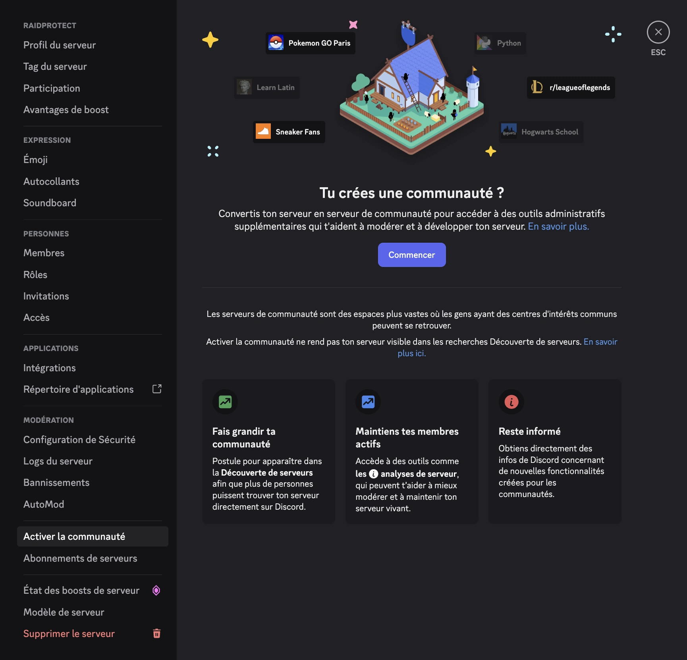

L’activation de la communauté rend disponibles plusieurs réglages de sécurité avancés de Discord, dont certaines fonctionnalités de RaidProtect ont besoin :
- la [Fermeture des MP](../features/dm-lock.mdx) (**DM Lock**) ;
- le [mode raid](../features/raid-mode.md) et la [Fermeture des Jointures](../features/join-lock.mdx), **seulement** avec l'action pendant le raid “**Bloquer les invitations**” (le réglage par défaut).

Le [captcha](../features/captcha.md) et les autres actions du mode raid (“**Expulser les arrivants**”, “**Envoyer au captcha**”, “**Captcha gelé pendant le raid**”) fonctionnent sans la communauté.

## 🚦 Prérequis {#requirement}

- Être administrateur du serveur Discord.

## 🚩 Activer les fonctions communautaires {#steps}

1. **Ouvrez les paramètres de votre serveur**
   - Cliquez sur le nom du serveur en haut à gauche > “Paramètres du serveur”.

2. **Accédez à la section “Communauté”**
   - Dans la barre latérale, rendez-vous dans l’onglet **Activer la communauté** puis cliquez sur **Commencer**.

:::note
Si la communauté est déjà activée sur votre serveur, la section s'appellera **Vue d'ensemble de la communauté**.
:::

3. **Suivez l’assistant d’activation**
   - Activez la vérification par e-mail pour tous les membres.
   - Activez le filtre du contenu explicite.
   - Configurez un salon de règles et un salon d’annonces.
   - Accepter la charte d'utilisation des serveurs de communauté.

4. **Terminez la configuration**
   - Cliquez sur “Terminer la configuration”. Le badge “Communauté” s’affichera sur votre serveur une fois l’activation finalisée.

## 💡 Utiliser les modules DM Lock & Mode raid après activation {#use}

1. Faites la [commande `/settings`](../setup.md#settings).
2. Pour la [Fermeture des MP](../features/dm-lock.mdx), ouvrez l'onglet “**Protection**” et cliquez sur “**Modifier**” à côté de “**Fermeture des MP**”.
3. Pour le [mode raid](../features/raid-mode.md#config), ouvrez l'onglet “**Arrivées**” et cliquez sur “**Configurer**” à côté de “**Auto RaidMode**”.

Si un encart vous demandait d'activer la communauté, cliquez sur “**Actualiser**” : il disparaît une fois la communauté activée.
