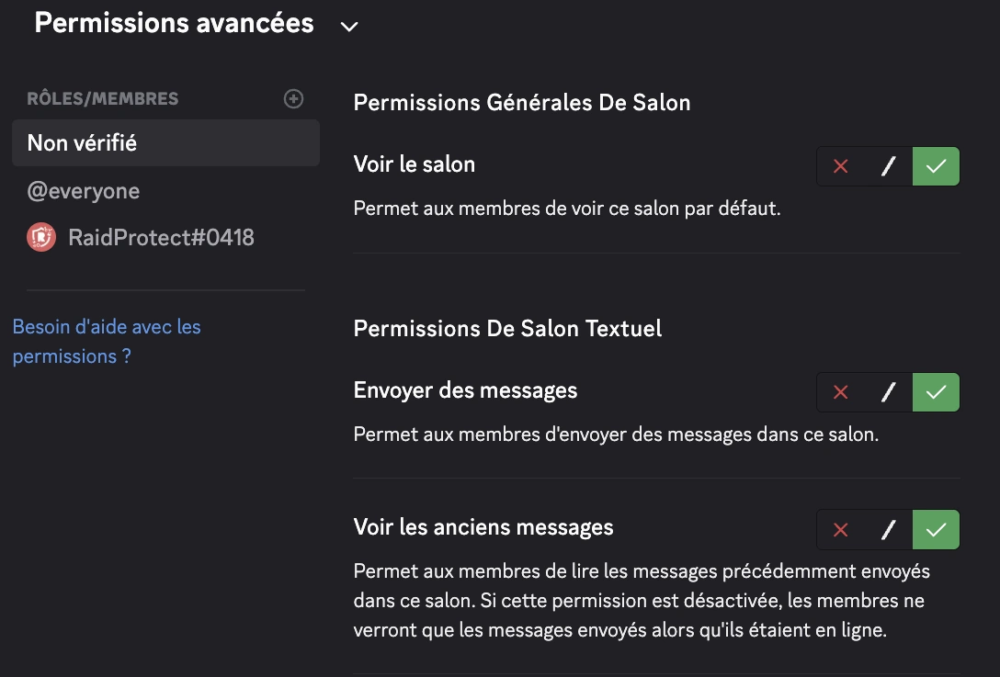
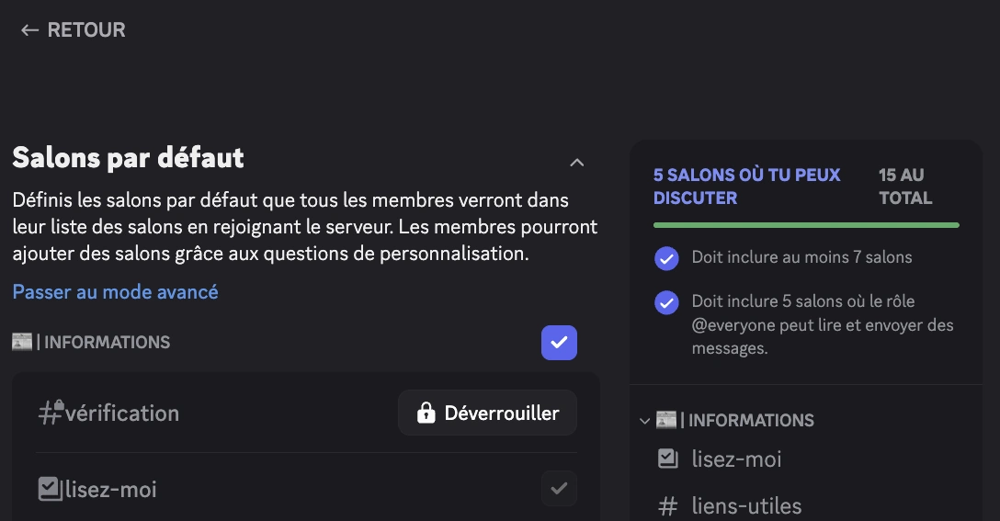

import Settings from '@site/src/components/DiscordMessage/mockups/v2';

Si le salon `#vérification` n’est pas visible par défaut pour les nouveaux membres, ils ne peuvent pas passer le [captcha](../features/captcha.md) et restent bloqués. Ce guide concerne le **Processus d'accueil de Discord** (Paramètres du serveur > Processus d'accueil). Pour le message de bienvenue et les rôles automatiques de RaidProtect, consultez la page [Arrivées et accueil](../features/onboarding.md).

Dans la plupart des cas, RaidProtect corrige le problème pour vous : commencez par l'étape 1.

## 1️⃣ Laisser RaidProtect corriger {#auto-fix}

1. Faites la [commande `/settings`](../setup.md#settings).
2. Ouvrez l'onglet “**Arrivées**”.
3. Cliquez sur “**Configurer**” à côté de “**Captcha**”.
4. Si un encart signale que le salon de vérification **n'est pas visible par défaut**, cliquez sur :
   - “**Déplacer dans** _catégorie_” pour placer le salon dans une catégorie déjà visible des nouveaux membres ;
   - ou “**Créer une nouvelle catégorie**” pour que nous créions une catégorie « Bienvenue » ajoutée aux salons par défaut.

Les permissions du salon sont conservées lors du déplacement.

<Settings start="captcha" />

:::tip
Le même écran signale les **fuites** du rôle `@Non vérifié` : rôles donnés par le Processus d'accueil Discord qui contournent la vérification, salons encore visibles aux membres en vérification. Le bouton “**Corriger**” ferme les salons concernés. Voir les [alertes de l'écran Captcha](../features/captcha.md#alerts).
:::

## 2️⃣ Vérifier les permissions du salon {#permissions}

RaidProtect pose lui-même les permissions du salon `#vérification` et du rôle `@Non vérifié`. Si vous les avez modifiées, vérifiez-les :

1. Ouvrez les paramètres du salon `#vérification` (clic droit > **Modifier le salon**).
2. Dans l’onglet **Permissions** :
   - Assurez-vous que `@everyone` **n’a pas** la permission de voir le salon.
   - Vérifiez que le rôle `@Non vérifié` **a** la permission de **voir le salon** et **voir les anciens messages**.
   - En mode **Panneau (Interactif)**, le mode par défaut, `@Non vérifié` **ne doit pas** pouvoir envoyer de messages : le code se saisit dans une fenêtre. En mode **Challenge (Classique)**, il doit pouvoir **envoyer des messages** pour taper le code.

{/*  : montre « Envoyer des messages » autorisé, vrai seulement en mode Challenge */}

## 3️⃣ Vérifier la catégorie d’accueil {#default-category}

Si vous préférez corriger à la main :

1. Allez dans **Paramètres du serveur** > **Processus d'accueil**.
2. Dans la section **Salons par défaut**, vérifiez que la catégorie contenant `#vérification` est cochée comme visible pour les nouveaux membres.
3. Si nécessaire, déplacez `#vérification` dans une catégorie cochée.
4. Sauvegardez les modifications.

## 4️⃣ Actualiser la configuration dans RaidProtect {#refresh-config}

1. Faites la [commande `/settings`](../setup.md#settings).
2. Ouvrez l'onglet “**Arrivées**”.
3. Cliquez sur “**Configurer**” à côté de “**Captcha**”.
4. Si un encart est encore affiché, cliquez sur “**Actualiser**” pour relancer la vérification. Quand l'encart disparaît, le captcha fonctionne correctement.

## 5️⃣ Tester avec un compte de test {#test-account}

Pour confirmer que tout est bien configuré :

1. Rejoignez le serveur avec un autre compte Discord.
2. Vérifiez que le salon `#vérification` est visible à l’arrivée.
3. Cliquez sur “**Vérifier**” et saisissez le code (mode Panneau), ou tapez le code dans le salon (mode Challenge).
4. Une fois vérifié, le compte devrait avoir accès aux autres salons.

## 🛠️ Problèmes fréquents et solutions {#common-issues}

| Problème | Solution |
|---------|----------|
| 🔴 Le salon `#vérification` reste invisible | Cliquez sur “**Déplacer dans** _catégorie_” sur l'écran Captcha, ou mettez le salon dans une **catégorie cochée** de l’accueil Discord. |
| 🚫 Le rôle `@Non vérifié` ne peut pas écrire | Normal en mode Panneau : le membre clique sur “**Vérifier**”. En mode Challenge, donnez-lui la **permission d’envoyer des messages** dans `#vérification`. |
| 🔓 Un membre non vérifié voit d'autres salons | Cliquez sur “**Corriger**” dans l'encart de fuite de l'écran Captcha, et retirez les rôles que le Processus d'accueil Discord donne à l'arrivée. |
| ❌ Le Captcha ne fonctionne pas après modification | Cliquez sur “**Actualiser**” sur l'écran Captcha (onglet “**Arrivées**” de `/settings`). |

---

✅ En suivant ces étapes, votre système de vérification sera pleinement opérationnel pour accueillir les membres en toute sécurité et bloquer efficacement les bots ou raids.
