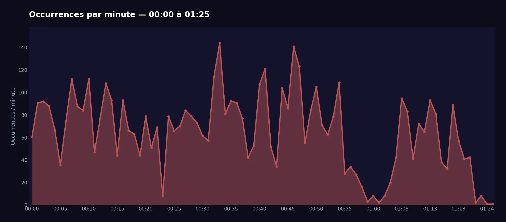
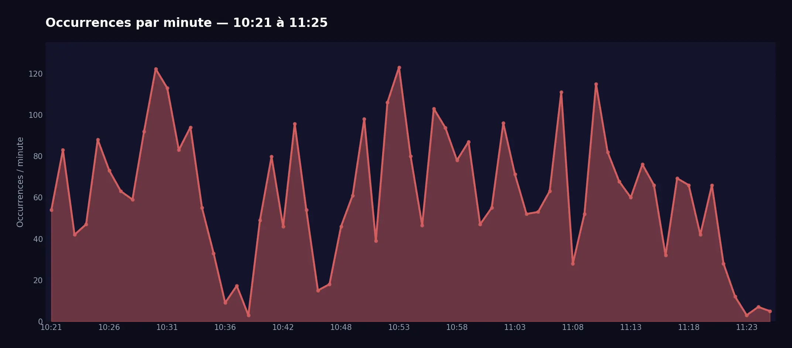

import Timestamp from '@site/src/components/Timestamp';

Un’importante ondata di spam legata alla **truffa delle “immagini crypto”** ci ha spinto ad attivare in anticipo la modalità `Deletion` di **RaidProtect ScamLens**, il nostro modulo anti-truffa di analisi delle immagini.

{/* truncate */}

## 🛡️ Dettagli dello spam {#threat}

Il <Timestamp value={1771023600} format="D" /> si sono verificate due ondate massicce di spam, tra le <Timestamp value={1771023600} format="T" /> e le <Timestamp value={1771068391} format="T" />. Più di **2.500 account compromessi** sono stati usati per inviare oltre **10.000 messaggi** contenenti questo tipo di immagine. Queste cifre rappresentano solo quanto osservato sui 340.000 server protetti da RaidProtect: poiché Discord conta diversi milioni di server attivi, la portata reale di questo attacco può essere stimata in **diverse centinaia di migliaia di messaggi** su tutta la piattaforma.

La truffa, detta delle “immagini crypto”, consiste nell’invio massiccio di **4 immagini** che spingono gli utenti ad acquistare criptovalute fraudolente, nel maggior numero possibile di canali.

  
  
  
  

#### Ondata 1 {#wave-1}

#### Ondata 2 {#wave-2}

Di fronte a questo volume elevato di messaggi fraudolenti, abbiamo attivato in anticipo la modalità `Deletion` di **ScamLens**, introdotto in modalità `Learning` con l’[aggiornamento 3.3.1](/blog/3.3.1-jail-and-mute#changelog).
Questo modulo analizza le immagini inviate sui tuoi server e ora elimina automaticamente quelle identificate come fraudolente (non è necessaria alcuna configurazione).

### E poi? {#next}

A breve verrà attivata la modalità `Sanction`: oltre a eliminare le immagini fraudolente, ScamLens applicherà automaticamente un **timeout di un giorno** al mittente. Abbiamo scelto di non bannare questi account, perché si tratta quasi esclusivamente di **account hackerati**: un ban penalizzerebbe il vero proprietario dell’account. Il timeout permette di neutralizzare subito la minaccia, il tempo necessario perché il proprietario riprenda il controllo del suo account.

:::info 🔒 Funzionamento volutamente opaco
Per motivi di sicurezza, non comunichiamo e non comunicheremo i metodi di rilevamento usati da ScamLens. Questo approccio “a scatola nera” mira a impedire ai truffatori di adattare le loro tecniche per aggirare le nostre protezioni.
:::

---

## ❓ FAQ {#faq}

#### Come bloccare lo spam di immagini su Discord? {#antispam-images}
[Aggiungi RaidProtect](https://raidprotect.bot/invite) al tuo server. ScamLens è attivo per impostazione predefinita ed eliminerà tutte le immagini rilevate come fraudolente: non è necessaria alcuna configurazione aggiuntiva.

#### Come proteggersi dalla truffa delle immagini crypto su Discord? {#arnaque-images-crypto}
Basta [aggiungere RaidProtect](https://raidprotect.bot/invite). ScamLens rileverà ed eliminerà automaticamente le immagini fraudolente.

#### Come impedire i bot di spam sul mio server Discord? {#anti-spam-bots}
Oltre a ScamLens, attiva il [captcha](/docs/features/captcha) di RaidProtect per impedire agli account automatizzati di entrare nel tuo server.

---

:::tip 📚 Risorse utili
- 🔗 [Aggiungi RaidProtect al tuo server](https://raidprotect.bot/invite)
- 📘 [Consulta la documentazione completa](https://docs.raidprotect.bot/)
- 💡 [Invia un suggerimento o un riscontro](https://suggestions.raidprotect.bot/)
- 📣 [Segui gli annunci e unisciti alla community](https://raidprotect.bot/discord)
:::
