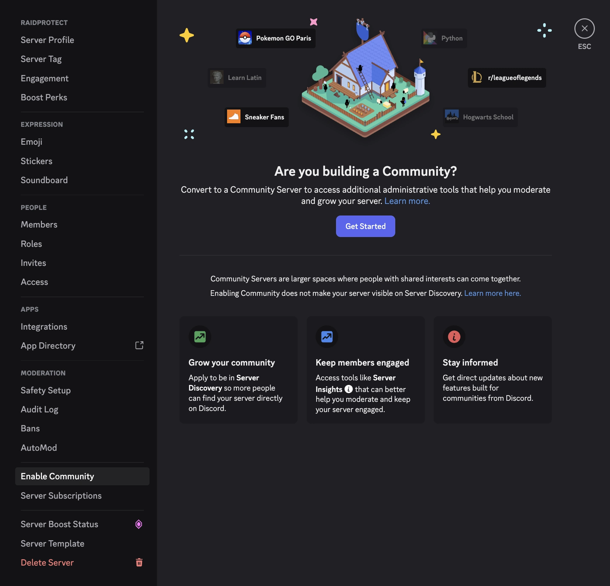

L'attivazione della community rende disponibili diverse impostazioni di sicurezza avanzate di Discord, di cui alcune funzionalità di RaidProtect hanno bisogno:
- la [Chiusura dei MP](../features/dm-lock.mdx) (**DM Lock**);
- la [modalità raid](../features/raid-mode.md) e il [Join Lock](../features/join-lock.mdx), **solo** con l'azione durante il raid “**Bloccare gli inviti**” (l'impostazione predefinita).

Il [captcha](../features/captcha.md) e le altre azioni della modalità raid (“**Espellere chi arriva**”, “**Mandare al captcha**”, “**Captcha congelato durante il raid**”) funzionano senza la community.

## 🚦 Prerequisiti {#requirement}

- Essere amministratore del server Discord.

## 🚩 Attivare le funzioni della community {#steps}

1. **Apri le impostazioni del tuo server**
   - Clicca sul nome del server in alto a sinistra > “Impostazioni del server”.

2. **Accedi alla sezione “Community”**
   - Nella barra laterale, vai alla scheda **Abilita la community** poi clicca su **Inizia**.

:::note
Se la community è già attivata sul tuo server, la sezione si chiamerà **Panoramica della community**.
:::

3. **Segui la procedura guidata di attivazione**
   - Attiva la verifica via e-mail per tutti i membri.
   - Attiva il filtro dei contenuti espliciti.
   - Configura un canale delle regole e un canale degli annunci.
   - Accetta le linee guida per i server community.

4. **Termina la configurazione**
   - Clicca su “Termina la configurazione”. Il badge “Community” apparirà sul tuo server una volta completata l'attivazione.

## 💡 Usare i moduli DM Lock e modalità raid dopo l'attivazione {#use}

1. Esegui il [comando `/settings`](../setup.md#settings).
2. Per la [Chiusura dei MP](../features/dm-lock.mdx), apri la scheda “**Protezione**” e clicca su “**Modifica**” accanto a “**Chiusura dei MP**”.
3. Per la [modalità raid](../features/raid-mode.md#config), apri la scheda “**Arrivi**” e clicca su “**Configurare**” accanto a “**Auto RaidMode**”.

Se un riquadro ti chiedeva di attivare la community, clicca su “**Aggiornare**”: scompare una volta attivata la community.
