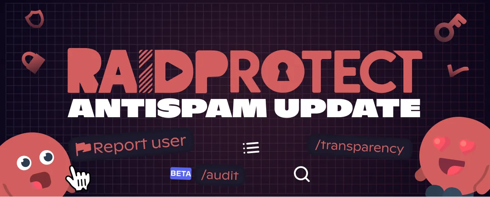

バージョン 3.4.0 は、**スパム対策の大型アップデート** です。RaidProtect は、これまで以上に的確かつきめ細かくサーバーを守ります。さらに、**刷新された通報**、モデレーションをオープンに示す **透明性** のシステム、そしてワンクリックでサーバーの **セキュリティを監査** するコマンドも登場します。

<!--truncate-->

## 🛡️ より賢くなったスパム対策 {#antispam}

複数のチャンネルを同時に荒らすスパマー？詐欺リンクをばらまく乗っ取られたアカウント？[スパム対策](/docs/features/anti-spam)が、これらをはるかにきめ細かく処理できるようになりました。

- **複数のチャンネルにまたがるスパムを見つけ出し**、その場合はより[厳しい処罰](/docs/features/anti-spam#triggers)を適用します。
- **すべてを片付けます**：処罰のたびに、スパムメッセージを例外なく削除します。
- **主導権はあなたに**：[スパムの種類ごと](/docs/features/anti-spam#triggers)に個別に有効・無効を切り替え、[詐欺画像に対する処罰](/docs/features/anti-spam#sanctions)を選べます。
- **新機能：添付ファイルのスパム** もブロックできるようになりました。

*（Premium）* メンバーが処罰されたことを知らせる公開メッセージを非表示にして、より目立たないモデレーションを行うこともできます。

---

## 🚩 ついにわかりやすくなった通報 {#reports}

重複したアラートに埋もれることはもうありません。[通報](/docs/features/reports)が、モデレーションチームにとって本当に役立つツールになります。

- **1 人のメンバーに 1 つのアラート**：同じ人物に対する通報はすべて[まとめて表示](/docs/features/reports#group)され、記録を残すための専用スレッドも用意されます。
- **メンバーにも状況を伝えます**：通報が処理されたときに、通報したメンバーへ[通知](/docs/features/reports#notify)できます。
- **信頼できるメンバーがすばやく対応** *（Premium）*：モデレーターが到着するまでの間、[予防的なタイムアウト](/docs/features/reports#trusted-role)を適用する権限を与えられます。
- **虚偽の通報者を無力化**：通報を悪用する人は、[自動で見つけ出して対処](/docs/features/reports#bad-reporters)されます。

---

## 📊 モデレーションしていることを示そう {#transparency}

活発で誠実なモデレーションを示すことほど、コミュニティを安心させるものはありません。新しい[透明性](/docs/features/transparency)のシステムは、まさにそのためのものです。

- **自動のまとめ**：サーバーのモデレーション活動のまとめを[定期的に](/docs/features/transparency#recaps)公開できます。
- **処罰の公開ログ**：ワンクリックで作成できる[専用チャンネル](/docs/features/transparency#modlog)に処罰を表示し、そこに表示する内容（処罰の種類、発生元）を細かく選べます。
- [`/transparency`](/docs/features/transparency#command) コマンドで、**必要なときにまとめを表示**。

---

## 🔍 ワンクリックでサーバーを安全に {#audit}

あなたのサーバーは十分に守られていますか？新しい [`/audit`](/docs/features/audit) コマンドは、サーバーに **セキュリティスコア** を付け、[弱点を指摘](/docs/features/audit#checks)し（認証レベル、権限、チャンネル）、[ワンクリックですべて修正](/docs/features/audit#fix)することを提案します。

---

## ✨ そのほかにも {#other}

- **キックモード** *（Premium）*：レイドの際に、すべての参加をブロックする代わりに、新規参加者を説明メッセージと再参加用の招待とともにキックします。誰かを入れる必要がある場合は、[`/bypass raid`](/docs/features/raid-mode#bypass-raid) コマンドが使えます。
- [DM の遮断](/docs/features/dm-lock)によって発生した Discord のセキュリティアラートの下に、**RaidProtect が返信して** 対処方法をお伝えします。

---

修正を含む詳細をすべて知りたいですか？すべて[変更履歴](/docs/changelog#3-4-0)に載っています。

:::tip 📚 お役立ちリソース
- 🔗 [RaidProtect をサーバーに追加する](https://raidprotect.bot/invite)
- 📘 [ドキュメントの全文を読む](https://docs.raidprotect.bot/)
- 💡 [提案やフィードバックを送る](https://suggestions.raidprotect.bot/)
- 📣 [お知らせをフォローしてコミュニティに参加する](https://raidprotect.bot/discord)
:::
