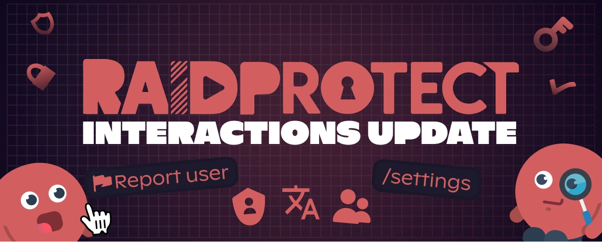
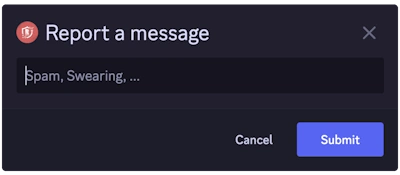

Já faz algum tempo desde nossa última grande atualização do RaidProtect, e pedimos sinceras desculpas pela longa espera. Nos últimos meses, trabalhamos duro para modernizar e melhorar a experiência do bot. Hoje, temos o prazer de apresentar a **Atualização de Interações**!

<!--truncate-->

## ✨ O que muda (e é muita coisa) {#new}

Esta atualização marca uma virada na forma como o RaidProtect funciona, com foco na **interação e facilidade de uso**, especialmente com a introdução dos **comandos slash** e de um **sistema de configuração renovado**.

Além disso, ouvimos os <a href="https://suggestions.raidprotect.bot" target="_blank">comentários e ideias de vocês</a>, e esta atualização inclui muitas funcionalidades que vocês pediram! Vocês também podem [consultar o registro de alterações](/docs/changelog) para ver quais sugestões foram implementadas.

### Comandos Slash {#slash-commands}

Sim, vocês esperaram muito tempo por eles... Nós também. Digam adeus aos comandos de texto ultrapassados e olá aos comandos slash! Mais simples, mais rápidos, e fazendo o RaidProtect finalmente ficar à altura de 2021 (sim, sabemos que já estamos em 2025).

Não se preocupem, usuários de longa data — os comandos de texto continuam disponíveis, e agora vocês podem até definir seu próprio prefixo personalizado!

### Internacionalização (o RP fica bilíngue) {#internationalization}

Lançamos as bases de um [**sistema multilíngue**](/docs/language) e adicionamos o inglês como segundo idioma oficial! Mais idiomas serão adicionados no futuro.

### Um comando de denúncias {#report}

Uma funcionalidade muito pedida: [**um sistema de denúncias**](/docs/features/reports) que permite que sua comunidade denuncie facilmente incidentes no seu servidor.

### Novos comandos de configuração {#configuration}

Sabemos que configurar um bot pode rapidamente virar uma dor de cabeça, por isso simplificamos bastante o processo:
- **Um painel interativo com [`/settings`](/docs/setup#settings)** para gerenciar o RaidProtect em um instante.
- **Um novo [`/setup`](/docs/setup#install)** para guiar você desde o processo de instalação.
- **Opções mais flexíveis** para uma configuração mais detalhada.

### Uma melhor experiência de usuário {#ux}

Junto com essas novas funcionalidades, melhoramos a usabilidade geral:
- Um captcha mais inteligente e mais bem integrado.
- Detecção automática de erros de permissões.
- Mensagens mais claras e consistentes.

### Atualização do site e da documentação {#web}

Além das melhorias do bot, também atualizamos **o site e a documentação** para tornar as informações mais acessíveis e estruturadas. Não deixem de dar uma olhada!

## 🔎 O que vem por aí? {#next}

Esta atualização é apenas o primeiro passo rumo a uma versão ainda mais avançada do RaidProtect. Já estamos trabalhando em mais melhorias e mal podemos esperar para compartilhá-las com vocês!

Para ver o que vem por aí, <a href="https://suggestions.raidprotect.bot/roadmap" target="_blank">consultem nosso roteiro</a>.

:::tip Participe da conversa!
Quer acompanhar o desenvolvimento do RaidProtect em tempo real, compartilhar sua opinião sobre futuras funcionalidades ou simplesmente conversar com a comunidade? <a href="https://raidprotect.bot/discord" target="_blank">Entre no nosso servidor Discord!</a>
:::

---

## ❤️ Obrigado pela paciência (de verdade) {#thanks}

Sabemos, esta atualização demorou bastante. Um enorme obrigado a todos que nos apoiaram e esperaram pacientemente (ou não 😆).

Um agradecimento especial a todos que compartilharam suas <a href="https://suggestions.raidprotect.bot" target="_blank">ideias e sugestões</a> — a contribuição de vocês foi inestimável para moldar esta atualização! Continuem nos enviando feedback, e prometemos ser mais rápidos da próxima vez (bom, vamos tentar).
