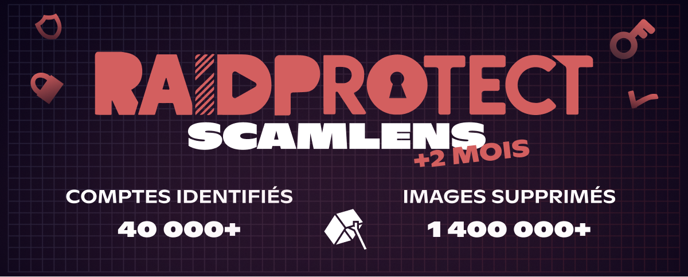

import Timestamp from '@site/src/components/Timestamp';

Resumo de abril de 2026 nos **355 000 servidores Discord** protegidos pelo RaidProtect (de 21 de março a 1º de maio de 2026): **1,4 milhão de imagens de scam removidas** pelo ScamLens e **40 000 contas Discord hackeadas** identificadas. Também lançamos o **HoneyPot**, um novo **canal-armadilha antispam** que complementa o ScamLens ao pegar os **scams ainda não catalogados** e as outras formas de spam automatizado (links, menções, raids de texto).

{/* truncate */}

## 🛰️ Relembrando: ScamLens, o anti-scam de imagens do RaidProtect {#what-is-scamlens}

O ScamLens é o módulo **anti-scam de imagens** do RaidProtect, o **bot de proteção para Discord**. Ele analisa cada imagem em tempo real e remove automaticamente as que identifica como fraudulentas: **scams de cripto**, **falsos giveaways de celebridades** (MrBeast, Elon Musk, Kick, Stake…), **falsas promoções de cassinos on-line**. Sem regras para escrever, sem listas negras para manter: basta [adicionar o RaidProtect](https://raidprotect.bot/pt/invite), e o ScamLens é ativado por padrão.

  
  
  
  

## 📊 Resumo do ScamLens desde 14 de fevereiro de 2026 {#stats}

Dados acumulados desde a [ativação antecipada do ScamLens](/pt/blog/scamlens-early-activation) em <Timestamp value={1771023600} format="D" />, nos **355 000 servidores Discord** protegidos pelo RaidProtect:

| **Indicador (acumulado desde 14 de fevereiro)** | **21 de março de 2026** | **1º de maio de 2026** | **Evolução** |
|---|---|---|---|
| Imagens analisadas (únicas) | 162 000 | **890 000** | **+450 %** |
| Imagens de scam detectadas (únicas) | 62 000 | **82 000** | +32 % |
| Imagens fraudulentas removidas | 260 000 | **1 400 000** | **+440 %** |
| Contas Discord hackeadas identificadas | 15 000 | **40 000** | **+167 %** |

O volume de imagens removidas **mais do que quintuplicou**: a [cobertura ampliada](/pt/blog/scamlens-1-month-recap#coverage) agora capta imagens que escapavam da análise por razões técnicas ligadas à CDN do Discord. O catálogo de imagens únicas cresce só 32 % porque os atacantes vivem criando variações de alguns **clusters visuais** (recortes, filtros, retoques).

Uma **variante «2 imagens»** (em vez de 4) apareceu durante o período; o ScamLens a cobre, e vários **picos de ~2 000 remoções por minuto** já foram interceptados. Cada imagem é processada em **~400 ms**, antes mesmo que a maioria dos membros tenha tempo de vê-la.

---

## 🆕 Novidades {#updates}

### ⏱️ Timeout automático de 24 h {#scamlens-timeout}

Agora aplicamos um **timeout automático de 24 h** a qualquer conta pega pelo ScamLens. Isso dá ao proprietário legítimo (quase sempre vítima de hackers) tempo para recuperar o acesso e cortar o dos atacantes.

### 🍯 O HoneyPot do RaidProtect {#honeypot}

Um **[HoneyPot Discord](https://docs.raidprotect.bot/pt/features/honeypot)** (ou «canal-armadilha») é um canal em que nenhum membro legítimo deve escrever. Já as **contas hackeadas** e os **bots de spam** despejam sua carga (imagens, links, menções, pings) em **todos os canais** sem fazer triagem, portanto também na armadilha. Qualquer mensagem que chegue ali dispara uma **sanção automática**, independentemente do conteúdo.

**O RaidProtect agora integra seu próprio HoneyPot.** Com [`/settings` → **HoneyPot**](https://docs.raidprotect.bot/pt/features/honeypot), o bot cria o canal, coloca-o no topo do servidor e publica nele uma mensagem de aviso traduzida.

#### Por que o HoneyPot do RaidProtect em vez de outro? {#honeypot-vs-others}

Nosso HoneyPot está **diretamente ligado ao ScamLens**:

- **O ScamLens age primeiro.** Se uma imagem publicada na armadilha já é conhecida, ela é removida e o HoneyPot **não é disparado**: ele deixa o ScamLens agir.
- **O HoneyPot enriquece o ScamLens.** Qualquer imagem nova pega em um canal-armadilha alimenta nosso catálogo, que depois bloqueia a onda **nos 355 000 servidores protegidos**.

#### O que cada um cobre {#scamlens-honeypot}

- **ScamLens** = imagens de scam conhecidas, removidas com timeout de 24 h.
- **HoneyPot** = todo o resto: **spam de links, raids de texto, menções em massa, bots** e **imagens novas** ainda não identificadas.

O ScamLens está ativo por padrão. **Ativar o HoneyPot não atrapalha nada**: ele vem fechar os pontos cegos.

---

## ❓ FAQ {#faq}

#### Por que minha conta Discord envia mensagens sozinha? {#compte-discord-envoie-messages-seul}
Sua conta provavelmente foi **hackeada**. Os golpistas roubam o **token de autenticação** (site falso, software infectado, extensão maliciosa) e o usam para fazer spam de imagens de scam em todos os servidores em que você está. Troque sua senha do Discord, ative a **autenticação em dois fatores** e encerre as sessões ativas.

#### O que fazer se um dos meus membros estiver divulgando um scam de cripto? {#membre-diffuse-scam-crypto}
Não o bana: quase sempre é uma **conta hackeada**, não um usuário mal-intencionado. Entre em contato com ele no privado para que ele proteja a conta. O ScamLens já remove a imagem em tempo real, sem punir o proprietário legítimo.

#### Como reconhecer uma falsa promoção de cripto no Discord? {#reconnaitre-fausse-promo-crypto}
Qualquer **«oferta» de cripto**, **cassino on-line** com logotipo de celebridade ou **investimento milagroso** é uma fraude. O Discord nunca organiza distribuição de criptomoedas, e nenhuma marca séria faz spam em vários servidores.

#### O que é um HoneyPot no Discord? {#qu-est-ce-qu-un-honeypot}
Um **HoneyPot** (ou canal-armadilha) é um canal visível para todos, mas em que **nenhum membro legítimo deve escrever**. Qualquer mensagem que chegue ali é necessariamente spam automatizado: o RaidProtect sanciona automaticamente a conta (ban, softban, kick, timeout, jail ou mute, à sua escolha).

#### Como ativar o HoneyPot no meu servidor Discord? {#activer-honeypot}
[Adicione o RaidProtect](https://raidprotect.bot/pt/invite), execute `/settings` → **HoneyPot** e depois "**Criar canal**". O bot cria o canal-armadilha, coloca-o no topo do servidor e publica uma mensagem de aviso traduzida. Mais detalhes na [documentação](https://docs.raidprotect.bot/pt/features/honeypot).

#### O RaidProtect protege automaticamente contra spam? {#raidprotect-spam-auto}
Sim. [Adicione o RaidProtect](https://raidprotect.bot/pt/invite) com as permissões recomendadas: **o ScamLens fica ativo por padrão** e remove imagens fraudulentas em ~400 ms. O **HoneyPot** é ativado com um clique pelo `/settings` para fechar os pontos cegos (spam de links, raids de texto, novos formatos de imagens).

---

:::tip 📚 Recursos úteis
- 🔗 [Adicionar o RaidProtect ao seu servidor](https://raidprotect.bot/pt/invite)
- 📘 [Documentação do HoneyPot](https://docs.raidprotect.bot/pt/features/honeypot)
- 💡 [Enviar uma sugestão](https://suggestions.raidprotect.bot/)
- 📣 [Entrar no nosso servidor Discord](https://raidprotect.bot/discord)
:::
