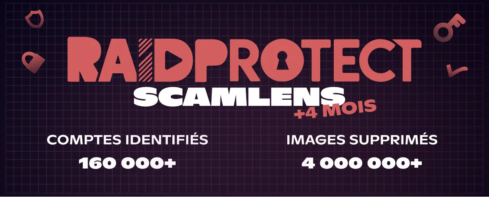

import Timestamp from '@site/src/components/Timestamp';
import Head from '@docusaurus/Head';

Resumo de junho de 2026 nos **375 000 servidores Discord** protegidos pelo RaidProtect (de 1º de junho a 1º de julho de 2026): **4 milhões de imagens de scam removidas** pelo ScamLens e **160 000 contas Discord hackeadas** identificadas. Esses scams **usurpam a imagem de celebridades** como MrBeast, Elon Musk ou Andrew Tate, que obviamente não têm nenhuma ligação com essas mensagens. Novidade do mês: o ScamLens **passa a sancionar logo na primeira imagem detectada**, em vez de limpar toda a onda antes de sancionar, para cortar o acesso de uma conta hackeada antes que ela possa publicar mais.

{/* truncate */}

## 🛰️ Lembrete: ScamLens, o anti-scam de imagens do RaidProtect {#what-is-scamlens}

Para os servidores que estão conhecendo o RaidProtect agora: o ScamLens é o módulo que cuida das **imagens de scam**. Assim que uma imagem é publicada, ele a compara com seu catálogo e **remove** automaticamente as fraudulentas: **scams cripto**, **falsos giveaways de celebridades** (MrBeast, Elon Musk, Andrew Tate, Kick, Stake…), **falsas promoções de cassinos on-line**. Nada para configurar nem manter do seu lado: o ScamLens funciona **por padrão** assim que você [adiciona o RaidProtect](https://raidprotect.bot/pt/invite).

  
  
  
  

## 📊 Balanço do ScamLens desde 14 de fevereiro de 2026 {#stats}

Dados acumulados desde a [ativação antecipada do ScamLens](/pt/blog/scamlens-early-activation) em <Timestamp value={1771023600} format="D" />:

| **Indicador (acumulado desde 14 de fevereiro)** | **1º de junho de 2026** | **1º de julho de 2026** | **Evolução** |
|---|---|---|---|
| Imagens analisadas (únicas) | 1 800 000 | **3 000 000** | **+67 %** |
| Imagens de scam detectadas (únicas) | 141 000 | **275 000** | **+95 %** |
| Imagens fraudulentas removidas | 2 300 000 | **4 000 000** | **+74 %** |
| Contas Discord hackeadas identificadas | 80 000 | **160 000** | **+100 %** |

O número de **contas hackeadas identificadas dobrou de novo** em um mês (80 000 → 160 000), e o volume de imagens removidas agora chega a **4 milhões**. O catálogo de imagens únicas também sobe bastante (+95 %): **novos clusters visuais** continuam surgindo em massa. Um cluster visual é uma mesma imagem de scam **e todas as suas microvariantes** (recortes, filtros, retoques); quando as únicas crescem tanto, **novos visuais** estão sendo lançados, não apenas derivados dos antigos (veja o [combo «3 imagens»](/pt/blog/threat-weather-may-2026#updates) de maio).

---

## 🆕 Novidade: sanção logo na primeira imagem {#updates}

Até agora, quando uma conta hackeada despejava sua onda, o ScamLens **removia primeiro todas as mensagens** e só depois sancionava. Durante essa limpeza, a conta podia continuar por alguns segundos, e essas ondas **às vezes incluíam menções de cargos** que inundavam o servidor de notificações.

Agora, logo na **primeira imagem de scam** detectada, o RaidProtect **remove e sanciona imediatamente** (sanção configurável) e *depois* limpa o resto. A conta hackeada é cortada na hora, sem tempo de publicar mais nem de pingar o servidor.

---

## ❓ FAQ {#faq}

<Head>
  
</Head>

#### O que é o ScamLens no Discord? {#quest-ce-que-scamlens}
O ScamLens é o **módulo anti-scam de imagens** do RaidProtect, o **bot de proteção para Discord**. Ele analisa cada imagem publicada em tempo real e **remove automaticamente** as que identifica como fraudulentas (scams cripto, falsos giveaways de celebridades, falsas promoções de cassinos on-line), **sem nenhuma configuração**.

#### O ScamLens remove as imagens ou sanciona primeiro a conta? {#suppression-ou-sanction}
Desde junho de 2026, o ScamLens **sanciona a conta logo na primeira** imagem de scam detectada (sanção configurável) e *depois* limpa o resto da onda. Antes, ele removia todas as mensagens antes de sancionar, o que deixava uma conta hackeada publicar mais algumas imagens.

#### Por que minha conta Discord envia mensagens de scam sozinha? {#compte-discord-envoie-messages-seul}
Sua conta muito provavelmente foi **hackeada**. Os golpistas roubam seu **token de autenticação** (site falso, software infectado, extensão maliciosa) e o usam para enviar imagens de scam em spam em **todos os servidores em que você está**, sem que você saiba.

#### O que fazer se um membro do meu servidor Discord divulga um scam cripto? {#membre-diffuse-scam-crypto}
**Não o bana**: quase sempre é uma **conta hackeada**, não um usuário mal-intencionado. Entre em contato com ele no privado para que ele proteja a conta. O ScamLens já remove a imagem na hora, sem punir o proprietário legítimo.

#### Como reconhecer um falso giveaway ou uma falsa promoção cripto no Discord? {#reconnaitre-fausse-promo-crypto}
Qualquer **«presente» cripto**, **cassino on-line** com logotipo de celebridade (MrBeast, Elon Musk, Andrew Tate, Kick, Stake) ou **investimento «garantido»** é um scam. **Essas personalidades não estão por trás dessas mensagens**: os golpistas apenas usurpam a imagem e a fama delas. O Discord nunca organiza distribuição de criptomoedas, e nenhuma marca séria faz spam em vários servidores.

---

:::tip 📚 Recursos úteis
- 🔗 [Adicionar o RaidProtect ao seu servidor](https://raidprotect.bot/pt/invite)
- 📘 [Documentação do HoneyPot](https://docs.raidprotect.bot/pt/features/honeypot)
- 💡 [Enviar uma sugestão](https://suggestions.raidprotect.bot/)
- 📣 [Entrar no nosso servidor Discord](https://raidprotect.bot/discord)
:::
