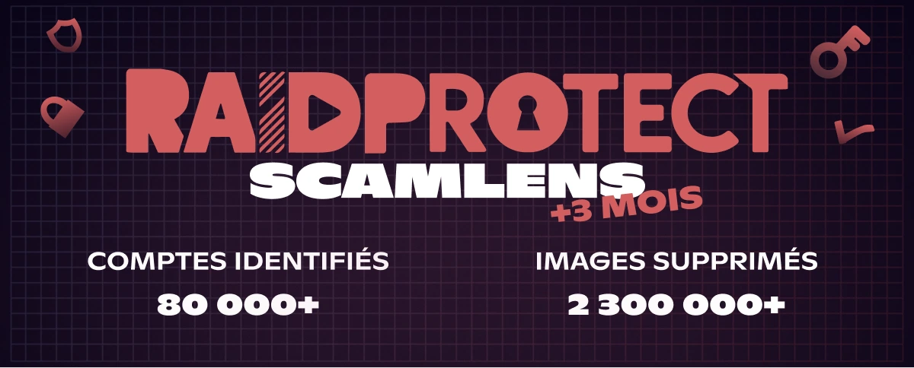

import Timestamp from '@site/src/components/Timestamp';
import Head from '@docusaurus/Head';

Resumo de maio de 2026 nos **365 000 servidores Discord** protegidos pelo RaidProtect (de 1º de maio a 1º de junho de 2026): **2,3 milhões de imagens de scam removidas** pelo ScamLens e **80 000 contas Discord hackeadas** identificadas. Esses scams **usurpam a imagem de celebridades** como MrBeast, Elon Musk ou Andrew Tate, que obviamente não têm nenhuma ligação com essas mensagens. Também ampliamos a cobertura para uma nova variante, o **combo «3 imagens»**, detectado durante um **pico de mais de 2 000 imagens** interceptadas em poucos minutos.

{/* truncate */}

## 🛰️ Relembrando: ScamLens, o anti-scam de imagens do RaidProtect {#what-is-scamlens}

Para os servidores que estão conhecendo o RaidProtect agora: o ScamLens é o módulo que cuida das **imagens de scam**. Assim que uma imagem é publicada, ele a compara com seu catálogo e **remove** automaticamente as fraudulentas: **scams de cripto**, **falsos giveaways de celebridades** (MrBeast, Elon Musk, Andrew Tate, Kick, Stake…), **falsas promoções de cassinos on-line**. Nada para configurar nem manter do seu lado: o ScamLens funciona **por padrão** assim que você [adiciona o RaidProtect](https://raidprotect.bot/pt/invite).

  
  
  
  

## 📊 Balanço do ScamLens desde 14 de fevereiro de 2026 {#stats}

Dados acumulados desde a [ativação antecipada do ScamLens](/pt/blog/scamlens-early-activation) em <Timestamp value={1771023600} format="D" />:

| **Indicador (acumulado desde 14 de fevereiro)** | **1º de maio de 2026** | **1º de junho de 2026** | **Evolução** |
|---|---|---|---|
| Imagens analisadas (únicas) | 890 000 | **1 800 000** | **+100 %** |
| Imagens de scam detectadas (únicas) | 82 000 | **141 000** | **+72 %** |
| Imagens fraudulentas removidas | 1 400 000 | **2 300 000** | **+64 %** |
| Contas Discord hackeadas identificadas | 40 000 | **80 000** | **+100 %** |

O número de **contas hackeadas identificadas dobrou** em um mês, e o volume de imagens removidas agora passa de **2,3 milhões**. O catálogo de imagens únicas também cresce (+72 %): é sobretudo o sinal de que **novos clusters visuais** estão surgindo. Um cluster visual é uma mesma imagem de scam **e todas as suas microvariantes** (recortes, filtros, retoques); quando o número de únicas sobe tanto, são realmente **novos visuais** sendo lançados, e não apenas variações dos antigos.

---

## 🆕 Novidade: Cobertura do combo «3 imagens» {#updates}

Os golpistas fazem variações do seu visual em vários **formatos combinados** para enganar a detecção: 4 imagens no início, depois 2 imagens no mês passado (veja o [«2 imagens»](/pt/blog/threat-weather-april-2026#stats)) e agora um **combo de 3 imagens**. Observamos esse novo formato durante um **pico de mais de 2 000 imagens** interceptadas em poucos minutos.

Esse combo de 3 imagens também chegou com um **novo cluster visual**: um visual de scam inédito, que ainda não estava no nosso catálogo. Cobrimos os dois de uma vez só, e o ScamLens agora reconhece esse combo por inteiro, sem nenhuma ação do seu lado. Cada imagem continua sendo processada em **~400 ms**, antes mesmo que a maioria dos membros tenha tempo de vê-la.

---

## ❓ FAQ {#faq}

<Head>
  
</Head>

#### O que é o ScamLens no Discord? {#quest-ce-que-scamlens}
O ScamLens é o **módulo anti-scam de imagens** do RaidProtect, o **bot de proteção para Discord**. Ele analisa cada imagem publicada em tempo real e **remove automaticamente** as que identifica como fraudulentas (scams de cripto, falsos giveaways de celebridades, falsas promoções de cassinos on-line), **sem nenhuma configuração**.

#### Como remover automaticamente as imagens de scam de cripto no Discord? {#supprimer-images-arnaque-crypto}
[Adicione o RaidProtect](https://raidprotect.bot/pt/invite) ao seu servidor: o **ScamLens está ativo por padrão** e remove as imagens de scam de cripto em **~400 ms**, antes que a maioria dos membros as veja. Sem regras para escrever nem listas negras para manter.

#### Por que minha conta Discord envia mensagens de scam sozinha? {#compte-discord-envoie-messages-seul}
Sua conta muito provavelmente foi **hackeada**. Os golpistas roubam seu **token de autenticação** (site falso, software infectado, extensão maliciosa) e o usam para enviar spam de imagens de scam em **todos os servidores em que você está**, sem que você saiba.

#### O que fazer se um membro do meu servidor Discord divulgar um scam de cripto? {#membre-diffuse-scam-crypto}
**Não o bana**: quase sempre é uma **conta hackeada**, não um usuário mal-intencionado. Entre em contato com ele no privado para que ele proteja a conta. O ScamLens já remove a imagem na hora, sem punir o proprietário legítimo.

#### Como reconhecer um falso giveaway ou uma falsa promoção de cripto no Discord? {#reconnaitre-fausse-promo-crypto}
Qualquer **«presente» de cripto**, **cassino on-line** com logotipo de celebridade (MrBeast, Elon Musk, Andrew Tate, Kick, Stake) ou **investimento «garantido»** é um golpe. **Essas personalidades não estão por trás dessas mensagens**: os golpistas apenas usurpam a imagem e a fama delas. O Discord nunca organiza distribuições de criptomoedas, e nenhuma marca séria faz spam em vários servidores.

---

:::tip 📚 Recursos úteis
- 🔗 [Adicionar o RaidProtect ao seu servidor](https://raidprotect.bot/pt/invite)
- 📘 [Documentação do HoneyPot](https://docs.raidprotect.bot/pt/features/honeypot)
- 💡 [Enviar uma sugestão](https://suggestions.raidprotect.bot/)
- 📣 [Entrar no nosso servidor Discord](https://raidprotect.bot/discord)
:::
