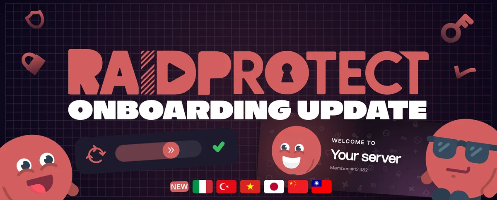

A versão 3.5.0 é **a Onboarding Update**: repensamos tudo o que acontece quando um membro entra no seu servidor. No programa: um **`/settings` totalmente refeito**, uma **mensagem de boas-vindas**, um **captcha de nova geração** e um bot que agora fala **11 idiomas**.

<!--truncate-->

## ⚙️ Um novo /settings {#settings}

O coração do RaidProtect ganha uma cara nova. O comando [`/settings`](/docs/setup#settings) se torna um verdadeiro painel de controle, pensado para encontrar a configuração certa em poucos cliques.

- **Cinco abas claras**: Geral, Chegadas, Proteção, Moderação e Utilitários.
- **Uma interface totalmente refeita** com os novos componentes do Discord (Components V2): telas mais legíveis e janelas de entrada para as configurações que pedem texto.
- **Um selo Novo** nas novas configurações, para você não perder nada.
- **As configurações Premium continuam visíveis**: você pode explorar tudo, o Premium só é exigido para modificar uma configuração reservada.

---

## 👋 Chegadas cuidadas {#onboarding}

Os primeiros segundos de um membro no seu servidor contam. A nova página [Chegadas e boas-vindas](/docs/features/onboarding) reúne tudo o que é preciso para recebê-los bem.

- **Uma mensagem de boas-vindas** com [cartão de boas-vindas, variáveis e botões](/docs/features/onboarding#welcome-message). Ela é pausada durante um raid, para não dar boas-vindas às contas dos raiders.
- **Cargos automáticos** que aceitam [vários cargos](/docs/features/onboarding#autorole), atribuídos depois que a verificação é concluída.
- **A idade mínima da conta** oferece [várias ações](/docs/features/onboarding#minage-action): expulsar a conta muito recente, colocá-la em jail até a idade exigida, ou bloqueá-la em um captcha que ela só poderá resolver depois que a idade for atingida.
- **O Auto RaidMode escolhe sua resposta** durante um raid: [bloquear os convites, expulsar os recém-chegados, enviá-los ao captcha, ou fazê-los esperar no captcha até o fim do raid](/docs/features/raid-mode#action). *(A expulsão é reservada ao Premium.)*

---

## 🧩 Um captcha de nova geração {#captcha}

O [captcha](/docs/features/captcha) está mais sólido contra os robôs e mais agradável para os seus membros.

- **Uma verificação integrada**: no modo [Painel](/docs/features/captcha#display-mode), o captcha [se abre sem sair do Discord](/docs/features/captcha#activity), com as cores do seu servidor e um quebra-cabeça bem mais difícil para os robôs. Se um resultado for duvidoso, sua equipe recebe um relatório e decide se deixa o membro entrar ou não.
- **Um acionamento ao seu gosto**: [a cada chegada, ou somente durante um raid](/docs/features/captcha#trigger).
- **Um modo de teste** para que sua equipe [refaça o captcha](/docs/features/captcha#test-mode) sem aplicar nada.
- **Uma configuração sem falhas**: a configuração do captcha sinaliza os canais e os cargos que permitem contornar a verificação, e um botão os corrige para você.

---

## 🛡️ Para a sua equipe {#staff}

- **Quem está em serviço?** O novo comando [`/onduty`](/docs/features/moderation#onduty) e seu cargo em serviço mostram aos seus membros quais moderadores estão disponíveis.
- **Painéis para a equipe** com [`/display staff`](/docs/features/display#staff), para publicar nos seus canais da staff: obtenção de cargo, entrada em serviço, lembrete dos comandos úteis.

---

## 🌍 O RaidProtect fala 11 idiomas {#languages}

Boas-vindas ao **italiano**, ao **turco**, ao **vietnamita**, ao **japonês** e ao **chinês** (simplificado e tradicional)! Por padrão, o RaidProtect [segue o idioma do seu servidor](/docs/language#follow), sem nada para configurar.

---

## ✨ E também {#other}

- **Novo comando [`/inviteinfo`](/docs/features/utilities#inviteinfo)** para saber tudo sobre um convite. Ele e o `/userinfo` também se instalam na sua conta, para usá-los em qualquer lugar do Discord.
- **Seus dados, suas escolhas**: o novo comando [`/privacy`](/docs/features/utilities#privacy) e uma configuração para ativar o [cache de mensagens](/docs/features/utilities#message-cache), necessário para encontrar as mensagens excluídas com `/snipe`.
- **Um fuso horário** para o seu servidor, usado pelos [resumos de transparência](/docs/features/transparency#recaps).
- **O [`/feedback`](/docs/features/utilities#feedback) propõe um diagnóstico** quando você relata um problema de anti-spam.

---

Quer o detalhe completo, correções inclusas? Tudo está no [registro de alterações](/docs/changelog#3-5-0).

:::tip 📚 Recursos úteis
- 🔗 [Adicionar o RaidProtect ao seu servidor](https://raidprotect.bot/invite)
- 📘 [Consultar a documentação completa](https://docs.raidprotect.bot/)
- 💡 [Enviar uma sugestão ou um retorno](https://suggestions.raidprotect.bot/)
- 📣 [Acompanhar os anúncios e entrar na comunidade](https://raidprotect.bot/discord)
:::
