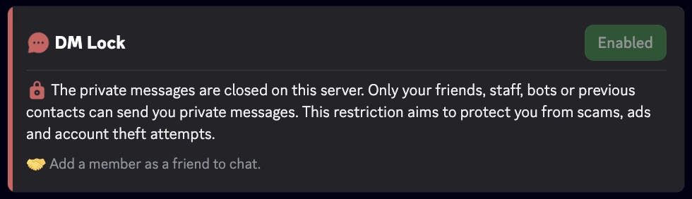
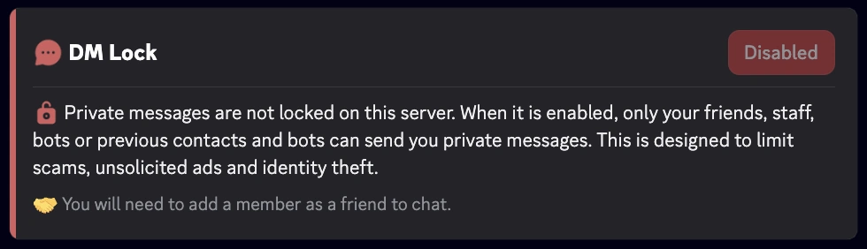

import Settings, { SettingsModal } from '@site/src/components/DiscordMessage/mockups/v2';

import DmLockMockup from '@site/src/components/DiscordMessage/mockups/dm-lock';

<DmLockMockup />

import SeparatedBox from '@site/src/components/SeparatedBox';
import Tabs from '@theme/Tabs';
import TabItem from '@theme/TabItem';

A funcionalidade **Bloqueio de DMs** do RaidProtect permite fechar permanentemente o acesso às mensagens diretas (DMs) enviadas a partir do servidor, superando assim a limitação nativa do Discord, que só permite esse bloqueio por 24 horas por meio da ação de segurança “Pausar DMs”.

## 🚦 Casos de uso e recomendações {#recommendations}

- **Servidores expostos a spam ou assédio:** O Bloqueio de DMs é particularmente recomendado para comunidades públicas ou de grande audiência, onde os riscos de abuso por DM são maiores.
- **Eventos temporários ou períodos sensíveis:** Durante lançamentos, anúncios importantes ou períodos de grande movimento (ex.: concursos, promoções), ativar o Bloqueio de DMs ajuda a prevenir tentativas de [phishing](/pt/learn/token-grabber) ou golpe.
- **Comunidades com público jovem:** Para servidores com um grande número de menores, restringir as DMs pode reforçar a segurança e prevenir comportamentos inadequados.
- **Proteção contínua:** Graças à automatização, não há janela de vulnerabilidade ligada ao esquecimento da renovação manual.

## ❓ Como funciona o Bloqueio de DMs {#working}

O RaidProtect renova automaticamente o bloqueio das DMs antes de sua expiração, sem período de vulnerabilidade.

:::info
Continua sendo possível enviar e receber mensagens com:
- seus amigos
- os bots
- a equipe
:::
:::warning
As funcionalidades comunitárias do Discord são indispensáveis para o bom funcionamento do Bloqueio de DMs. [Siga nosso guia para verificar a ativação da comunidade no seu servidor.](../guides/community.md)
:::

## 🚩 Configuração do Bloqueio de DMs {#config}

1. Execute o [comando `/settings`](../setup.md#settings).
2. Abra a aba “**Proteção**”.
3. Clique em “**Editar**” ao lado de “**Bloqueio de DMs**”.
4. Na janela que se abre, marque ou desmarque “**Fechar as mensagens privadas do servidor**” e depois confirme.

<SettingsModal name="dmlock" />

### Comando /dmlock {#dmlock}

Você também pode usar o comando: ```/dmlock```

Ele abre a tela “**Configuração do Bloqueio de DMs**”, com um interruptor para ativar ou desativar a proteção. Se um pré-requisito estiver faltando (modo Comunidade ou permissão “**Gerenciar servidor**”), um aviso indica isso e o botão “**Atualizar**” permite verificar novamente após a correção. O comando é reservado aos membros que têm a permissão “**Gerenciar servidor**”.

<Settings start="dmlockCommand" />

## ℹ️ Comando /dmlock-info {#info}

O comando `/dmlock-info` permite informar os membros sobre o estado atual do **Bloqueio de DMs** no servidor. Ele exibe uma mensagem clara que indica se a restrição está **ativada** ou **desativada**, acompanhada de uma explicação didática sobre sua utilidade.

**Objetivo:**
- Explicar por que as DMs estão restritas (combate ao spam, golpes, phishing).
- Reduzir a confusão e as perguntas recorrentes dos novos membros.
- Relembrar as condições para continuar trocando mensagens por DM (amigos, equipe, bots, contatos anteriores).

**Exemplo de exibição**
<SeparatedBox>
<Tabs>
  <TabItem value="enable" label="Ativado" default>



  </TabItem>
  <TabItem value="disable" label="Desativado">



  </TabItem>
</Tabs>
</SeparatedBox>

### ⚙️ Boas práticas

- Convide os membros ativos a usar `/dmlock-info` para responder às perguntas dos novos membros.
- Exiba-o regularmente ou fixe-o nos seus canais de boas-vindas.
- Combine-o com suas regras ou anúncios para relembrar a política anti-spam do servidor.

## Perguntas frequentes {#faq}

### Onde ativar o Bloqueio de DMs?

Em `/settings`, aba Proteção, clicando em “Editar” ao lado de “Bloqueio de DMs” e depois marcando “Fechar as mensagens privadas do servidor”. O comando `/dmlock` também abre uma tela dedicada.

### Por que não consigo ativar o Bloqueio de DMs?

Falta um pré-requisito: o modo Comunidade do Discord deve estar ativado no seu servidor, e o RaidProtect deve ter a permissão “Gerenciar servidor”.

### Por quanto tempo as DMs ficam fechadas?

Enquanto a proteção estiver ativa. O Discord limita sua ação de segurança a 24 horas, e nós a renovamos automaticamente até que você desative o Bloqueio de DMs.

### Os membros ainda podem se escrever por DM?

Sim, se forem amigos ou já tiverem conversado. Os bots e a equipe também podem sempre enviar DMs.

### O DISCON ativa o Bloqueio de DMs?

Sim, a partir do nível 3 do [DISCON](./discon.md). Ao descer, só o desativamos se foi o DISCON que o tinha ativado.
