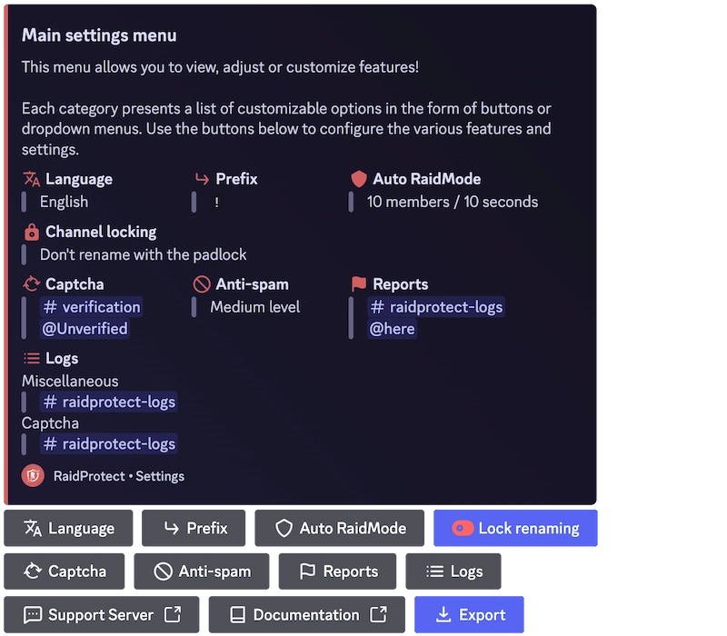

RaidProtect için büyük bir güncelleme yayımlamayalı epey oldu ve bu uzun bekleyiş için özür dileriz. Son aylarda botun deneyimini modernleştirmek ve iyileştirmek için çok çalıştık; bugün size **Interactions Update**'i sunmaktan mutluluk duyuyoruz!

<!--truncate-->

## ✨ Neler değişiyor (ve çok şey değişiyor) {#new}

Bu güncelleme, özellikle **Slash komutlarının** eklenmesi ve **yapılandırmanın yeniden tasarlanmasıyla** **etkileşime ve kullanım kolaylığına** odaklanarak RaidProtect'in işleyişinde bir dönüm noktası oluyor. Ayrıca <a href="https://suggestions.raidprotect.bot" target="_blank">geri bildirimlerinizi ve fikirlerinizi</a> dinledik; bu güncelleme bizden istediğiniz birçok özelliği içeriyor! Hayata geçirilen önerileri görmek için [değişiklik günlüğüne de göz atabilirsiniz](/docs/changelog).

### Slash komutları {#slash-commands}

Evet, onları uzun zamandır bekliyordunuz... Biz de. Başka bir çağdan kalma metin komutlarına elveda, Slash komutlarına merhaba! Daha basit, daha hızlı olan bu komutlar RaidProtect'i nihayet 2021 yılına layık kılıyor (evet, biliyoruz, şimdiden 2025).

Eski kullanıcılar endişelenmesin, metin komutları kullanılabilir olmaya devam ediyor ve artık istediğiniz ön eki bile ayarlayabilirsiniz!

### Uluslararasılaşma (RP iki dilli oluyor) {#internationalization}

Bir [**çok dilli sistemin**](/docs/language) temellerini attık ve İngilizceyi ikinci resmi dil olarak ekledik! İleride başka diller de gelecek.

### Bir bildirim komutu {#report}

Uzun zamandır istenen bir özellik: topluluğunuzun sunucunuzdaki olayları kolayca bildirmesini sağlayan [**bir bildirim sistemi**](/docs/features/reports).

### Yeni yapılandırma komutları {#configuration}

Bir botu yapılandırmanın kısa sürede baş ağrısına dönüşebileceğini biliyoruz, bu yüzden her şeyi basitleştirdik:
- RaidProtect'i bir bakışta yönetmek için **[`/settings`](/docs/setup#settings) ile etkileşimli bir panel**.
- Kurulumdan itibaren size rehberlik eden **yeni bir [`/setup`](/docs/setup#install)**.
- Tam size göre bir yapılandırma için **daha esnek seçenekler**.

### Daha iyi bir kullanıcı deneyimi {#ux}

Yeniliklerin yanı sıra kullanım kolaylığı üzerinde de çalıştık:
- Daha akıllı ve daha iyi entegre edilmiş bir captcha.
- İzin hatalarının otomatik olarak algılanması.
- Daha net ve tutarlı mesajlar.

### Web sitesi ve dokümantasyon güncellemesi {#web}

Bottaki iyileştirmelere ek olarak bilgilere erişimi daha net ve düzenli hale getirmek için **web sitesini ve dokümantasyonu** da güncelledik. Bir göz atmaktan çekinmeyin!

## 🔎 Peki sırada ne var? {#next}

Bu güncelleme, RaidProtect'in daha da kapsamlı bir sürümüne doğru atılan ilk adım. Başka iyileştirmeler üzerinde de düşünüyoruz ve size daha fazlasını anlatmak için sabırsızlanıyoruz!

Planlanan sonraki gelişmeleri öğrenmek için <a href="https://suggestions.raidprotect.bot/roadmap" target="_blank">yol haritamıza göz atın</a>.

:::tip Sohbete katılın!
RaidProtect'in gelişimini gerçek zamanlı takip etmek, gelecekteki özellikler hakkında fikrinizi söylemek ya da sadece toplulukla sohbet etmek mi istiyorsunuz? <a href="https://raidprotect.bot/discord" target="_blank">Discord sunucumuza katılın!</a>
:::

---

## ❤️ Sabrınız için teşekkürler (gerçekten) {#thanks}

Biliyoruz, bu güncelleme epey gecikti. Bizi destekleyen ve sabırla (ya da sabırsızlıkla 😆) bekleyen herkese teşekkürler.

<a href="https://suggestions.raidprotect.bot" target="_blank">Fikirlerini ve önerilerini</a> paylaşan herkese bir kez daha teşekkürler, bu güncellemeyi şekillendirmede çok değerliydiler! Geri bildirimlerinizi bizimle paylaşmaya devam edin; bir dahaki sefere daha hızlı olacağımıza söz veriyoruz (en azından deneyeceğiz).
