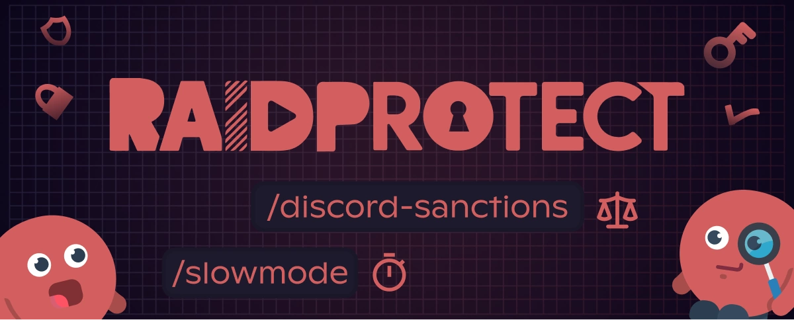

RaidProtect'in **3.2.1** sürümü, yeni faydalı komutlar ve daha da sağlam bir anti-spam ile **günlük moderasyona** odaklanıyor.

<!--truncate-->

## ⚖️ Discord tarafından verilen yaptırımları görüntüleyin {#new}

Bu güncellemenin büyük yeniliği: [`/ds` komutu](/docs/features/utilities#discord-sanctions). Bir kullanıcıya karşı **Discord tarafından verilen resmî yaptırımları** doğrudan görüntülemenizi sağlar.

### 📋 Neler görebilirsiniz

- **Yaptırım türü**: kaldırılan içerik, kısıtlanan, askıya alınan veya silinen hesap.  
- **Veriliş tarihi** ve ilgili **içerik türü**.  
- **İlişkili işaretler**: örneğin yasa dışı içerik veya otomatik algılama. 

---

## 🛡️ Daha da akıllı bir anti-spam {#antispam}

Anti-spam iki önemli gelişmeden yararlanıyor:

- Kanalları rahatsız etmek için sıkça kullanılan **Slash komutu spam'inin** engellenmesi.
- Özel yeni bir tetikleyici: [**harici komut spam'i**](/docs/features/anti-spam#triggers).

Bu eklemeler yeni kötüye kullanım biçimlerini önceden kestirmeyi ve üyelerinize daha akıcı bir deneyim sunmayı sağlıyor.

---

## ⚙️ Moderatörleriniz için daha fazla araç {#changelog}

Bu güncelleme, moderasyon ekiplerinizin işini kolaylaştırmak için merakla beklenen birkaç komut getiriyor:

- **[`/slowmode`](/docs/features/moderation#slowmode)**: bir kanalın yavaş modunu tek hamlede ve daha hassas şekilde etkinleştirin veya değiştirin.
- **[`/unban`](/docs/features/moderation#unban)**: bir kullanıcının yasağını bir sebep belirterek daha hızlı kaldırın.
- **[`/bypass captcha`](/docs/features/captcha#bypass)**: captcha'yı geçemeyen meşru bir kullanıcıya elle izin vermenizi sağlar.

Ayrıca [`/lock`](/docs/features/channel-lock#lock) ve [`/unlock`](/docs/features/channel-lock#unlock) komutları artık bir **sebep** içerebiliyor; bu da moderasyon eylemlerinin netliğini ve takibini iyileştiriyor.

---

Tam ve ayrıntılı listeye göz atmak için [değişiklik günlüğüne](/docs/changelog#3-2-1) gidin.

:::tip 📚 Faydalı kaynaklar
- 🔗 [RaidProtect'i sunucunuza ekleyin](https://raidprotect.bot/invite)
- 📘 [Tam dokümantasyona göz atın](https://docs.raidprotect.bot/)
- 💡 [Bir öneri veya geri bildirim gönderin](https://suggestions.raidprotect.bot/)
- 📣 [Duyuruları takip edin ve topluluğa katılın](https://raidprotect.bot/discord)
:::
