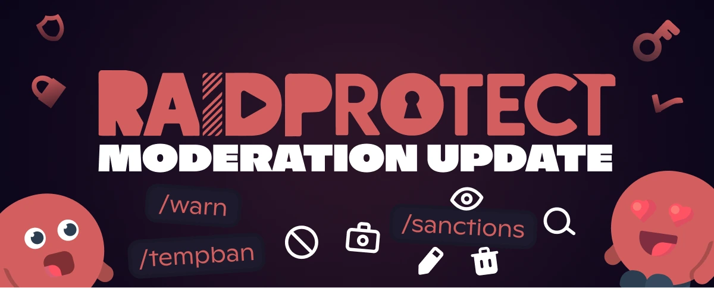

3.3.0 sürümü, Yaptırım geçmişi ile Discord sunucunuzdaki yaptırımların yönetimini yeniden şekillendiriyor: tüm moderasyon eylemlerini takip etmek, yönetmek ve analiz etmek için eksiksiz bir sistem.

<!--truncate-->

## 📋 Her yaptırım için eksiksiz bir geçmiş {#new}

Yeni [Yaptırım geçmişi](/docs/features/sanctions) ile tüm moderasyon eylemlerinin kaydını tutun. Kimin, ne zaman ve neden yaptırım aldığı konusunda artık hiçbir şüphe yok:

- **Otomatik merkezileştirme**: Yasaklamalar, atmalar, uzaklaştırmalar ve automod yaptırımları otomatik olarak kaydedilir.
- [`/sanctions search`](/docs/features/sanctions#search) ile **gelişmiş arama**: Bir üyenin geçmişini anında bulun.
- [`/sanctions info`](/docs/features/sanctions#info) ile **eksiksiz ayrıntılar**: Belirli bir yaptırımın tüm ayrıntılarını görüntüleyin.
- [`/sanctions edit`](/docs/features/sanctions#edit) ile **esnek düzenleme**: Bir sebebi düzeltin veya mevcut bir yaptırımı ayarlayın.
- [`/sanctions delete`](/docs/features/sanctions#delete) ile **silme veya iptal**: Gerekirse bir yaptırımı iptal edin veya geçmişten silin.
- **[Yaptırım durumlarının akıllı yönetimi](/docs/features/sanctions#status)**

Her yaptırım artık, üyenin bildirimi özel mesajla gerçekten alıp almadığını doğrulayan bir alındı bildirimi oluşturuyor.

---

## ⚡ Yeni moderasyon araçları {#moderation}

Bu güncelleme, moderasyon cephaneliğinizi üç temel yeni komutla da zenginleştiriyor:

- **[`/tempban`](/docs/features/moderation#tempban)**: Bir üyeyi belirlenen bir süre boyunca geçici olarak yasaklayın.
- **[`/warn`](/docs/features/moderation#warn)**: Bir üyeyi, geçmişte tam izlenebilirlikle uyarın.
- **[`/untimeout`](/docs/features/moderation#untimeout)**: Bir uzaklaştırmayı planlanan bitişinden önce kaldırın.

---

## 🛡️ Geliştirilmiş RaidMode ve JoinLock {#raid}

Anti-raid sistemi daha akıllı ve daha esnek hale geliyor:

- **Otomatik devre dışı kalma**: [RaidMode](/docs/features/raid-mode#raid-mode) ve [Otomatik RaidMode](/docs/features/raid-mode#duration) belirli bir süre sonra otomatik olarak devre dışı kalır; unutmalara son!
- **Süre parametresi**: [`/raidmode`](/docs/features/raid-mode#raid-mode) ile etkinleştirirken süreyi doğrudan belirleyin.
- **Yeni [`/joinlock`](/docs/features/join-lock) komutu**: Yeni gelenler üzerinde tam kontrol için davetleri süresiz olarak kapatın.
- **[Minimum hesap yaşı](/docs/features/raid-mode#minage) için alındı bildirimi**: Üyenin açıklama mesajını gerçekten alıp almadığını doğrulayan bir alındı bildirimi alın.

---

## ✨ 3.3.0'ın diğer yenilikleri {#changelog}

- **Yaptırımlara ayrılmış loglar**: Tüm yaptırım loglarını merkezileştirmek için özel bir kanal yapılandırın.
- **[`/channel duplicate`](/docs/features/utilities#channel-duplicate)**: Bir kanalı tüm ayarlarıyla birebir çoğaltın.
- **`/changelog` komutu**: Değişiklik günlüğüne doğrudan Discord'dan göz atın; `/settings` ve `/about` üzerinden de erişilebilir.

---

Yeniliklerin, düzeltmelerin ve teknik ayrıntıların eksiksiz listesi için [değişiklik günlüğüne](/docs/changelog#3-3-0) göz atın.

:::tip 📚 Faydalı kaynaklar
- 🔗 [RaidProtect'i sunucunuza ekleyin](https://raidprotect.bot/invite)
- 📘 [Tam dokümantasyona göz atın](https://docs.raidprotect.bot/)
- 💡 [Bir öneri veya geri bildirim gönderin](https://suggestions.raidprotect.bot/)
- 📣 [Duyuruları takip edin ve topluluğa katılın](https://raidprotect.bot/discord)
:::
