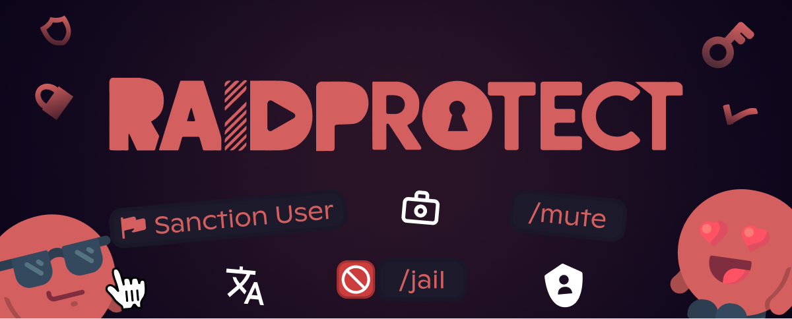

3.3.1 sürümü **Jail**, **rol ile Mute**, üyelerinizin kendi yaptırımlarını görüntüleyebilmesi ve **3 yeni dilin** gelişiyle moderasyona daha fazla ayrıntı düzeyi getiriyor.

<!--truncate-->

## 🔒 Yeni “Jail” yaptırımı {#jail}

Yeni [Jail “Hapis”](/docs/features/sanctions#jail) sistemiyle rahatsızlık veren bir üyeyi yasaklamadan izole edin. Üye, sunucunun geri kalanına erişimi olmadan kendisine ayrılmış bir kanala kapatılır:

- **[`/jail`](/docs/features/moderation#jail)**: Bir üyeyi hemen hapsedin.
- **[`/tempjail`](/docs/features/moderation#tempjail)**: Bir üyeyi belirlenen bir süre boyunca geçici olarak hapsedin.
- **[`/unjail`](/docs/features/moderation#unjail)**: Bir üyeyi istediğiniz zaman serbest bırakın.
- **Esnek yapılandırma**: Jail rolünü ve bilgilendirme kanalını doğrudan `/settings` üzerinden belirleyin.

Jail, kesin bir karar vermeden önce ilgili üyeyle konuşma imkânı bırakarak hassas durumları yönetmenizi sağlar.

---

## 🔇 Rol ile Mute: Discord timeout'unun ötesinde {#mute}

Discord timeout'u pratiktir ama kısıtlayıcıdır: üyenin, düğmeler ve menüler dahil **tüm etkileşimlerini engeller**. Timeout'taki bir üye yaptırımlarını görüntüleyemez, bilet açamaz veya sunucudaki herhangi bir öğeyle etkileşime giremez. Üstelik süresi 28 günle sınırlıdır.

Yeni [rol ile Mute](/docs/features/sanctions#mute) bu sorunları çözüyor:

- [Yapılandırılabilir bir eşiğin](/docs/features/sanctions#mute-threshold) üzerinde bot, Discord timeout'u yerine otomatik olarak bir **Mute rolü** verir. Üye artık yazamaz, ancak düğmeleri ve menüleri kullanabilmeye devam eder.
- `/timeout` ve `/untimeout` komutları akıllı bir işleyişle [`/mute`](/docs/features/moderation#timeout) ve [`/unmute`](/docs/features/moderation#untimeout) haline gelir: **eşiğin altında klasik Discord timeout'u kullanılır**.
- Süre ne olursa olsun Discord timeout'unu zorlamak için yeni `[force_timeout]` parametresi.

---

## ⚡ Zenginleştirilmiş moderasyon {#moderation}

Bu güncelleme, moderatörlerinizin ve üyelerinizin günlük kullanımı için yeni araçlar getiriyor:

- **[Bağlam menüsü](/docs/features/moderation#context-menu)**: Komut yazmadan, profiline basit bir sağ tıklamayla bir üyeye yaptırım uygulayın.
- **[`/my-sanctions`](/docs/features/utilities#my-sanctions)**: Üyelerinizin kendi yaptırımlarını görüntülemesine izin verin; erişimi denetlemek için bir [gizlilik ayarı](/docs/features/sanctions#sanctions-privacy) ile birlikte.
- Yaptırım sebeplerinde **[medyaların gösterilmesi](/docs/features/sanctions#show-medias)**: görsel kanıtlar doğrudan görünür.
- [`/sanctions search`](/docs/features/sanctions#search) içindeki **filtreler yenilendi**, yeni bir [moderatör türü](/docs/features/sanctions#search) filtresiyle.
- Destek botu aracılığıyla yaptırımların **[içe / dışa aktarımı](/docs/features/sanctions#import-export)**.

---

## 🌍 RaidProtect 3 yeni dil konuşuyor {#i18n}

Bot ve dokümantasyonu artık **[5 dilde](/docs/language)** kullanılabilir:

- Almanca
- İspanyolca
- Portekizce

Bu diller, zaten mevcut olan Fransızca ve İngilizceye ekleniyor.

---

## ✨ 3.3.1'in diğer yenilikleri {#changelog}

- **[Bilgi panelleri](/docs/features/display)**: `/display public` ile kanallarınızda bilgi panelleri gösterin. RaidProtect, işleyişini üyelerinize açıklamak için Discord'un desteklediği tüm dillere çevrilmiş mesajlar oluşturur: bildirimler, yaptırımlara erişim, hapis...
- **[Üyeleri engelleme](/docs/features/utilities#block)**: [`/block add`](/docs/features/utilities#block-add), [`/block remove`](/docs/features/utilities#block-remove) ve [`/block list`](/docs/features/utilities#block-list) ile bazı üyelerin RaidProtect'in belirli özelliklerine erişimini engelleyin.
- **[`/prune`](/docs/features/utilities#prune)**: Etkin olmayan üyeleri daha hassas koşullarla çıkarın.
- **[`/channel clear`](/docs/features/utilities#channel-clear)**: Bir kanalı tek komutla silip yeniden oluşturun.
- **`/bypass` için loglar**: `/bypass` komutlarının tam izlenebilirliği.
- **Anti-Scam**: Scam girişimlerini algılamak için yeni modül.

---

Yeniliklerin, düzeltmelerin ve teknik ayrıntıların eksiksiz listesi için [değişiklik günlüğüne](/docs/changelog#3-3-1) göz atın.

:::tip 📚 Faydalı kaynaklar
- 🔗 [RaidProtect'i sunucunuza ekleyin](https://raidprotect.bot/invite)
- 📘 [Tam dokümantasyona göz atın](https://docs.raidprotect.bot/)
- 💡 [Bir öneri veya geri bildirim gönderin](https://suggestions.raidprotect.bot/)
- 📣 [Duyuruları takip edin ve topluluğa katılın](https://raidprotect.bot/discord)
:::
