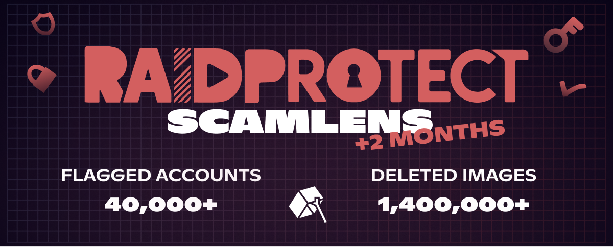

import Timestamp from '@site/src/components/Timestamp';

RaidProtect tarafından korunan **355.000 Discord sunucusunda** Nisan 2026 bilançosu (21 Mart - 1 Mayıs 2026): ScamLens tarafından **1,4 milyon dolandırıcılık görseli silindi** ve **40.000 hacklenmiş Discord hesabı** tespit edildi. Ayrıca ScamLens'i tamamlayan, **henüz kataloglanmamış scam'leri** ve diğer otomatik spam biçimlerini (bağlantılar, etiketlemeler, metin baskınları) yakalayan yeni bir **anti-spam tuzak kanalı** olan **HoneyPot**'u da başlatıyoruz.

{/* truncate */}

## 🛰️ Hatırlatma: RaidProtect'in görsel anti-scam'i ScamLens {#what-is-scamlens}

ScamLens, **Discord için koruma botu** RaidProtect'in **görsel anti-scam** modülüdür. Her görseli gerçek zamanlı olarak analiz eder ve sahte olarak tanımladıklarını otomatik olarak siler: **kripto dolandırıcılıkları**, **sahte ünlü çekilişleri** (MrBeast, Elon Musk, Kick, Stake…), **sahte çevrim içi kumarhane promosyonları**. Yazılacak kural yok, sürdürülecek kara liste yok: [RaidProtect'i eklemeniz](https://raidprotect.bot/tr/invite) yeterli, ScamLens varsayılan olarak etkinleşir.

  
  
  
  

## 📊 14 Şubat 2026'dan bu yana ScamLens bilançosu {#stats}

<Timestamp value={1771023600} format="D" /> tarihindeki [ScamLens'in planlanandan önce etkinleştirilmesinden](/tr/blog/scamlens-early-activation) bu yana, RaidProtect tarafından korunan **355.000 Discord sunucusunda** kümülatif veriler:

| **Gösterge (14 Şubat'tan bu yana kümülatif)** | **21 Mart 2026** | **1 Mayıs 2026** | **Değişim** |
|---|---|---|---|
| Analiz edilen görseller (benzersiz) | 162.000 | **890.000** | **+%450** |
| Tespit edilen scam görselleri (benzersiz) | 62.000 | **82.000** | +%32 |
| Silinen sahte görseller | 260.000 | **1.400.000** | **+%440** |
| Tespit edilen hacklenmiş Discord hesapları | 15.000 | **40.000** | **+%167** |

Silinen görsellerin hacmi **beş katından fazla arttı**: [genişletilmiş kapsam](/tr/blog/scamlens-1-month-recap#coverage), Discord CDN'iyle ilgili teknik nedenlerle analizden kaçan görselleri artık yakalıyor. Benzersiz görsel kataloğu yalnızca %32 artıyor, çünkü saldırganlar birkaç **görsel kümeyi** sürekli olarak türetiyor (kırpmalar, filtreler, rötuşlar).

Bu dönemde (4 yerine) **“2 görselli” bir varyant** ortaya çıktı; ScamLens onu da kapsıyor ve **dakikada ~2.000 silmeye** varan birkaç zirve şimdiden engellendi. Her görsel **~400 ms** içinde işleniyor; üyelerin çoğu onu görmeye fırsat bulamadan.

---

## 🆕 Yenilikler {#updates}

### ⏱️ Otomatik 24 saatlik timeout {#scamlens-timeout}

Artık ScamLens tarafından yakalanan her hesaba **otomatik 24 saatlik timeout** uyguluyoruz. Bu, meşru sahibine (neredeyse her zaman bir hacklenme mağduru) kontrolü yeniden ele alıp saldırganların erişimini kesmesi için zaman tanır.

### 🍯 RaidProtect HoneyPot {#honeypot}

Bir **[Discord HoneyPot'u](https://docs.raidprotect.bot/tr/features/honeypot)** (veya “tuzak kanal”), hiçbir meşru üyenin yazmaması gereken bir kanaldır. **Hacklenmiş hesaplar** ve **spam botları** ise yüklerini (görseller, bağlantılar, etiketlemeler, ping'ler) ayrım yapmadan **tüm kanallara**, dolayısıyla tuzağa da boşaltır. Oraya gelen her mesaj, içeriği ne olursa olsun **otomatik bir yaptırımı** tetikler.

**RaidProtect artık kendi HoneyPot'unu içeriyor.** [`/settings` → **HoneyPot**](https://docs.raidprotect.bot/tr/features/honeypot) ile bot kanalı oluşturur, sunucunun en üstüne yerleştirir ve oraya çevrilmiş bir uyarı mesajı gönderir.

#### Neden başka bir HoneyPot yerine RaidProtect HoneyPot? {#honeypot-vs-others}

HoneyPot'umuz **doğrudan ScamLens'e bağlıdır**:

- **Önce ScamLens devreye girer.** Tuzağa gönderilen bir görsel zaten biliniyorsa silinir ve HoneyPot **tetiklenmez**: ScamLens'in işini yapmasına izin verir.
- **HoneyPot ScamLens'i zenginleştirir.** Bir tuzak kanalda yakalanan her yeni görsel kataloğumuzu besler; katalog da ardından dalgayı **korunan 355.000 sunucunun tamamında** engeller.

#### Her birinin kapsadığı alan {#scamlens-honeypot}

- **ScamLens** = bilinen dolandırıcılık görselleri, silinir ve 24 saatlik timeout uygulanır.
- **HoneyPot** = geri kalan her şey: **bağlantı spam'i, metin baskınları, toplu etiketlemeler, botlar** ve henüz tanımlanmamış **yeni görseller**.

ScamLens varsayılan olarak etkindir. **HoneyPot'u etkinleştirmek hiçbir şeyi bozmaz**, yalnızca kör noktaları kapatır.

---

## ❓ SSS {#faq}

#### Discord hesabım neden kendi kendine mesaj gönderiyor? {#compte-discord-envoie-messages-seul}
Hesabınız büyük olasılıkla **hacklendi**. Dolandırıcılar **kimlik doğrulama token'ını** (sahte site, virüslü yazılım, kötü amaçlı eklenti) çalar ve bulunduğunuz tüm sunuculara dolandırıcılık görselleri spam'lemek için kullanır. Discord şifrenizi değiştirin, **iki faktörlü kimlik doğrulamayı** etkinleştirin ve etkin oturumları iptal edin.

#### Üyelerimden biri kripto scam'i yayıyorsa ne yapmalıyım? {#membre-diffuse-scam-crypto}
Onu yasaklamayın: bu neredeyse her zaman kötü niyetli bir kullanıcı değil, **hacklenmiş bir hesaptır**. Hesabını güvenceye alması için onunla özelden iletişime geçin. ScamLens, meşru sahibini cezalandırmadan görseli anında siler zaten.

#### Discord'da sahte bir kripto promosyonu nasıl anlaşılır? {#reconnaitre-fausse-promo-crypto}
Her kripto **“hediyesi”**, ünlü logolu her **çevrim içi kumarhane** veya **mucizevi yatırım** bir dolandırıcılıktır. Discord asla kripto para dağıtımı düzenlemez ve hiçbir ciddi marka çoklu sunucu spam'i yapmaz.

#### Discord'da HoneyPot nedir? {#qu-est-ce-qu-un-honeypot}
Bir **HoneyPot** (veya tuzak kanal), herkesin görebildiği ama **hiçbir meşru üyenin yazmaması gereken** bir kanaldır. Oraya düşen her mesaj mutlaka otomatik spam'dir: RaidProtect hesaba otomatik olarak yaptırım uygular (ban, softban, kick, timeout, jail veya mute, tercihinize göre).

#### Discord sunucumda HoneyPot nasıl etkinleştirilir? {#activer-honeypot}
[RaidProtect'i ekleyin](https://raidprotect.bot/tr/invite), `/settings` → **HoneyPot** yapın, ardından “**Kanalı oluştur**”a tıklayın. Bot tuzak kanalı oluşturur, sunucunun en üstüne yerleştirir ve çevrilmiş bir uyarı mesajı gönderir. Ayrıntılar [dokümantasyonda](https://docs.raidprotect.bot/tr/features/honeypot).

#### RaidProtect spam'lere karşı otomatik olarak korur mu? {#raidprotect-spam-auto}
Evet. [RaidProtect'i](https://raidprotect.bot/tr/invite) önerilen izinlerle ekleyin: **ScamLens varsayılan olarak etkindir** ve sahte görselleri ~400 ms içinde siler. **HoneyPot**, kör noktaları (bağlantı spam'i, metin baskınları, yeni görsel biçimleri) kapatmak için `/settings` üzerinden tek tıkla etkinleşir.

---

:::tip 📚 Faydalı kaynaklar
- 🔗 [RaidProtect'i sunucunuza ekleyin](https://raidprotect.bot/tr/invite)
- 📘 [HoneyPot dokümantasyonu](https://docs.raidprotect.bot/tr/features/honeypot)
- 💡 [Bir öneri gönderin](https://suggestions.raidprotect.bot/)
- 📣 [Discord sunucumuza katılın](https://raidprotect.bot/discord)
:::
