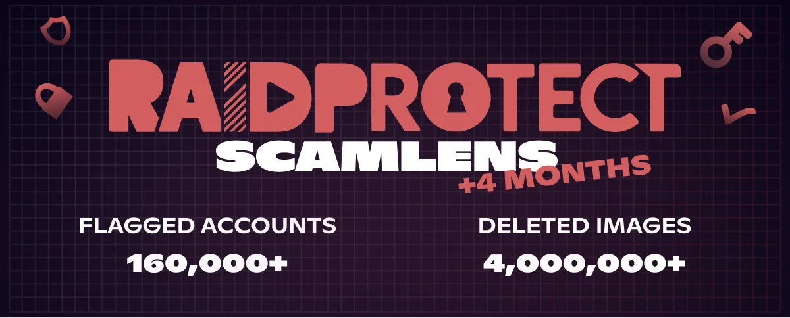

import Timestamp from '@site/src/components/Timestamp';
import Head from '@docusaurus/Head';

RaidProtect tarafından korunan **375.000 Discord sunucusunda** Haziran 2026 bilançosu (1 Haziran - 1 Temmuz 2026): ScamLens tarafından **4 milyon dolandırıcılık görseli silindi** ve **160.000 hacklenmiş Discord hesabı** tespit edildi. Bu dolandırıcılıklar, elbette bu mesajlarla hiçbir ilgisi olmayan MrBeast, Elon Musk veya Andrew Tate gibi **ünlülerin imajını izinsiz kullanıyor**. Ayın yeniliği: ScamLens, yaptırım uygulamadan önce tüm dalgayı temizlemek yerine **artık ilk tespit edilen görselden itibaren yaptırım uyguluyor**; böylece hacklenmiş bir hesabın erişimi, başka görsel göndermesine fırsat vermeden kesiliyor.

{/* truncate */}

## 🛰️ Hatırlatma: RaidProtect'in görsel anti-scam'i ScamLens {#what-is-scamlens}

RaidProtect'i yeni keşfeden sunucular için: ScamLens, **dolandırıcılık görsellerini** ele alan modüldür. Bir görsel gönderildiği anda onu kataloğuyla karşılaştırır ve sahte olanları otomatik olarak siler: **kripto dolandırıcılıkları**, **sahte ünlü çekilişleri** (MrBeast, Elon Musk, Andrew Tate, Kick, Stake…), **sahte çevrim içi kumarhane promosyonları**. Sizin tarafınızda ayarlanacak veya sürdürülecek hiçbir şey yok: [RaidProtect'i eklediğiniz](https://raidprotect.bot/tr/invite) anda ScamLens **varsayılan olarak** çalışır.

  
  
  
  

## 📊 14 Şubat 2026'dan bu yana ScamLens bilançosu {#stats}

<Timestamp value={1771023600} format="D" /> tarihindeki [ScamLens'in planlanandan önce etkinleştirilmesinden](/tr/blog/scamlens-early-activation) bu yana kümülatif veriler:

| **Gösterge (14 Şubat'tan bu yana kümülatif)** | **1 Haziran 2026** | **1 Temmuz 2026** | **Değişim** |
|---|---|---|---|
| Analiz edilen görseller (benzersiz) | 1.800.000 | **3.000.000** | **+%67** |
| Tespit edilen scam görselleri (benzersiz) | 141.000 | **275.000** | **+%95** |
| Silinen sahte görseller | 2.300.000 | **4.000.000** | **+%74** |
| Tespit edilen hacklenmiş Discord hesapları | 80.000 | **160.000** | **+%100** |

**Tespit edilen hacklenmiş hesaplar** bir ayda **yeniden ikiye katlandı** (80.000 → 160.000) ve silinen görsellerin hacmi artık **4 milyona** ulaştı. Benzersiz görsel kataloğu hızla büyüyor (+%95): **yeni görsel kümeler** toplu halde ortaya çıkmaya devam ediyor. Bir görsel küme, aynı dolandırıcılık görseli **ve tüm mikro varyantlarıdır** (kırpmalar, filtreler, rötuşlar); benzersiz görseller bu kadar arttığında, yalnızca eskilerin türevleri değil, gerçekten **yeni görseller** piyasaya sürülüyor demektir (Mayıs ayındaki [“3 görselli” kombinasyona](/tr/blog/threat-weather-may-2026#updates) bakın).

---

## 🆕 Yenilik: ilk görselden itibaren yaptırım {#updates}

Şimdiye kadar hacklenmiş bir hesap dalgasını boşalttığında ScamLens **önce tüm mesajları siliyor**, ardından yaptırım uyguluyordu. Bu temizlik sırasında hesap birkaç saniye daha devam edebiliyordu ve bu dalgalar **bazen rol etiketlemeleri içeriyor**, sunucuyu bildirimlere boğuyordu.

Artık tespit edilen **ilk dolandırıcılık görselinden** itibaren RaidProtect **hemen siler ve yaptırım uygular** (yaptırım yapılandırılabilir), ardından geri kalanını temizler. Hacklenmiş hesabın, başka görsel göndermesine ya da sunucuyu ping'lemesine fırsat kalmadan erişimi anında kesilir.

---

## ❓ SSS {#faq}

<Head>
  
</Head>

#### Discord'da ScamLens nedir? {#quest-ce-que-scamlens}
ScamLens, **Discord için koruma botu** RaidProtect'in **görsel anti-scam modülüdür**. Gönderilen her görseli gerçek zamanlı olarak analiz eder ve sahte olarak tanımladıklarını (kripto dolandırıcılıkları, sahte ünlü çekilişleri, sahte çevrim içi kumarhane promosyonları) **hiçbir yapılandırma gerektirmeden** **otomatik olarak siler**.

#### ScamLens önce görselleri mi siler, yoksa hesaba mı yaptırım uygular? {#suppression-ou-sanction}
Haziran 2026'dan bu yana ScamLens, tespit edilen **ilk dolandırıcılık görselinden itibaren hesaba yaptırım uygular** (yaptırım yapılandırılabilir), *ardından* dalganın geri kalanını temizler. Önceden yaptırım uygulamadan önce tüm mesajları siliyordu; bu da hacklenmiş bir hesabın birkaç görsel daha göndermesine izin veriyordu.

#### Discord hesabım neden kendi kendine dolandırıcılık mesajları gönderiyor? {#compte-discord-envoie-messages-seul}
Hesabınız büyük olasılıkla **hacklendi**. Dolandırıcılar **kimlik doğrulama token'ınızı** (sahte site, virüslü yazılım, kötü amaçlı eklenti) çalar, ardından sizin haberiniz olmadan **bulunduğunuz tüm sunuculara** dolandırıcılık görselleri spam'lemek için kullanır.

#### Discord sunucumdaki bir üye kripto scam'i yayıyorsa ne yapmalıyım? {#membre-diffuse-scam-crypto}
**Onu yasaklamayın**: bu neredeyse her zaman kötü niyetli bir kullanıcı değil, **hacklenmiş bir hesaptır**. Hesabını güvenceye alması için onunla özelden iletişime geçin. ScamLens, meşru sahibini cezalandırmadan görseli anında siler zaten.

#### Discord'da sahte bir çekiliş veya sahte bir kripto promosyonu nasıl anlaşılır? {#reconnaitre-fausse-promo-crypto}
Her kripto **“hediyesi”**, ünlü logolu (MrBeast, Elon Musk, Andrew Tate, Kick, Stake) her **çevrim içi kumarhane** veya **“garantili” her yatırım** bir dolandırıcılıktır. **Bu ünlüler bu mesajların arkasında değil**: dolandırıcılar yalnızca onların imajını ve şöhretini izinsiz kullanıyor. Discord asla kripto para dağıtımı düzenlemez ve hiçbir ciddi marka çoklu sunucu spam'i yapmaz.

---

:::tip 📚 Faydalı kaynaklar
- 🔗 [RaidProtect'i sunucunuza ekleyin](https://raidprotect.bot/tr/invite)
- 📘 [HoneyPot dokümantasyonu](https://docs.raidprotect.bot/tr/features/honeypot)
- 💡 [Bir öneri gönderin](https://suggestions.raidprotect.bot/)
- 📣 [Discord sunucumuza katılın](https://raidprotect.bot/discord)
:::
