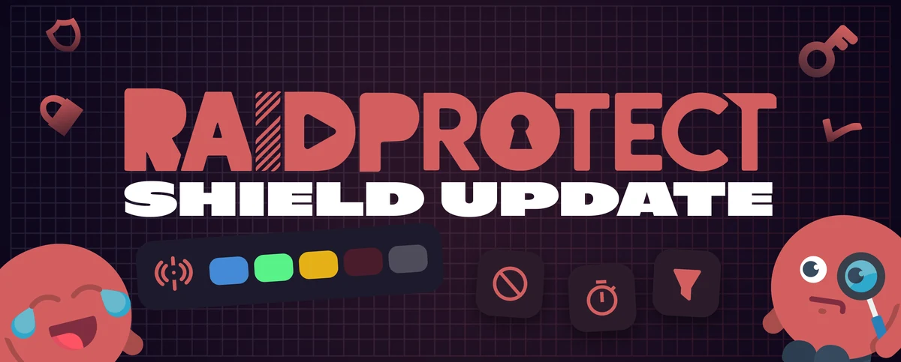

3.6.0 sürümü **Shield Update**: sunucunuzu her gün koruyan her şeyi güçlendirdik. Programda şunlar var: **DISCON**, tek tıkla ayarladığınız bir tehlike seviyesi, diğer sunucuları ve dosyaları filtreleyen bir **Automod**, **kontrol altındaki bot katılımları** ve yeni bir **kurulum sihirbazı**.

<!--truncate-->

## 🚨 DISCON, uyarı seviyeniz {#discon}

DEFCON örnek alınarak hazırlanan [DISCON](/docs/features/discon), sunucunuza **beş kademeli bir tehlike seviyesi** verir. Seviyeyi `/discon` ile veya [ekip için bir panelden](/docs/features/discon#panel) tek tıkla değiştirirsiniz; RaidProtect her seviyede sunucuyu kendiliğinden sıkılaştırır.

- **Kademeli bir yanıt**: doğrulama, gelen herkese zorunlu captcha, DM kapatma, baskın modu, kilitleme. Seviye yükseldikçe korumalar sıkılaşır ve seviye düştüğünde her şey eski haline döner.
- **Her yerde bir panel**: bir metin kanalında veya bir ses kanalının sohbetinde yayımlanır.
- **Bir durum ses kanalı** (**Premium**) geçerli seviyeyi gösterir, böylece tüm ekip bir bakışta görebilir.

---

## 🧹 Daha kapsamlı bir Automod {#automod}

- **Diğer sunucular**: yeni [Diğer sunucular](/docs/features/automod#servers) filtresi, diğer sunucuların davetlerini, iletilen mesajlarını, kanal veya etkinlik bağlantılarını ve etiketlerini denetler. Ortaklarınıza dokunmadan başıboş reklamı engelleyin; kara liste veya beyaz liste ile.
- **Dosya uzantıları**: [Dosya uzantıları](/docs/features/automod#files) filtresi uzantı gruplarını (çalıştırılabilir dosyalar, arşivler, belgeler…) engeller ya da yalnızca seçtiklerinize izin verir; tüm sunucuda veya kanal kanal. `.png` olarak yeniden adlandırılmış bir `.exe` artık geçemez: gizlenmiş dosyaları tanıyoruz.
- **ScamLens**: [özel görsel kataloğu](/docs/features/scam-images#catalog) (**Premium**), kendi veri tabanımıza ek olarak sizin dolandırıcılık görsellerinizi engeller.

---

## 🛡️ Anti-spam ve HoneyPot {#antispam}

- **[Önleyici yavaş mod](/docs/features/slowmode)** (**Premium**): kanallarınızın yavaş modu, belirlediğiniz mesaj akış hızını tutturmak için kendiliğinden ayarlanır ve kanal sakinleşince düşer.
- **“Spam” kanalları** artık her zaman yok sayılmak yerine [anti-spam tarafından izlenebilir](/docs/features/anti-spam#ignore).
- **[HoneyPot](/docs/features/honeypot)**: [cezadan önceki gecikme](/docs/features/honeypot#grace), iyi niyetli bir üyeye yanıldığını söyleme zamanı tanır; yasaklama ve jail da kalıcı olabilir.

---

## 👋 Daha iyi korunan katılımlar {#arrivals}

- **Bir antibot**: botlara [kendi rollerini](/docs/features/onboarding#bots) verin ve sizin onayınız olmadan eklenen her botu doğrudan atın. Sunucu sahibi, [`/bypass bot`](/docs/features/onboarding#bypass-bot) ile birinin girmesine izin verir.
- **Daha akıllı bir captcha**: [Akıllı tetikleme](/docs/features/captcha#trigger), baskınlar dışında da hesabı şüpheli görünen gelenleri doğrular.
- **Renklerinize bürünen bir captcha**: **Premium** bir sunucuda, sunucunuzun simgesi [doğrulamada](/docs/features/captcha#activity) RaidProtect logosunun yerini alır.
- **Minimum hesap yaşı** artık gerekli yaşa kadar [karantinaya](/docs/features/onboarding#minage-action) alır; karantina doğru tarihte kendiliğinden kalkar.

---

## ⚖️ Moderasyon ekibiniz için {#moderation}

- **Senkronize karantina**: yeni Karantina yaptırımı [Discord karantinasını](/docs/features/sanctions#discord-quarantine) takip eder ve Discord AutoMod tarafından engellenen her mesaj geçmişe sessiz bir uyarı bırakır.
- **[Bir kategoride `/lock`](/docs/features/channel-lock#lock-category)** tüm kanallarını tek seferde kilitler; `/lock`, `/unlock` ve `/slowmode` komutlarının `silent` seçeneği kanalda hiçbir şey duyurmadan işlem yapar.
- Yasaklamada varsayılan bir **[mesaj silme](/docs/features/sanctions#ban-delete)** ayarı; bir kez ayarlarsınız, bitti.

---

## 🧭 Yeni bir kurulum sihirbazı {#setup}

Yeni [`/setup` sihirbazı](/docs/setup#wizard) sizi bölüm bölüm yönlendirir, sunucunuza uygun korumaları önerir ve bir denetim önizlemesiyle biter.

---

Düzeltmeler dahil tüm ayrıntıları mı istiyorsunuz? Hepsi [değişiklik günlüğünde](/docs/changelog#3-6-0).

:::tip 📚 Faydalı kaynaklar
- 🔗 [RaidProtect'i sunucunuza ekleyin](https://raidprotect.bot/invite)
- 📘 [Tam dokümantasyona göz atın](https://docs.raidprotect.bot/)
- 💡 [Bir öneri veya geri bildirim gönderin](https://suggestions.raidprotect.bot/)
- 📣 [Duyuruları takip edin ve topluluğa katılın](https://raidprotect.bot/discord)
:::
