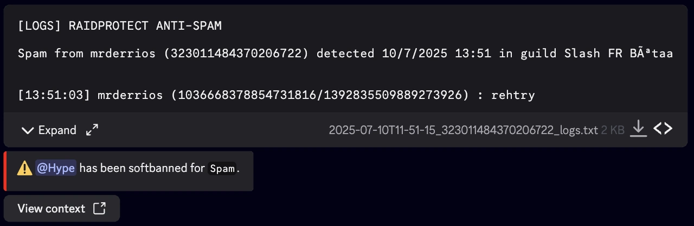
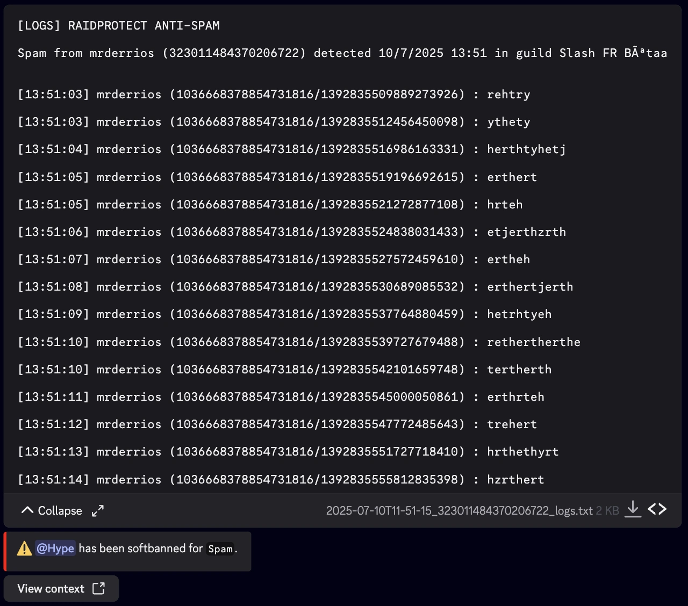

import AntiSpamMockup from '@site/src/components/DiscordMessage/mockups/anti-spam';
import Settings, { SettingsModal } from '@site/src/components/DiscordMessage/mockups/v2';

import SeparatedBox from '@site/src/components/SeparatedBox';
import Tabs from '@theme/Tabs';
import TabItem from '@theme/TabItem';

<AntiSpamMockup />

RaidProtect'in **anti-spam**'i Discord sunucunuzdaki [spam'i](/tr/learn/spam-discord) otomatik olarak algılar ve cezalandırır: seri mesajlar, taşan ekran, kopyala-yapıştır, bağlantılar, toplu bahsetmeler, [selfbotlar](/tr/learn/self-bot) ve birden fazla kanala yayılan spam. Etkinleştirildikten sonra, bir moderatörün müdahale etmesine gerek kalmadan her şeyi halleder.

## ❓ Anti-spam nasıl çalışır? {#working}

Her mesajı, yazarının son mesajlarıyla karşılaştırarak analiz ederiz.

- **On tetikleyici**: her spam türünün kendi tetikleyicisi vardır (spam, flood, dosyalar, yinelenenler, bağlantılar, bahsetmeler, selfbot, harici komutlar, AutoMod tarafından engellenen mesajlar, çok kanallı). Ayrıntılar [tetikleyiciler tablosundadır](#triggers).
- **Dört aile**: tetikleyiciler niteliklerine göre gruplanır (**Aşırılık**, **Spam**, **Otomatik** ve **Çok kanallı spam**); bu, cezaları birkaç tıkta ayarlamayı sağlar.
- **En ağır ceza geçerli olur**: bir spam aynı anda birden fazla tetikleyiciyi aştığında en güçlü cezayı uygularız.
- **Net gerekçe**: cezanın gerekçesi, algılanan spam türünü belirtir.
- **Loglar**: her ceza, silinen mesajlarla birlikte log kanalınıza gönderilir ([loglara](#logs) bakın).

Anti-spam **varsayılan olarak devre dışıdır**. İşaretlerseniz [`/setup` komutu](../setup.md) sırasında ya da istediğiniz zaman `/settings` üzerinden etkinleşir.

## 🛡️ Anti-spam yapılandırması {#config}

Anti-spam, `/settings` komutunun “**Koruma**” sekmesinde bulunur. Ekranı; anahtarı, cezaları, hazır ayarı, muafiyetleri ve simülasyonu bir araya getirir.

<Settings start="antispam" />

### Anti-spam'i etkinleştirme veya devre dışı bırakma {#toggle}

1. [`/settings` komutunu](../setup.md#settings) çalıştırın.
2. “**Koruma**” sekmesini açın.
3. “**Anti-spam**” yanındaki “**Yapılandır**” düğmesine tıklayın.
4. Ekranın sağ üstündeki “**Etkinleştir**”e (veya “**Devre dışı bırak**”a) tıklayın.

### Bir hazır ayar seçme {#presets}

Anti-spam'i ayarlamanın en basit yolu bir **hazır ayar** seçmektir. Her ailenin cezasını tek seferde belirler:

| Hazır ayar | Aşırılık | Spam | Otomatik | Çok kanallı spam |
|---|---|---|---|---|
| **Esnek** | Uyarı | Timeout | Jail | Timeout |
| **Standart** *(varsayılan)* | Timeout | Softban | Yasaklama | Jail |
| **Sıkı** *(önerilmez)* | Softban | Yasaklama | Yasaklama | Yasaklama |

**Esnek** hazır ayarı hiçbir zaman atmaz ve yasaklamaz: en fazla bir timeout ya da jail uygular.

1. [`/settings` komutunu](../setup.md#settings) çalıştırın.
2. “**Koruma**” sekmesini açın.
3. “**Anti-spam**” yanındaki “**Yapılandır**” düğmesine tıklayın.
4. “**Bir hazır ayar seçin**” seçicisinde bir hazır ayar seçin.

Ayarlarınız hiçbir hazır ayara karşılık gelmediğinde seçici “**Özel**” gösterir. Bu durumda bir hazır ayar uygulamak ayarlarınızın üzerine yazar: “**Anladım, hazır ayarı uygula**”yı işaretleyerek onaylamanızı isteriz. Bazı tetikleyicilere özel süreler o zaman [varsayılan süreye](#duration) döner.

<SettingsModal name="antispamPreset" />

### Yok sayılan kanalları, rolleri ve üyeleri yönetme {#ignore}

Bazı kanalları, rolleri veya üyeleri anti-spam denetiminden hariç tutabilirsiniz.

1. [`/settings` komutunu](../setup.md#settings) çalıştırın.
2. “**Koruma**” sekmesini açın.
3. “**Anti-spam**” yanındaki “**Yapılandır**” düğmesine tıklayın.
4. Muafiyetlerinizi “**Yok sayılan kanal(lar)**”, “**Yok sayılan rol(ler)**” ve “**Yok sayılan üye(ler)**” seçicilerinde seçin (her biri için en fazla 25).

Kanal seçici **kategorileri** (tüm kanalları o zaman yok sayılır), ayrıca ses kanallarını, sahneleri ve forumları kabul eder. Alt başlıklar üst kanallarını izler.

:::info Kim otomatik olarak yok sayılır?
- Adında “**spam**” geçen kanallar (bir alt başlık için üst kanalın adı geçerlidir).
- RaidProtect'in modere edemediği üyeler (kendi rolünden yüksek rol).
- **Ekip** (`Yönetici`, `Sunucuyu Yönet` veya `Mesajları Yönet` izni), **hiçbir rol veya üye yok sayılmadığı sürece**. Listeye bir rol veya üye eklediğiniz anda yalnızca bu liste geçerli olur: listede yer almayan ekip üyelerine o zaman ceza uygulanabilir.
:::

### Cezaları tetikleyiciye göre yapılandırma {#triggers}

Cezaların ayrıntıları anti-spam ekranından açılır.

1. [`/settings` komutunu](../setup.md#settings) çalıştırın.
2. “**Koruma**” sekmesini açın.
3. “**Anti-spam**” yanındaki “**Yapılandır**” düğmesine tıklayın.
4. “**Cezalar**”ın sağındaki “**Ayrıntıları gör**”e tıklayın.
5. Ayarlanacak ailenin yanındaki “**Düzenle**”ye tıklayın, ardından “**Ceza**”yı ve gerekirse “**Süre**”yi seçin.

<Settings start="antispamSanctions" />

Her aile, aynı nitelikteki tetikleyicileri bir araya getirir. İşte algıladığımız tetikleyiciler ve varsayılan cezaları (**Standart** hazır ayarı):

| Aile | Tetikleyici | Algılanan | Varsayılan ceza |
|---|---|---|---|
| **Aşırılık** | Spam | Kısa sürede çok fazla mesaj. Emojiler, çıkartmalar ve anlamsız mesajlar (tekrarlanan karakter, döngüdeki kelimeler) de sayılır. | Timeout |
| **Aşırılık** | Flood (ekran doldurma) | Ekranı dolduran mesajlar: uzun metinler, görseller, bağlantı önizlemeleri, çıkartmalar | Timeout |
| **Aşırılık** | Dosya spamı | Toplu dosya veya görsel gönderimi | Timeout |
| **Spam** | Yinelenen mesaj spamı | Kopyalanıp yapıştırılmış veya neredeyse aynı mesajlar | Softban |
| **Spam** | Bağlantı spamı | Toplu bağlantı gönderimi (bir Discord daveti, `https://` olmasa bile bir bağlantı sayılır; diğer Discord bağlantıları ve GIF'ler nötr kalır) | Softban |
| **Spam** | Bahsetme spamı | Toplu bahsetmeler | Softban |
| **Otomatik** | Selfbot ile spam | Spam yapmak için [selfbot](/tr/learn/self-bot) kullanımı | Yasaklama |
| **Otomatik** | Harici komut spamı | Spam yapmak için [harici komut](/tr/learn/server-raidable) kullanımı | Yasaklama |
| **Otomatik** | Engellenen mesaj spamı (AutoMod) | [Discord AutoMod](#automod) tarafından engellenen, tekrarlanan mesajlar | Yasaklama |
| *(ayrı)* | Çok kanallı spam | Aynı mesajın kısa sürede birden fazla kanalda gönderilmesi | Jail |

:::info Çok kanallı spam
**Çok kanallı spam** özeldir: cezası, spam birden fazla kanalı etkilediğinde, yalnızca daha ağırsa asıl tetikleyicinin cezasının yerine geçer. Devre dışı bırakmak, sunucu çapındaki tüm denetimi de kapatır.
:::

Her aile veya tetikleyici için **[kullanılabilir cezalar](/tr/learn/discord-sanctions)** şunlardır:

- **Uyarı (Warn)**: üyeye bir uyarı gönderir.
- **Timeout**: üyeyi belirli bir süre için susturur (en fazla 28 gün, Discord'un sınırı).
- **Mute**: sunucunuzda yapılandırılmış [Mute rolünü](./sanctions.mdx#mute) verir.
- **Jail**: sunucunuzda yapılandırılmış [Jail rolünü](./sanctions.mdx#jail) verir.
- **Atma (Kick)**: üyeyi sunucudan atar.
- **Softban**: üyeyi yasaklayıp hemen yasağını kaldırır; bu, mesajlarını siler.
- **Yasaklama (Ban)**: üyeyi yasaklar.
- **Devre dışı bırak**: tetikleyiciyi tamamen kapatır, hiçbir ceza uygulanmaz.

:::info
Rolü yapılandırılmamış bir **Jail** veya **Mute** bir **Timeout** olur: ekran bunu “**→ Timeout**” ile belirtir. Bu rolleri “**Moderasyon**” sekmesindeki “**Cezalar**” modülünde ayarlamayı unutmayın.
:::

Tüm cezaları varsayılana döndürmek için cezalar ekranının sağ üstündeki “**Sıfırla**”ya tıklayın.

#### Gelişmiş mod: her tetikleyiciyi ayarlama {#advanced}

Yalnızca bir tetikleyici için farklı bir ceza istiyorsanız (örneğin bağlantı spam'ini yasaklamak ama bahsetmeler için Softban tutmak), gelişmiş moda geçin.

1. [`/settings` komutunu](../setup.md#settings) çalıştırın.
2. “**Koruma**” sekmesini açın.
3. “**Anti-spam**” yanındaki “**Yapılandır**” düğmesine tıklayın.
4. “**Ayrıntıları gör**”e, ardından “**Gelişmiş mod**”a tıklayın.
5. “**Düzenlenecek tetikleyicileri seçin**” içinde bir veya birkaç tetikleyici seçin, ardından cezalarını ve sürelerini ayarlayın.

<SettingsModal name="antispamFamily" />

Gelişmiş mod, bir ailenin ayarları tetikleyiciye göre farklı olduğu sürece görüntülenmeye devam eder. Basit moda dönmek için “**Gelişmiş mod**”a yeniden tıklayın ve “**Anladım, aileleri eşitle**”yi işaretleyin.

#### Cezaların süresi {#duration}

Süresi olan cezalar (mute, timeout, jail) 1 saat olarak belirlenen **varsayılan süreyi** kullanır. Bunu tüm anti-spam için değiştirebilir ya da bir aileye veya tetikleyiciye özel bir süre verebilirsiniz.

**Varsayılan süre:**

1. [`/settings` komutunu](../setup.md#settings) çalıştırın.
2. “**Koruma**” sekmesini açın.
3. “**Anti-spam**” yanındaki “**Yapılandır**” düğmesine tıklayın.
4. “**Ayrıntıları gör**”e tıklayın.
5. “**Varsayılan süre**” seçicisinde bir süre seçin (Kalıcı, 5 dakika, 1 saat veya 1 gün) ya da kendi sürenizi girmek için “**Özel değer**”i seçin (örneğin `30m`, `2h`, `7d`).

**Bir aileye veya tetikleyiciye özel süre:** “**Düzenle**”nin (veya gelişmiş modun) açtığı pencerede bir “**Süre**” seçin ya da bir “**Özel süre**” girin. “**Varsayılan (genel süre)**” seçeneği varsayılan süreye döner.

:::info
- Özel bir süre **en az 5 dakika** olmalıdır.
- Bir Timeout üzerindeki “**Kalıcı**”, Discord'un izin verdiği azami süre olan 28 güne indirilir.
- Süre, süresi olmayan cezalarda (uyarı, atma, softban, yasaklama) yok sayılır.
- Çok kanallı spam devraldığında onun süresi uygulanır.
:::

### Herkese açık ceza mesajı Premium {#public-message}

Varsayılan olarak anti-spam'in her cezası kanalda **herkese açık bir mesajla** duyurulur (örneğin “üye susturuldu”). [Premium](/tr/premium) sunucular, daha gizli bir moderasyon için bunu gizleyebilir.

1. [`/settings` komutunu](../setup.md#settings) çalıştırın.
2. “**Koruma**” sekmesini açın.
3. “**Anti-spam**” yanındaki “**Yapılandır**” düğmesine tıklayın.
4. “**Ayrıntıları gör**”e tıklayın.
5. “**Herkese açık ceza mesajı**” yanındaki “**Devre dışı bırak**”a tıklayın.

:::info
Bu ayar [ScamLens görsel filtresi](./scam-images.md) ile paylaşılır: devre dışı bırakmak, silinen dolandırıcılık görsellerinin duyurularını da gizler.
:::

## 🔎 Spam simülasyonu {#simulation}

Bir üye spam yaptığı halde cezalandırılmadı mı, ya da tam tersine bir üyeye haksız yere ceza mı verildi? **Simülasyon**, anti-spam'in belirli bir durumda tetiklenip tetiklenmeyeceğini ve nedenini söyler.

1. [`/settings` komutunu](../setup.md#settings) çalıştırın.
2. “**Koruma**” sekmesini açın.
3. “**Anti-spam**” yanındaki “**Yapılandır**” düğmesine tıklayın.
4. “**Simüle et**”e tıklayın.
5. “**Test edilecek üye**”yi, “**Test edilecek kanal**”ı ve “**Spam türü**”nü seçin.

<SettingsModal name="antispamSimulate" />

Simülasyon izinleri, muafiyetleri ve öngörülen cezayı kontrol eder.

Sonuç ayrıca bu üye için **son bir saatin zirvesini**, eşiğin yüzdesi olarak, ardından kararı ve uygulanacak cezayı da belirtir.

:::warning Gerekli izinler
RaidProtect'in `Üyeleri Yasakla`, `Üyeleri At` ve `Üyeleri Geçici Olarak Uzaklaştır` izinlerinin hepsine birden sahip olmaması durumunda anti-spam kimseye ceza uygulamaz.
:::

## 🤖 Discord AutoMod {#automod}

RaidProtect, **Discord AutoMod** ile birlikte çalışır:

- **Engellenen mesaj spamı**: bir üye AutoMod kurallarınız tarafından engellenen mesajları art arda gönderdiğinde “**Engellenen mesaj spamı (AutoMod)**” tetikleyicisi onu cezalandırır (**Otomatik** ailesi). Bunun için AutoMod kuralının **uyarılarını** RaidProtect'in görebildiği bir kanala göndermesi gerekir: engellenen mesajları bu uyarılar sayesinde tespit ederiz.
- **Engellenen her mesajda uyarı**: sunucunuzda cezalar etkinse, kural zaten bir timeout uygulamıyorsa AutoMod kuralı tarafından engellenen her mesaj üyenin geçmişine bir uyarı olarak kaydedilir. Üye bu uyarı için özel mesaj almaz. Daha fazla ayrıntı [yaptırımlar](./sanctions.mdx) sayfasında.

## 🐢 Önleyici yavaş mod Deneme Premium {#slowmode}

Hiç kimseyi cezalandırmadan çok aktif bir kanalı sakinleştirmek için [önleyici yavaş mod](./slowmode.md) (Premium, Shield Update ile deneme aşamasında) kanallarınızın yavaş modunu mesaj akış hızına göre otomatik olarak ayarlar.

## 📑 Anti-spam logları {#logs}

Her ceza, gerekçe olarak spam türüyle log kanalınıza gönderilir. Uyarı dışındaki tüm cezalarda silinen mesajları içeren bir dosya eklenir: indirebilir veya açabilirsiniz.

<SeparatedBox>
<Tabs>
  <TabItem value="animator" label="Daraltılmış" default>

  </TabItem>
  <TabItem value="moderator" label="Genişletilmiş">

  </TabItem>
</Tabs>
</SeparatedBox>

## Sık sorulan sorular {#faq}

### Anti-spam yapılandırma olmadan çalışır mı?

Etkinleştirmeniz yeterli, `/setup` komutu sırasında veya `/settings` içinde Koruma sekmesinde. Ardından çoğu sunucuya uygun olan Standart hazır ayarı kullanır. Daha sonra hazır ayarı değiştirebilir veya her aileyi ayarlayabilirsiniz.

### Anti-spam'in güvenlik seviyeleri (yüksek, orta, düşük) var mı?

Hassasiyet seviyesi yok: anti-spam etkinleştirilir veya devre dışı bırakılır. Buna karşılık üç ceza hazır ayarı sunulur (Esnek, Standart ve Sıkı) ve her aileye veya tetikleyiciye kendi cezası verilebilir.

### Bazı kanallar veya üyeler anti-spam'den hariç tutulabilir mi?

Evet, belirli kanalları, kategorileri, rolleri veya üyeleri yok sayabilirsiniz. Adında “spam” geçen kanallar otomatik olarak yok sayılır. Listeye hiçbir rol veya üye eklemediğiniz sürece ekip (Yönetici, Sunucuyu Yönet, Mesajları Yönet) yok sayılır.

### Spam'e uygulanan ceza seçilebilir mi?

Evet. Bir hazır ayar seçin, her ailenin cezasını ayarlayın ya da her tetikleyiciyi uyarıdan yasaklamaya kadar ayarlamak için gelişmiş moda geçin. Ayrıca bir tetikleyiciyi tamamen devre dışı bırakabilir ve her birine özel bir süre verebilirsiniz.

### Bir üye neden cezalandırılmadı?

[Simülasyonu](#simulation) kullanın: RaidProtect'in izinlerini, rol hiyerarşisini, muafiyetleri, kanalı ve spam türünün cezasını kontrol eder, ardından üyenin etkinlik zirvesini eşikle karşılaştırarak belirtir.
