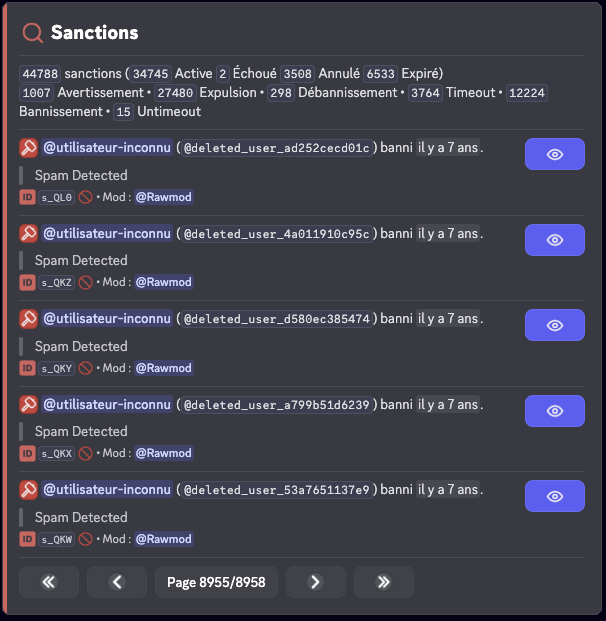
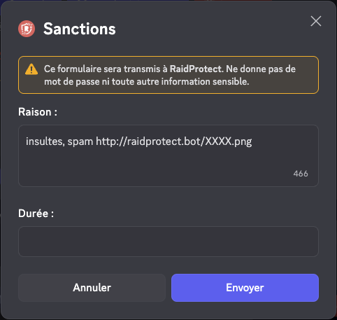
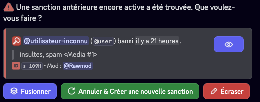
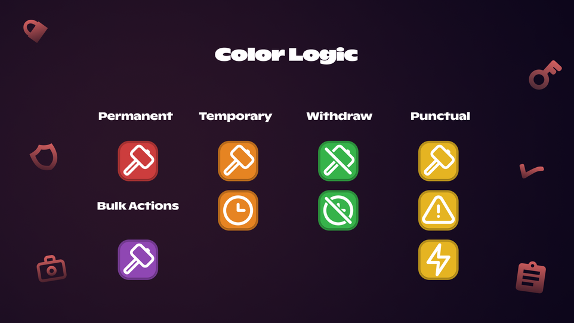

import Settings, { SettingsModal } from '@site/src/components/DiscordMessage/mockups/v2';

import SanctionsMockup from '@site/src/components/DiscordMessage/mockups/sanctions';

{/* <SanctionsMockup /> geçici olarak gizli: mockup iyileştirilecek */}

import Icon from "@site/src/components/Icon";

RaidProtect'in yaptırım geçmişi, sunucunuzda uygulanan tüm [yaptırımları](/tr/learn/discord-sanctions) takip etmenizi ve yönetmenizi sağlar. Bu sistem tüm moderasyon eylemlerini görüntülenebilir ve değiştirilebilir bir veritabanında toplayarak moderasyon ekibinizin işini kolaylaştırır.

## ❓ Geçmiş nasıl çalışır {#working}

Yaptırım geçmişi, sunucunuzda yapılan tüm moderasyon eylemlerini otomatik olarak kaydeder:

- **Manuel yaptırımlar**: tüm [moderasyon komutları](./moderation.mdx) (`/ban`, `/tempban`, `/kick`, `/mute`, `/jail`, `/warn`…) geçmişe kaydedilir.
- **Otomatik yaptırımlar**: koruma modüllerimizin ([anti-spam](./anti-spam.mdx), [HoneyPot](./honeypot.md), [ScamLens](./scam-images.md)…) uyguladığı yaptırımlar da geçmişe eklenir.
- **Yasaklamalar, atmalar ve timeout'lar**: RaidProtect üzerinden geçmeden uygulanan yaptırımlar geçmişe eklenir.
- **Discord AutoMod**: Discord AutoMod'un uyguladığı timeout'lar kaydedilir. Bir AutoMod kuralı tarafından engellenen her mesaj ayrıca “**Discord Automod**” adına, sessiz (DM yok) bir **uyarı** oluşturur; kural zaten bir timeout uygulamıyorsa.
- **Yaptırım bildirimleri**: yaptırım uygulanan üyeler yaptırımı ve sebebini bildiren bir özel mesaj alır. Bot ayrıca gönderim durumunu doğrulayan ayrıntılı bir alındı bildirimi gönderir: **alındı**, **DM kapalı**, **süresi doldu** veya **sessiz** (`[--silent]` seçeneği kullanıldığında). Kick, softban ve geçici ban için bu mesaj ayrıca, üyenin yaptırım bittikten sonra geri dönebilmesi için **sunucuya bir davet içeren bir düğme** de barındırır.

:::info
Kaydedilen tüm yaptırımlar şunları içerir: yaptırım uygulanan kullanıcı, sorumlu moderatör, sebep (en fazla 512 karakter), tarih ve saat, yaptırım türü ve kullanıcının bilgilendirilip bilgilendirilmediği.
:::

## 🔍 Yaptırımları arama {#search}

`/sanctions search` komutu, geçmişte çeşitli ölçütlere göre yaptırım aramanızı sağlar.

Şu komutu kullanın: ```/sanctions search [user] [moderator] [type] [reason] [date] [status] [moderator_type]```

- `[user]`: belirli bir kullanıcının tüm yaptırımlarını arar. Bu hesap bir [çift hesap](./alt-accounts.md) grubunun parçasıysa bağlı hesapların yaptırımları da görünür.
- `[moderator]`: belirli bir moderatörün uyguladığı tüm yaptırımları arar.
- `[type]`: yaptırım türüne göre filtreler (Yasaklama, Yasak kaldırma, Atma, Hapsetme, Serbest bırakma, Karantina, Timeout, Timeout kaldırma, Susturma, Susturma kaldırma, Uyarı).
- `[reason]`: sebebe göre filtreler (kısmi eşleşme).
- `[date]`: yaptırımın tarihine göre filtreler.
- `[status]`: yaptırımın durumuna göre filtreler (Aktif, Süresi doldu, İptal edildi).
- `[moderator_type]`: moderatör türüne göre filtreler (İnsan işlemleri, Otomatik işlemler, RaidProtect işlemleri, Discord işlemleri, Antispam, Süre dolumu, Antiscam, HoneyPot, Discord Automod, Discord Süre Dolumu).



:::tip
Aramanızı daraltmak için birkaç ölçütü birleştirebilirsiniz. Örneğin belirli bir moderatörün yaptığı tüm yasaklamaları aramak.
:::

## ℹ️ Bir yaptırımı görüntüleme {#info}

`/sanctions info` komutu, belirli bir yaptırım hakkında ayrıntılı bilgi almanızı sağlar.

Şu komutu kullanın: ```/sanctions info (id)```

`(id)` yerine görüntülemek istediğiniz yaptırımın kimliğini yazın.


## ✏️ Bir yaptırımı değiştirme {#edit}

`/sanctions edit` komutu, mevcut bir yaptırımın sebebini veya süresini değiştirmenizi sağlar; bir hatayı düzeltmek veya ayrıntı eklemek için yararlıdır.

Şu komutu kullanın: ```/sanctions edit (id) [reason] [duration]```

`(id)` yerine değiştirilecek yaptırımın kimliğini, `[reason]` yerine yeni sebebi (en fazla 512 karakter) ve `[duration]` yerine yeni süreyi (örn.: `1d 2h`) yazın.



:::warning
Bir yaptırımı değiştirmek geçmişteki kaydı günceller ama Discord'da uygulanan yaptırımı değiştirmez (örneğin yasaklanmış bir kullanıcı yasaklı kalır).
:::

## 🗑️ Bir yaptırımı silme {#delete}

`/sanctions delete` komutu, bir yaptırımı geçmişten silmenizi sağlar. Bu eylem geri alınamaz.

Şu komutu kullanın: ```/sanctions delete (id) [reason]```

`(id)` yerine silinecek yaptırımın kimliğini yazın. `[reason]` parametresi, loglara kaydedilecek **silmenin gerekçesini belirtmeyi** sağlar.


## Yaptırım durumları {#status}

Yaptırımlar farklı durumlara sahip olabilir:

| **Durum**     | **Emojiler**                                                                                                                | **Anlamları**                                             |
| ------------- | ----------------------------------------------------------------------------------------------------------------------------| --------------------------------------------------------- |
| `Aktif`       | <Icon src="/img/icons/SanctionStatusACTIVE.svg" alt="icon SanctionStatusACTIVE" title=":iconSanctionStatusACTIVE:"/>        | Yaptırım sürüyor.                                         |
| `Süresi doldu`| <Icon src="/img/icons/SanctionStatusEXPIRED.svg" alt="icon SanctionStatusEXPIRED" title=":iconSanctionStatusEXPIRED:"/>     | Yaptırımın süresi doldu.                                  |
| `İptal edildi`| <Icon src="/img/icons/SanctionStatusCANCELED.svg" alt="icon SanctionStatusCANCELED" title=":iconSanctionStatusCANCELED:"/>  | Yaptırım bir moderatör tarafından iptal edildi.           |
| `Başarısız`   | <Icon src="/img/icons/SanctionStatusFAILED.svg" alt="icon SanctionStatusFAILED" title=":iconSanctionStatusFAILED:"/>        | Yaptırım başarısız oldu (izin eksikliği).                 |

### Kopyaların yönetimi {#duplicates}

Daha önceki bir aktif yaptırım bulunduğunda şunları yapabilirsiniz:

- İki yaptırımı **Birleştir**: süreler mümkünse toplanır ve sebepler birleştirilir.
- Aktif yaptırımı **İptal** edip yeni bir yaptırım oluştur.
- Aktif yaptırımı girilen yaptırımın bilgileriyle **Değiştir**.



## ⚙️ Cezaların yapılandırması {#config}

Cezaların tüm ayarları tek bir ekranda bulunur:

1. [`/settings` komutunu](../setup.md#settings) çalıştırın.
2. “**Moderasyon**” sekmesini açın.
3. “**Cezalar**” yanındaki “**Yapılandır**” düğmesine tıklayın.

<Settings start="sanctions" />

### Cezaları devre dışı bırakma {#disable}

Sunucunuzdaki **ceza sistemini tamamen devre dışı bırakabilirsiniz**. Cezalar devre dışı olduğunda RaidProtect geçmişe hiçbir yaptırım kaydetmez ve ilgili komutlar kullanılamaz.

1. [`/settings` komutunu](../setup.md#settings) çalıştırın.
2. “**Moderasyon**” sekmesini açın.
3. “**Cezalar**” yanındaki “**Yapılandır**” düğmesine tıklayın.
4. Ekran başlığının sağındaki “**Devre dışı bırak**”a tıklayın (yeniden açmak için “**Etkinleştir**”).

### Jail {#jail}

Klasik bir mute'tan daha kısıtlayıcı, rol tabanlı bir moderasyon yaptırımını etkinleştirmek için **Jail**'i yapılandırın. Yapılandırıldıktan sonra bu rol, bir üyeyi güçlü biçimde sınırlanmış izinlerle izole etmeyi sağlar ve [`/jail`](./moderation.mdx#jail) ile [`/tempjail`](./moderation.mdx#tempjail) komutlarının kullanımının kilidini açar.

1. [`/settings` komutunu](../setup.md#settings) çalıştırın.
2. “**Moderasyon**” sekmesini açın.
3. “**Cezalar**” yanındaki “**Yapılandır**” düğmesine tıklayın.
4. “**Jail**” yanındaki “**Düzenle**” düğmesine tıklayın.
5. Seçiciden mevcut bir rol seçin ya da “**Benim için bir tane oluştur**”a tıklayın.

<Settings start="jail" />

“**Benim için bir tane oluştur**” düğmesi, rolü adlandırdığınız (varsayılan `Hapsedilmiş`) ve jail'deki üyelere ayrılmış **bilgi kanalını** yapılandırdığınız bir pencere açar:

- **Mevcut bir kanal seçin**: mevcut görünürlüğünü korur.
- Bir ad girerek **yeni bir kanal oluşturun** (varsayılan `kısıtlı-erişim`).

Rolden sunucunun kanallarını görme iznini kaldırırız. Bilgi kanalında jail'deki üyeler mesajı ve geçmişi okuyabilir ama yazamaz, tepki veremez ve alt başlık oluşturamaz. Bu kanal, Jail yapılandırması tarafından otomatik olarak yönetilen, [bilgi panellerindeki](./display.mdx) ayrılmış yuvaya karşılık gelir.

:::info
Bir Jail rolü zaten yapılandırılmışsa bilgi kanalını Jail ekranındaki “**Kanalı düzenle**” düğmesiyle değiştirebilirsiniz.
:::

:::warning
Jail rolü bazı kanalları hâlâ gösteriyorsa Jail ekranı bunları bir kutuda listeler: bu kanallarda ona `Kanalı Görüntüle` iznini reddedin ya da “**Benim için bir tane oluştur**” ile yeni bir rol oluşturun. Jail veya Mute rolüne dayanan aktif yaptırımlar sürdükçe rolü değiştiremezsiniz: bu yaptırımları kaldırın veya sürelerinin dolmasını bekleyin.
:::

:::info
Jail rolü olmadan `/jail` ve `/tempjail` komutları kullanılamaz. Otomatik modüller ([anti-spam](./anti-spam.mdx), [HoneyPot](./honeypot.md), [sahte bildiriciler](./reports.md#bad-reporters)) yine de Jail ve Mute seçeneklerini “**Yapılandırılmamış, Timeout cezasına döner**” notuyla sunar: uygulanan yaptırım bu durumda bir timeout'tur.
:::

#### Jail sırasındaki roller {#jail-roles}

Jail ekranında “**Jail sırasında rol yönetimi**” seçicisi, bir üye hapsedildiğinde RaidProtect'in üyenin rolleriyle ne yapacağını belirler. İki mod:

- “**Jail rolünü ekle**” *(varsayılan)*: üye rollerini korur, jail rolü eklenir.
- “**Tüm rolleri değiştir**”: hapis süresince **üyenin tüm rollerini kaldırırız** ve serbest bırakıldığında onları geri yükleriz. Daha katıdır; açık izinleri olan bir rolün Jail rolünün kısıtlamalarını atlatmasını önler.

### Senkronize Discord karantinası {#discord-quarantine}

Discord AutoMod, profili bir kuralı ihlal eden (takma ad, sunucu etiketi) bir üyeyi karantinaya alabilir. Bu ayarla bu karantinayı izleriz: üye **jail rolünü** alır ve geçmişe bir **Karantina** yaptırımı kaydedilir. Discord karantinayı kaldırdığı anda üye karantinadan çıkar.

1. [`/settings` komutunu](../setup.md#settings) çalıştırın.
2. “**Moderasyon**” sekmesini açın.
3. “**Cezalar**” yanındaki “**Yapılandır**” düğmesine tıklayın.
4. “**Senkronize Discord karantinası**” yanındaki “**Etkinleştir**”e tıklayın.

:::info
Bu ayar bir [Jail rolü](#jail) gerektirir. Devre dışı bırakmak, koyduğu karantinaları serbest bırakır.
:::

### Yasaklamada mesajların silinmesi {#ban-delete}

“**Cezalar**” ekranında, “**Yasaklamada mesajların silinmesi**” seçicisi `/ban`, `?ban` veya `/tempban` ile `--delete-messages` belirtmeden yasakladığınızda varsayılan olarak silinen geçmişi belirler. “**Silme yok**” (varsayılan), 1 saat, 6 saat, 12 saat, 1 gün, 3 gün veya 7 gün seçin. Komutta verilen bir değer önceliklidir.

### Mute {#mute}

Uzun süreler için Discord timeout'u yerine rol tabanlı bir yaptırım kullanmak üzere **Mute rolünü** yapılandırın. Mute süresi tanımlanan eşiği aştığında bot, Discord timeout'u uygulamak yerine ilgili üyeye otomatik olarak Mute rolünü verir.

1. [`/settings` komutunu](../setup.md#settings) çalıştırın.
2. “**Moderasyon**” sekmesini açın.
3. “**Cezalar**” yanındaki “**Yapılandır**” düğmesine tıklayın.
4. “**Mute**” yanındaki “**Düzenle**” düğmesine tıklayın.
5. “**Mute rolü**” seçicisinde mevcut bir rol seçin ya da “**Benim için bir tane oluştur**”a tıklayın (`Susturulmuş` rolünü oluştururuz ve tüm kanallarda yazma iznini kaldırırız).

#### Mute eşiği {#mute-threshold}

**Mute eşiği**, rolle aynı ekranda ayarlanır. Botun hangi süreden itibaren Discord timeout'u yerine Mute rolünü kullanacağını tanımlar.

1. Mute ekranında “**Mute Eşiği**” seçicisini açın.
2. “**Her zaman**”, “**1 saat**” (varsayılan), “**1 gün**”, “**Uzatılmış timeout (=28 gün)**” veya “**Özel değer**” (0 ile 28 gün arası, örn.: `3d 1h 15m`) seçin.

“**Her zaman**” (0 değeri) Discord timeout'unu asla kullanmaz: her mute rolden geçer.

:::info
Timeout için 28 günlük sınır Discord tarafından dayatılır. Bu sürenin ötesinde, yapılandırılmışsa Mute rolü sistematik olarak kullanılır. [`/mute` komutunun](./moderation.mdx#timeout) `[--force-timeout]` seçeneği, eşiğe rağmen Discord timeout'unu zorlar.
:::

:::info
**Discord AutoMod'un uyguladığı timeout'lar**, süreleri yapılandırılan eşiği aşarsa manuel yaptırımlarınızla tutarlılığı sağlamak için otomatik olarak rol tabanlı mute'a dönüştürülür.
:::

### Cezaların Gizliliği {#sanctions-privacy}

Üyelerin **kendi yaptırımları** hakkında erişebilecekleri bilgileri, [`/yaptirimlarim`](./utilities.mdx#my-sanctions) komutu veya **Yaptırımlarımı görüntüle** düğmesi aracılığıyla denetlemek için yaptırımların gizlilik düzeyini yapılandırın.

1. [`/settings` komutunu](../setup.md#settings) çalıştırın.
2. “**Moderasyon**” sekmesini açın.
3. “**Cezalar**” yanındaki “**Yapılandır**” düğmesine tıklayın.
4. “**Cezaların Gizliliği**” yanındaki “**Düzenle**” düğmesine tıklayın.
5. Pencerede istediğiniz “**Erişim seviyesi**”ni seçin:

| **Seviye**                           | **Açıklama**                                                                                        |
| ------------------------------------ | --------------------------------------------------------------------------------------------------- |
| Devre dışı *(varsayılan)*            | Kullanıcılar cezalarını görüntüleyemez.                                                             |
| Yalnızca cezalar                     | Kullanıcılar yalnızca cezalarını ve varsa kalan süreyi görüntüleyebilir.                            |
| Sebeplerle birlikte                  | Kullanıcılar cezalarını ve sebebini, moderatörün kimliği olmadan görüntüleyebilir.                  |
| Sebepler ve moderatörlerle birlikte  | Kullanıcılar cezalarıyla ilgili her şeyi görüntüleyebilir.                                          |

<SettingsModal name="sanctionsPrivacy" />

:::note
Seçilen düzey ne olursa olsun **moderatörler**, moderasyon araçları aracılığıyla yaptırım geçmişine **tam erişimlerini korur**.
:::

### Medyaları göster {#show-medias}

Yaptırım sebeplerinde medyaların gösterimini yapılandırın. Bu seçenek devre dışı olduğunda (varsayılan), aşağıdaki uzantıları içeren bağlantılar, üyelere gösterilirken ([`/yaptirimlarim`](./utilities.mdx#my-sanctions) veya yaptırım bildirimleri aracılığıyla) yaptırım sebeplerinden otomatik olarak kaldırılır:

`png`, `jpg`, `jpeg`, `gif`, `webp`, `webm`, `mp4`

1. [`/settings` komutunu](../setup.md#settings) çalıştırın.
2. “**Moderasyon**” sekmesini açın.
3. “**Cezalar**” yanındaki “**Yapılandır**” düğmesine tıklayın.
4. “**Medyaları göster**” yanındaki “**Etkinleştir**”e veya “**Devre dışı bırak**”a tıklayın.

## ✨ Cezaların isimleri <span className="badge-premium">Premium</span> {#custom-names}

[Premium](/tr/premium) sürümle, her yaptırım türünün adını sunucunuzun kelime dağarcığına uyacak şekilde özelleştirebilirsiniz. Özel adlar; loglarda, aramalarda ve menülerde varsayılan adların yerini alır. Her tür için şunları yapılandırabilirsiniz:

- **İsim**: varsayılan adı seçtiğiniz adla değiştirin, en fazla 32 karakter (örn.: “Uyarı” → “Sarı Kart”).
- **Fiil**: mesajlarda kullanılan fiili tanımlayın, en fazla 32 karakter (örn.: “kart gösterildi”). Boş bırakılırsa isim kullanılır.
- **DM modu**: yaptırım uygulanan üyeye gönderilen özel mesajın ifadesini seçin:
  - “[fiil]” (varsayılan)
  - “Bir [isim] aldınız”

Özelleştirilebilir yaptırım türleri şunlardır: Yasaklama, Softban, Yasak kaldırma, Atma, Hapsetme, Serbest bırakma, Timeout, Timeout kaldırma, Susturma, Susturma kaldırma ve Uyarı.

1. [`/settings` komutunu](../setup.md#settings) çalıştırın.
2. “**Moderasyon**” sekmesini açın.
3. “**Cezalar**” yanındaki “**Yapılandır**” düğmesine tıklayın.
4. “**Cezaların isimleri**” düğmesine tıklayın.
5. Seçicide özelleştirilecek yaptırım türünü seçin, ardından pencerede ismi, fiili ve DM modunu girin.

<Settings start="sanctionNames" />

Ekrandaki “**Dışa aktar**” ve “**İçe aktar**” düğmeleri, adlarınızı bir JSON dosyasına kaydetmeyi ve ardından yeniden yapıştırmayı (“**JSON içeriğini yapıştırın**” alanı) sağlar; örneğin bunları başka bir sunucuda kullanmak için.

:::tip
Bir yaptırım türünü varsayılan adına sıfırlamak için alanları boş bırakın. “**Hepsini sıfırla**” düğmesi tüm adları sıfırlar.
:::

## 📨 İtiraz bağlantısı <span className="badge-premium">Premium</span> {#appeal}

**İtiraz bağlantısı**, yaptırım uygulanan üyelerin yaptırımlarına itiraz etmesini sağlar: uyarılar dışındaki tüm yaptırımların DM'lerine bağlantınıza giden bir düğme eklenir.

1. [`/settings` komutunu](../setup.md#settings) çalıştırın.
2. “**Moderasyon**” sekmesini açın.
3. “**Cezalar**” yanındaki “**Yapılandır**” düğmesine tıklayın.
4. “**İtiraz bağlantısı**” düğmesine tıklayın.
5. Pencereye bağlantınızı yapıştırın ya da kaldırmak için alanı boşaltın.

Kabul edilen platformlar: Discord, Google Forms, appeal.gg, Appy, DraftBot ve FlaviBot.

:::info
“**İtiraz bağlantısı**” düğmesi yalnızca [Premium](/tr/premium) sunucularda görünür.
:::

## 🔗 Çift hesaplar <span className="badge-experiment">Deneme</span> {#alt}

Identity Update ile deneme aşamasında ([Premium](/tr/premium) herkese açık beta), aynı kişinin kullandığı hesaplar `/alt` komutuyla bağlanabilir: birini yasaklamak diğerlerini de yasaklar ve her yaptırım ayarlarınıza göre gruba yayılır. Her şey [Çift hesaplar](./alt-accounts.md) sayfasında açıklanır.

## 📊 Yaptırım logları {#logs}

Daha iyi bir düzen için genel loglarınızdan ayrı, yalnızca yaptırımlara ayrılmış bir log kanalı yapılandırabilirsiniz.


### Yaptırım log kanalını yapılandırma {#config-logs}

1. [`/settings` komutunu](../setup.md#settings) çalıştırın.
2. “**Moderasyon**” sekmesini açın.
3. “**Cezalar**” yanındaki “**Yapılandır**” düğmesine tıklayın.
4. “**Loglar**” yanındaki “**Düzenle**” düğmesine tıklayın.
5. Yaptırım loglarının gönderileceği kanalı seçin ya da “**Benim için bir tane oluştur**” düğmesini kullanın.

Aynı ayarı, diğer log kanallarıyla birlikte “**Moderasyon**” sekmesinin “**Loglar**” ekranında da bulursunuz ([moderasyon loglarına](./moderation.mdx#logs) bakın). Özel bir kanal yoksa yaptırım logları genel log kanalına gider.

:::note
“**Pasif moderasyon logları**” anahtarı (varsayılan olarak etkin), RaidProtect'in bot üzerinden geçmeden yapılan eylemleri (Discord'dan ban, Discord AutoMod…) de kaydedip kaydetmeyeceğini seçer.
:::

### Renk mantığı {#logs-color}



## 📦 Yaptırımları içe / dışa aktarma {#import-export}

RaidProtect, sunucunuzun yaptırım geçmişini içe veya dışa aktarmanızı sağlar. Yaptırımlar ekranındaki “**Dışa aktar**” ve “**İçe aktar**” düğmeleri sizi [destek sunucumuza](https://raidprotect.bot/discord) yönlendirir: sunucunuzun davetini ve içe aktarma için kullandığınız moderasyon botunu (botlarını) belirterek bizimle iletişime geçin.

## Sık sorulan sorular {#faq}

### /jail komutu neden kullanılamıyor?

Bir Jail rolü gerektirir. Bunu `/settings` içinde “**Moderasyon**” sekmesi, “**Cezalar**”, ardından “**Jail**” yanındaki “**Düzenle**”den yapılandırın ya da RaidProtect'in bir tane oluşturmasına izin verin.

### Bir otomatik modül Jail rolü olmadan bir üyeyi hapsetmek zorunda kalırsa ne olur?

Yaptırım bir timeout'a döner. Mute rolü olmayan Mute için de aynısı geçerlidir.

### Bir üye kendi yaptırımlarını görebilir mi?

Evet, [yaptırımların gizliliğini](#sanctions-privacy) “**Devre dışı**” dışında bir düzeye ayarlarsanız. Bu durumda onları `/yaptirimlarim` ile görüntüler.

### Discord AutoMod tarafından engellenen mesajlar yaptırım sayılır mı?

Evet: engellenen her mesaj, kural zaten bir timeout uygulamıyorsa “**Discord Automod**” adına sessiz bir uyarı oluşturur. Bu uyarılar yalnızca pasif moderasyon logları etkinse kaydedilir.
