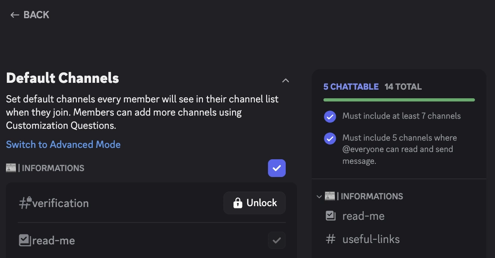

import Settings from '@site/src/components/DiscordMessage/mockups/v2';

`#doğrulama` kanalı yeni üyeler için varsayılan olarak görünür değilse [captcha](../features/captcha.md)'yı geçemezler ve takılı kalırlar. Bu rehber, **Discord'un Karşılama Süreci** ile ilgilidir (Sunucu Ayarları > Karşılama Süreci). RaidProtect'in karşılama mesajı ve otomatik rolleri için [Katılımlar ve karşılama](../features/onboarding.md) sayfasına bakın.

Çoğu durumda RaidProtect sorunu sizin yerinize düzeltir: 1. adımla başlayın.

## 1️⃣ RaidProtect'in düzeltmesine izin verin {#auto-fix}

1. [`/settings` komutunu](../setup.md#settings) çalıştırın.
2. “**Katılımlar**” sekmesini açın.
3. “**Captcha**” yanındaki “**Yapılandır**” düğmesine tıklayın.
4. Bir kutu doğrulama kanalının **varsayılan olarak görünür olmadığını** bildiriyorsa şuna tıklayın:
   - Kanalı yeni üyelerin zaten görebildiği bir kategoriye yerleştirmek için “**Şuraya taşı:** _kategori_”;
   - ya da varsayılan kanallara eklenen bir “Hoş geldiniz” kategorisini bizim oluşturmamız için “**Yeni kategori oluştur**”.

Kanalın izinleri taşıma sırasında korunur.

<Settings start="captcha" />

:::tip
Aynı ekran, `@Doğrulanmamış` rolünün **sızıntılarını** da bildirir: Discord Karşılama Süreci tarafından verilen ve doğrulamayı atlatan roller, doğrulamadaki üyelere hâlâ görünen kanallar. “**Düzelt**” düğmesi ilgili kanalları kapatır. [Captcha ekranının uyarılarına](../features/captcha.md#alerts) bakın.
:::

## 2️⃣ Kanalın izinlerini kontrol edin {#permissions}

RaidProtect, `#doğrulama` kanalının ve `@Doğrulanmamış` rolünün izinlerini kendisi ayarlar. Bunları değiştirdiyseniz kontrol edin:

1. `#doğrulama` kanalının ayarlarını açın (sağ tık > **Kanalı düzenle**).
2. **İzinler** sekmesinde:
   - `@everyone` rolünün kanalı görme iznine **sahip olmadığından** emin olun.
   - `@Doğrulanmamış` rolünün **kanalı görme** ve **eski mesajları görme** iznine **sahip olduğunu** doğrulayın.
   - Varsayılan mod olan **Panel (Etkileşimli)** modunda `@Doğrulanmamış` rolü mesaj **gönderememelidir**: kod bir pencerede girilir. **Meydan okuma (Klasik)** modunda ise kodu yazmak için **mesaj gönderebilmelidir**.

{/*  : “Mesaj Gönder” izinli gösteriliyor, yalnızca Meydan okuma modunda doğru */}

## 3️⃣ Karşılama kategorisini kontrol edin {#default-category}

Elle düzeltmeyi tercih ediyorsanız:

1. **Sunucu Ayarları** > **Karşılama Süreci** bölümüne gidin.
2. **Varsayılan Kanallar** bölümünde, `#doğrulama` kanalını içeren kategorinin yeni üyelere görünür olarak işaretlendiğinden emin olun.
3. Gerekirse `#doğrulama` kanalını işaretli bir kategoriye taşıyın.
4. Değişiklikleri kaydedin.

## 4️⃣ Yapılandırmayı RaidProtect'te yenileyin {#refresh-config}

1. [`/settings` komutunu](../setup.md#settings) çalıştırın.
2. “**Katılımlar**” sekmesini açın.
3. “**Captcha**” yanındaki “**Yapılandır**” düğmesine tıklayın.
4. Bir kutu hâlâ görüntüleniyorsa kontrolü yeniden başlatmak için “**Yenile**”ye tıklayın. Kutu kaybolduğunda captcha düzgün çalışıyordur.

## 5️⃣ Bir test hesabıyla deneyin {#test-account}

Her şeyin doğru yapılandırıldığını doğrulamak için:

1. Başka bir Discord hesabıyla sunucuya katılın.
2. `#doğrulama` kanalının katılımda görünür olduğunu kontrol edin.
3. “**Doğrula**”ya tıklayıp kodu girin (Panel modu) veya kodu kanala yazın (Meydan okuma modu).
4. Doğrulandıktan sonra hesabın diğer kanallara erişimi olmalıdır.

## 🛠️ Sık karşılaşılan sorunlar ve çözümleri {#common-issues}

| Sorun | Çözüm |
|---------|----------|
| 🔴 `#doğrulama` kanalı görünmez kalıyor | Captcha ekranında “**Şuraya taşı:** _kategori_”ye tıklayın veya kanalı Discord karşılama sürecinde **işaretli bir kategoriye** koyun. |
| 🚫 `@Doğrulanmamış` rolü yazamıyor | Panel modunda normaldir: üye “**Doğrula**”ya tıklar. Meydan okuma modunda ona `#doğrulama` kanalında **mesaj gönderme izni** verin. |
| 🔓 Doğrulanmamış bir üye başka kanalları görüyor | Captcha ekranındaki sızıntı kutusunda “**Düzelt**”e tıklayın ve Discord Karşılama Sürecinin katılımda verdiği rolleri kaldırın. |
| ❌ Captcha değişiklikten sonra çalışmıyor | Captcha ekranında “**Yenile**”ye tıklayın (`/settings` komutunun “**Katılımlar**” sekmesi). |

---

✅ Bu adımları izleyerek doğrulama sisteminiz, üyeleri güvenle karşılamak ve botları ya da baskınları etkili biçimde engellemek için tamamen çalışır durumda olacaktır.
