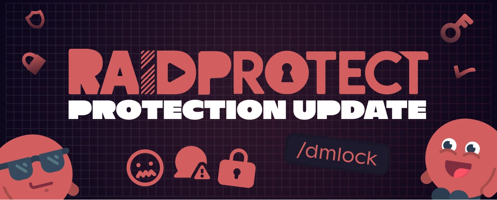

Phiên bản 3.2.0 đánh dấu một bước tiến lớn cho sự an toàn của cộng đồng Discord của bạn với sự ra mắt của Đóng tin nhắn riêng – một lá chắn chưa từng có chống lại spam, scam và lừa đảo qua tin nhắn riêng.

<!--truncate-->

## 🛡️ Chấm dứt scam qua tin nhắn riêng! {#new}

Bảo vệ các thành viên của bạn bằng cách tự động chặn việc nhận tin nhắn riêng với [Đóng tin nhắn riêng](/docs/features/dm-lock). Các trường hợp sử dụng điển hình:

- Các đợt spam tự động trong các sự kiện (ra mắt sản phẩm, cuộc thi, thời điểm đông người truy cập).
- Các nỗ lực scam nhắm vào thành viên, đặc biệt trên các máy chủ công khai có lưu lượng lớn.
- Các hành vi không phù hợp đối với trẻ vị thành niên hoặc các cộng đồng nhạy cảm.
- Các cuộc tấn công có phối hợp trong những sự kiện quan trọng (raid, chiến dịch phishing).

Tất cả đều được tự động hóa, không có nguy cơ quên thao tác thủ công, đảm bảo bảo vệ liên tục cho máy chủ của bạn.

---

## ✨ Các điểm mới khác của 3.2.0 {#changelog}

- **Lựa chọn [hình phạt chống spam](/docs/features/anti-spam#triggers)**: Xác định chính xác cách RaidProtect phản ứng với các loại spam khác nhau (đuổi, cấm...), để việc kiểm duyệt hoàn toàn phù hợp với cộng đồng của bạn.
- **[Nhật ký chống spam](/docs/features/anti-spam#logs) mới**: Thấy rõ hơn những gì được phát hiện và khi nào, để nắm quyền kiểm soát chỉ trong nháy mắt.
- **[Tuổi tối thiểu](/docs/features/raid-mode#minage) của tài khoản không cần captcha**: Lọc trực tiếp các thành viên mới có tài khoản quá mới, ngay cả khi captcha chưa được bật.
- **Lệnh [`/bypass minage`](/docs/features/raid-mode#bypass-minage)**: Chấp nhận thủ công một thành viên chưa đủ tuổi tài khoản yêu cầu, tiện lợi cho các trường hợp ngoại lệ.
- **Thiết kế lại hoàn toàn [`/userinfo`](/docs/features/utilities#userinfo)**: Giao diện được cải thiện, thông tin đầy đủ và rõ ràng hơn.
- **Nhật ký cấu hình**: Truy vết tốt hơn mỗi khi có thay đổi lớn trong cấu hình bot.

---

Để xem danh sách đầy đủ các điểm mới, bản sửa lỗi và chi tiết kỹ thuật, hãy xem [nhật ký thay đổi](/docs/changelog#3-2-0).

:::tip 📚 Tài nguyên hữu ích
- 🔗 [Thêm RaidProtect vào máy chủ của bạn](https://raidprotect.bot/invite)
- 📘 [Xem tài liệu đầy đủ](https://docs.raidprotect.bot/)
- 💡 [Gửi đề xuất hoặc phản hồi](https://suggestions.raidprotect.bot/)
- 📣 [Theo dõi thông báo và tham gia cộng đồng](https://raidprotect.bot/discord)
:::
