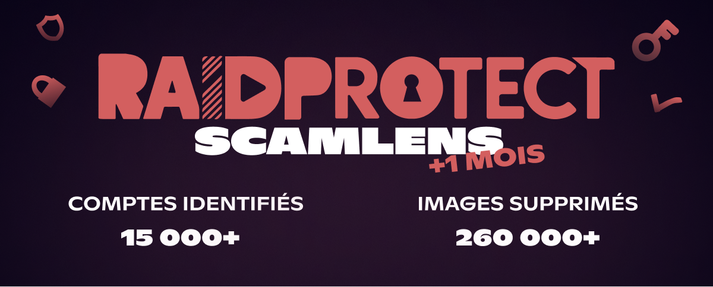
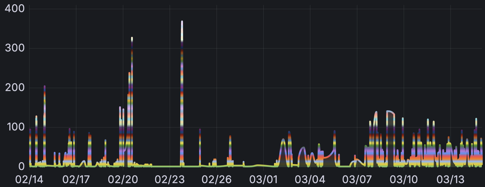

import Timestamp from '@site/src/components/Timestamp';

Một tháng sau khi [kích hoạt sớm ScamLens](/vi/blog/scamlens-early-activation), đây là những số liệu thống kê đầu tiên về việc phát hiện hình ảnh lừa đảo trên Discord, cùng một vài điểm mới.

{/* truncate */}

## 🔎 ScamLens là gì? {#what-is-scamlens}

ScamLens là **mô-đun chống lừa đảo của RaidProtect**. Nó tự động phân tích các hình ảnh được gửi trên máy chủ Discord của bạn và **xóa những hình ảnh được xác định là lừa đảo** — không cần bất kỳ cấu hình nào. Nó chủ yếu nhắm vào các trò lừa đảo về **tiền mã hóa**, **sòng bạc crypto** và **đầu tư giả**, được phát tán hàng loạt qua các tài khoản Discord bị hack.

Đây là hình dạng của những hình ảnh đó:

  
  
  
  

## 📊 Tổng kết sau 1 tháng {#stats}

Kể từ ngày <Timestamp value={1771023600} format="D" />, ScamLens liên tục phân tích các hình ảnh được gửi trên toàn bộ 340.000 máy chủ Discord được RaidProtect bảo vệ. Dưới đây là các con số:

| **Chỉ số** | **Số liệu** |
|---|---|
| Hình ảnh đã phân tích (duy nhất) | **162.000** |
| Hình ảnh lừa đảo bị phát hiện (duy nhất) | **62.000** |
| Hình ảnh lừa đảo đã bị xóa | **260.000** |
| Tài khoản đã được xác định | **15.000** |

**Cứ ba hình ảnh được phân tích thì có hơn một hình là lừa đảo.**

Không giống [các đợt ban đầu](/vi/blog/scamlens-early-activation#threat) vốn biểu hiện bằng **những đỉnh lớn và tập trung** trong các khung 1 giờ, hoạt động trong một tháng trải rộng hơn nhiều theo thời gian. Số lần phát hiện vẫn nhiều, nhưng phân bố liên tục thay vì dồn lại trong vài đợt cao điểm dữ dội.

---

## 🆕 Điểm mới {#updates}

### 🪵 Nhật ký phát hiện {#logs}

ScamLens giờ đây có **nhật ký riêng**: mỗi lần phát hiện một hình ảnh lừa đảo sẽ tạo ra một tin nhắn trong kênh nhật ký của bạn, kèm thành viên liên quan và (các) kênh bị nhắm đến. Bạn biết chính xác bot đã chặn những gì, không cần cấu hình thêm.

### 🔍 Phạm vi bao phủ mở rộng {#coverage}

Một số hình ảnh trước đây lọt qua khâu phân tích do cách chúng được CDN của Discord phân phối. ScamLens giờ đây đã bao phủ cả những trường hợp này.

---

## ❓ FAQ {#faq}

#### Vì sao các hình ảnh lừa đảo xuất hiện trên máy chủ Discord của tôi? {#pourquoi-scam-images}
Những hình ảnh này được gửi bởi **các tài khoản Discord bị hack**. Những kẻ lừa đảo chiếm quyền các tài khoản, rồi dùng chúng để spam càng nhiều máy chủ càng tốt cùng một lúc. Máy chủ của bạn **không bị nhắm đến một cách cụ thể** — nó chỉ là một phần trong số đó. Một tài khoản bị hack duy nhất có thể tiếp cận **hàng chục máy chủ chỉ trong vài giây**, vì thế việc xóa tự động là rất quan trọng.

#### Làm thế nào để bảo vệ máy chủ Discord của tôi khỏi lừa đảo? {#proteger-serveur-scam-discord}
[Thêm RaidProtect](https://raidprotect.bot/invite) vào máy chủ của bạn. ScamLens được bật mặc định và tự động xóa các hình ảnh bị phát hiện là lừa đảo, không cần bất kỳ cấu hình nào.

#### Hình ảnh lừa đảo có thay đổi để né tránh việc phát hiện không? {#evolution-scam}
Có, các kỹ thuật thay đổi thường xuyên. ScamLens được cập nhật liên tục để theo kịp những thay đổi này.

---

:::tip 📚 Tài nguyên hữu ích
- 🔗 [Thêm RaidProtect vào máy chủ của bạn](https://raidprotect.bot/invite)
- 📘 [Xem tài liệu đầy đủ](https://docs.raidprotect.bot/)
- 💡 [Gửi đề xuất hoặc phản hồi](https://suggestions.raidprotect.bot/)
- 📣 [Theo dõi thông báo và tham gia cộng đồng](https://raidprotect.bot/discord)
:::
