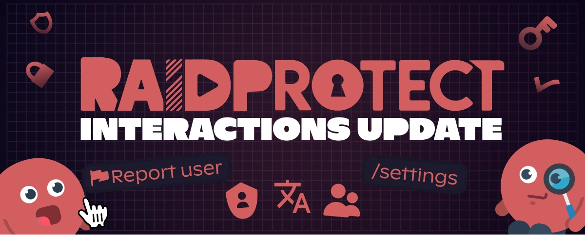

距离上一次为 RaidProtect 推出重大更新已经有一段时间了，我们为这段漫长的等待深表歉意。过去几个月里，我们一直在努力实现机器人体验的现代化与改进；今天，我们很高兴为您带来 **Interactions Update**！

<!--truncate-->

## ✨ 有哪些变化（而且变化很大） {#new}

此次更新标志着 RaidProtect 运作方式的一个转折点，重点放在**交互与易用性**上，尤其是新增了**斜杠命令**并**重构了配置**。此外，我们倾听了<a href="https://suggestions.raidprotect.bot" target="_blank">您的反馈和想法</a>，此次更新整合了许多您向我们提出的功能！您还可以[查看更新日志](/docs/changelog)，了解已实现的建议。

### 斜杠命令 {#slash-commands}

是的，您已经期待它们很久了……我们也是。告别上个时代的文本命令，迎接斜杠命令！它们更简单、更快捷，终于让 RaidProtect 配得上 2021 年的水准（是的，我们知道，现在已经是 2025 年了）。

老用户不必担心，文本命令依然可用，而且现在您甚至可以设置自己喜欢的前缀！

### 国际化（RP 支持双语了） {#internationalization}

我们为[**多语言系统**](/docs/language)打下了基础，并新增英语作为第二官方语言！未来还会加入更多语言。

### 举报命令 {#report}

一项期待已久的功能：[**举报系统**](/docs/features/reports)，让您的社区可以轻松举报服务器上发生的事件。

### 全新的配置命令 {#configuration}

我们知道配置机器人很快就会让人头疼，所以我们把这一切都简化了：
- **使用 [`/settings`](/docs/setup#settings) 打开交互式面板**，一眼就能管理 RaidProtect。
- **全新的 [`/setup`](/docs/setup#install)**，从安装开始就为您提供引导。
- **更灵活的选项**，让配置恰到好处。

### 更好的用户体验 {#ux}

除了新功能之外，我们还改进了易用性：
- 更智能、集成度更高的验证码。
- 自动检测权限错误。
- 更清晰、更统一的消息。

### 网站与文档更新 {#web}

除了机器人的改进，我们还更新了**网站和文档**，让信息的获取更加清晰、有条理。欢迎前去看看！

## 🔎 接下来呢？ {#next}

此次更新是迈向更加完善的 RaidProtect 的第一步。其他改进正在构思中，我们迫不及待想告诉您更多！

想了解接下来计划中的发展，<a href="https://suggestions.raidprotect.bot/roadmap" target="_blank">请查看我们的路线图</a>。

:::tip 加入讨论！
想实时关注 RaidProtect 的发展、对未来的功能发表意见，或者只是和社区聊聊天？<a href="https://raidprotect.bot/discord" target="_blank">加入我们的 Discord 服务器！</a>
:::

---

## ❤️ 感谢您的耐心（真的） {#thanks}

我们知道，这次更新让大家等了很久。感谢所有支持我们、耐心等待（或者没那么耐心 😆）的人。

再次感谢所有分享<a href="https://suggestions.raidprotect.bot" target="_blank">想法和建议</a>的朋友，它们对塑造此次更新非常宝贵！请继续向我们反馈，我们保证下次会更快（好吧，我们会尽力）。
