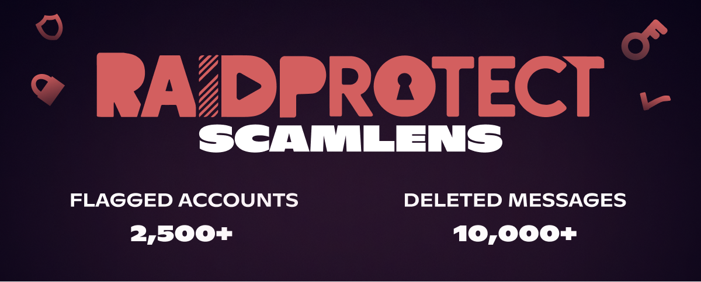

import Timestamp from '@site/src/components/Timestamp';

一波与“**加密货币图片**”**诈骗**相关的大规模垃圾信息，促使我们提前启用了 **RaidProtect ScamLens**（我们的反诈骗图片分析模块）的 `Deletion` 模式。

{/* truncate */}

## 🛡️ 垃圾信息详情 {#threat}

<Timestamp value={1771023600} format="D" />，在 <Timestamp value={1771023600} format="T" /> 至 <Timestamp value={1771068391} format="T" /> 之间，发生了两波大规模垃圾信息攻击。超过 **2,500 个被盗账户**被用来发送了超过 **10,000 条**包含此类图片的消息。这些数字仅代表在受 RaidProtect 保护的 340,000 个服务器上观察到的情况——Discord 拥有数百万个活跃服务器，这次攻击在整个平台上的实际规模估计可达**数十万条消息**。

这种被称为“加密货币图片”的诈骗，是在尽可能多的频道中大量发送 **4 张图片**，诱导用户购买欺诈性加密货币。

  
  
  
  

#### 第一波 {#wave-1}

#### 第二波 {#wave-2}

面对如此大量的欺诈消息，我们提前启用了 **ScamLens** 的 `Deletion` 模式——该模块最初在 [3.3.1 更新](/blog/3.3.1-jail-and-mute#changelog)中以 `Learning`（学习）模式推出。
该模块会分析发送到您服务器上的图片，现在会自动删除被识别为欺诈的图片（无需任何配置）。

### 接下来呢？ {#next}

`Sanction` 模式即将启用：除了删除欺诈图片之外，ScamLens 还会自动对发送者施加**一天的超时**。我们选择不封禁这些账户，因为它们几乎全部是**被盗账户**——封禁会让账户的真正所有者受到惩罚。超时可以立即消除威胁，让所有者有时间重新掌控自己的账户。

:::info 🔒 有意保持不透明的运作方式
出于安全考虑，我们不会、将来也不会公开 ScamLens 所使用的检测方法。这种“黑箱”做法旨在防止诈骗者调整手法来绕过我们的防护。
:::

---

## ❓ FAQ {#faq}

#### 如何拦截 Discord 上的图片垃圾信息？ {#antispam-images}
将 [RaidProtect 添加](https://raidprotect.bot/invite)到您的服务器。ScamLens 默认启用，会删除所有被检测为欺诈的图片，无需任何额外配置。

#### 如何防范 Discord 上的加密货币图片诈骗？ {#arnaque-images-crypto}
只需[添加 RaidProtect](https://raidprotect.bot/invite)。ScamLens 会自动检测并删除欺诈图片。

#### 如何阻止垃圾信息机器人进入我的 Discord 服务器？ {#anti-spam-bots}
除了 ScamLens，还可以启用 RaidProtect 的[验证码](/docs/features/captcha)，阻止自动化账户加入您的服务器。

---

:::tip 📚 实用资源
- 🔗 [将 RaidProtect 添加到您的服务器](https://raidprotect.bot/invite)
- 📘 [查看完整文档](https://docs.raidprotect.bot/)
- 💡 [提交建议或反馈](https://suggestions.raidprotect.bot/)
- 📣 [关注公告并加入社区](https://raidprotect.bot/discord)
:::
