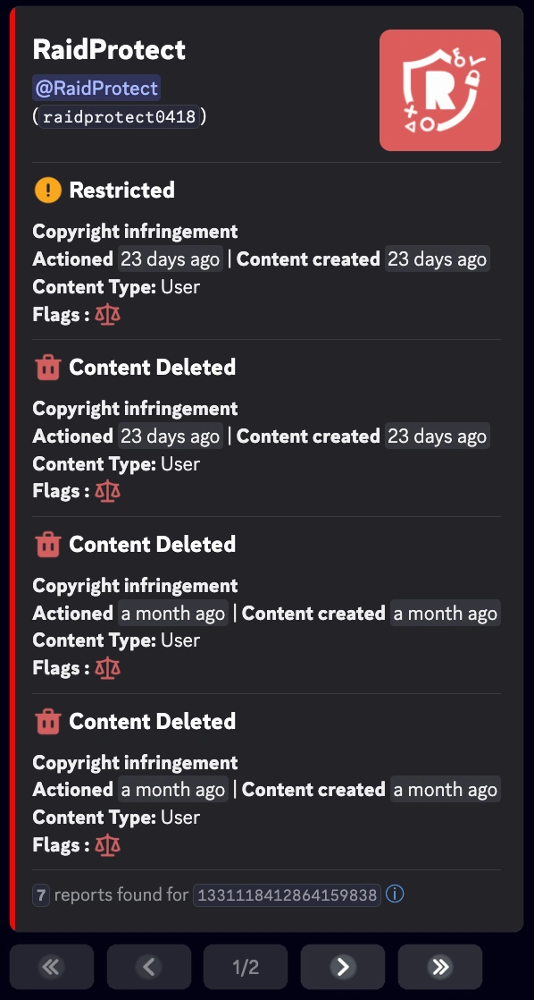
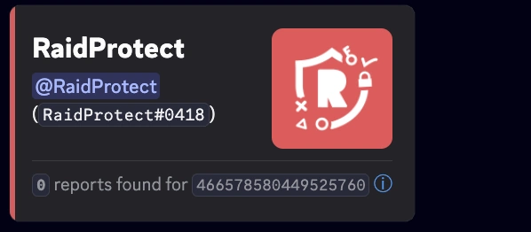

import SeparatedBox from '@site/src/components/SeparatedBox';
import Tabs from '@theme/Tabs';
import TabItem from '@theme/TabItem';
import Icon from "@site/src/components/Icon";
import Settings from '@site/src/components/DiscordMessage/mockups/v2';

更多简化服务器管理的功能。🔧

除验证码、Antispam 或反突袭等主要功能外，RaidProtect 还提供多种辅助工具，可以让您的服务器管理更加顺畅。

## 📋 复制频道 {#channel-duplicate}

`/channel duplicate` 命令可让您完整复制一个频道，包括它的所有设置、权限和配置。这弥补了 Discord 原生功能的不足：原生功能无法复制**分类**以及**某些特定设置**，例如论坛频道的标签。

使用命令：```/channel duplicate (#channel)```

将 `(#channel)` 替换为要复制的频道的提及或 [ID](../guides/id.mdx)。

### 🎯 功能 {#duplicate-features}

该命令会复制以下全部内容：

- **频道名称**
- **权限**（角色和用户）
- **频道类型**（文字、语音、论坛等）
- 根据频道类型而定的**特定设置**
- 在分类中的**位置**（如适用）

### ⚙️ RaidProtect 配置 {#duplicate-config}

当您复制的频道带有 RaidProtect 的内部配置时，机器人会自动提议：

- **替换**现有配置，改用新的频道
- **复制**该配置，使两个频道都保持已配置状态

**示例**：如果您复制日志频道，RaidProtect 会提议更新其配置，使新频道成为日志频道，或者按您的偏好让两个频道都保持已配置状态。

## 🗑️ 删除并重新创建频道 {#channel-clear}

`/channel clear` 命令可让您删除一个频道并按原样重新创建，同时保留它的设置、权限和 RaidProtect 配置。

使用命令：```/channel clear (#channel)```

将 `(#channel)` 替换为要重新创建的频道的提及或 [ID](../guides/id.mdx)。

:::warning
该频道的消息和 Webhook 将被永久删除。执行前会要求您确认。
:::

## 🧹 清理成员 {#prune}

`/prune` 命令可让您通过交互式菜单踢出服务器中的不活跃成员。

使用命令：```/prune [duration]```

将 `[duration]` 替换为所需的不活跃天数，范围为 1 至 30。机器人会显示一个交互式菜单，让您可以：
- 选择不活跃的时长
- 包含或排除特定角色
- 在确认前查看受影响的成员数量

确认文字会说明实际会有哪些人被移出：

| 模式 | 未选择角色时 | 选择了角色时 |
|---|---|---|
| **包含** | 仅限**没有任何角色**的不活跃成员 | **除所选角色外没有其他任何角色**的不活跃成员 |
| **排除** | 所有不活跃成员，**无论其拥有何种角色** | **没有任何所选角色**的不活跃成员 |

:::info
`/prune` 命令仅限管理员使用。只提供位置最低的 100 个角色；拥有更高角色的成员会被直接排除。
:::


## 🚫 屏蔽用户 {#block}

`/block` 命令可让您禁止某位用户在您的服务器上使用 RaidProtect 的某些功能（例如：提交举报或获得标签角色）。

屏蔽或解除屏蔽时，RaidProtect 会让您选择涉及的功能：

| 类型 | 效果 |
|---|---|
| **所有互动** | 屏蔽与机器人的所有互动 |
| **举报** | 该用户将无法再提交[举报](./reports.md) |
| **标签角色** | 该用户将无法再获得[标签角色](./tag-role.md) |

### 屏蔽用户 {#block-add}

使用命令：```/block add [@user] [reason]```

### 解除屏蔽 {#block-remove}

使用命令：```/block remove [@user] [reason]```

### 列出被屏蔽的用户 {#block-list}

使用命令：```/block list```

## 📢 信息面板 {#display}

请参阅[信息面板专页](./display.mdx)，了解更多关于 `/display public` 和 [`/display staff`](./display.mdx#staff) 命令的信息。

## 📜 我的处罚 {#my-sanctions}

`/my-sanctions` 命令让成员可以查看自己在服务器上的处罚，具体取决于管理员配置的[隐私级别](./sanctions.mdx#sanctions-privacy)。

使用命令：```/my-sanctions```

:::info
如果启用了该功能，也可以通过[信息面板](./display.mdx)上的**查看我的处罚**按钮使用此命令。
:::

## 🏠 服务器信息 {#serverinfo}

`/serverinfo` 命令会显示**当前服务器的信息**：名称、所有者、创建日期、成员数量、助力等级、已启用的功能等。

使用命令：```/serverinfo```

:::info
`serverinfo` 命令[可通过前缀使用](../guides/prefix.md)（别名 `ginfo`）。它只能在已安装 RaidProtect 的服务器上使用。
:::

## 🔗 邀请信息 {#inviteinfo}

`/inviteinfo` 命令可在您点击之前分析一个 Discord 邀请：适合用来核实合作、广告或私信中收到的链接。

使用命令：```/inviteinfo (invite)```

将 `(invite)` 替换为邀请的代码或链接（例如 `discord.gg/raidprotect`）。

对于服务器邀请，我们会显示：

- **服务器**：名称、徽章和标签、ID、成员数和在线成员数、验证级别、等级和助力。
- **邀请**：目标频道（文字、语音或舞台频道）、创建者、使用次数、到期日期、加入时授予的角色。
- 服务器重点展示的**主题和游戏**（游戏可点击）。
- **活动概况**：高峰和低谷时段、活跃规律。
- 一个“**加入服务器**”按钮。

好友邀请、私密群组邀请、活动邀请和直播邀请同样可以识别。

:::info
在服务器中，回复是临时的，且该命令默认需要“**管理消息**”权限。如果您将 RaidProtect 添加到您的 Discord 账号，也可以在私信和私密群组中使用 `/inviteinfo`：此时回复会显示在对话中。`inviteinfo` 命令[可通过前缀使用](../guides/prefix.md)（别名 `ii`）。
:::

## 🔐 您在此服务器上的数据 {#privacy}

`/privacy` 命令会显示 RaidProtect 在您的服务器上保存了什么。它向所有成员开放，回复仅您自己可见。

使用命令：```/privacy```

- **始终保存**：在 `/settings` 中选择的配置（只要 RaidProtect 在服务器中就会一直保留），以及用于管理记录的处罚（成员、管理员、原因和日期）。
- **取决于您的设置**：如果 Antispam、举报或[消息缓存](#message-cache)处于启用状态，则会保存消息（每个频道一小时，存于内存，绝不写入数据库）；如果启用了举报，则会保存举报（发起者、原因和被举报消息的副本）。

回复会指向我们的隐私政策，其中详细说明了保存时长、共享方式以及您的权利。

## 🗂️ 消息缓存 {#message-cache}

缓存会在内存中保留**每个频道一小时的消息**，绝不写入数据库。它为 [`/snipe`](./moderation.mdx#snipe) 命令以及 `/modview` 的 snipe 部分提供数据。没有缓存时，这些命令找不到任何已删除的消息。

1. 使用 [`/settings` 命令](../setup.md#settings)。
2. 打开“**实用工具**”选项卡。
3. 点击“**消息缓存**”旁边的“**启用**”。

<Settings start="home:utilities" />

:::info
缓存**默认关闭**。当 [Antispam](./anti-spam.mdx) 或[举报](./reports.md)处于启用状态时，它会被自动启用且无法关闭：这些功能需要读取消息。此时按钮会呈灰色。
:::

## 💬 反馈意见 {#feedback}

`/feedback` 命令可让您直接在 Discord 中**分享意见、建议或报告错误**，无需加入支持服务器。在服务器中，它默认需要“**管理消息**”权限；它也可以在与 RaidProtect 的私信中使用。

使用命令：```/feedback```

选择反馈类型，然后填写打开的窗口：

- **建议**：我们会将您引导到建议页面。
- **错误报告**：选择类别（Antispam、AntiRaid、验证码、处罚与管理、身份验证管理器、设置与配置、命令、日志、其他）；您的报告会转交给我们的团队。
- **综合反馈**：为您的体验打 1 到 5 分。
- **好评**。

## 👤 用户信息 {#userinfo}

`/userinfo` 命令可让您获取某位用户的详细信息。

使用命令：```/userinfo [user]```

将 `[user]` 替换为所需的提及或 ID。

:::info
`userinfo` 命令[可通过前缀使用](../guides/prefix.md)（别名 `ui`）。如果您将 RaidProtect 添加到您的 Discord 账号，也可以在私信和私密群组中使用它。
:::

### 📋 显示的信息 {#displayed-userinfo}

- Discord **账号创建日期**
- 用户的**头像**
- **个人资料横幅**
- **个人资料徽章**
  - Nitro、助力者、任务和旧用户名徽章不会显示。


### 🎭 服务器成员的信息 {#displayed-memberinfo}

如果目标是服务器成员，额外的信息包括：

- **加入服务器的日期**
- **服务器昵称**
- **角色数量**以及**前 6 个角色的列表**
- **权限类别**（仅管理员可见）：
<SeparatedBox>
<Tabs>
  <TabItem value="animator" label="活动主持" default>

    如果成员拥有以下权限中的**至少一项**，则显示**活动主持**类别：

    - `MANAGE_EXPRESSIONS`
    - `CREATE_GUILD_EXPRESSIONS`
    - `MANAGE_EVENTS`

  </TabItem>
  <TabItem value="moderator" label="管理人员">

    如果成员拥有以下权限中的**至少一项**，则显示**管理人员**类别：

    - `KICK_MEMBERS`
    - `BAN_MEMBERS`
    - `MODERATE_MEMBERS`
    - `MANAGE_MESSAGES`
    - `MUTE_MEMBERS`
    - `DEAFEN_MEMBERS`
    - `MOVE_MEMBERS`
    - `MANAGE_THREADS`

  </TabItem>
  <TabItem value="manager" label="管理者">

    如果成员拥有以下权限中的**至少一项**，则显示**管理者**类别：

    - `MANAGE_GUILD`
    - `MANAGE_ROLES`
    - `MANAGE_CHANNELS`
    - `VIEW_AUDIT_LOG`
    - `MANAGE_WEBHOOKS`
    - `MANAGE_SERVER_EXPRESSIONS`

  </TabItem>
  <TabItem value="admin" label="管理员">

    在**以下两种情况**下会显示**管理员**类别：

    1️⃣ 拥有以下权限：
    - `ADMINISTRATOR`

    2️⃣ **同时**拥有以下**三项权限**：
    - `MANAGE_GUILD`
    - `MANAGE_ROLES`
    - `MANAGE_CHANNELS`

  </TabItem>
  <TabItem value="owner" label="所有者">

    **条件**：该成员是**服务器所有者**。

  </TabItem>
</Tabs>
</SeparatedBox>

- **成员标志**（仅管理员可见）：

| **标志**                                | **表情符号**                                                                                                             | **含义**                                                |
| ---------------------------------------- | ---------------------------------------------------------------------------------------------------------------------- | ----------------------------------------------------------------- |
| `DID_REJOIN`                             | <Icon src="/img/icons/MemberDidRejoin.svg" alt="icon MemberDidRejoin" title=":MemberDidRejoin:"/>                      | 该用户离开后又重新加入了服务器。           |
| `IS_GUEST`                               | <Icon src="/img/icons/MemberIsGuest.svg" alt="icon MemberIsGuest" title=":MemberIsGuest:"/>                            | 访客成员（临时邀请或访客访问）。            |
| `COMPLETED_ONBOARDING`                   | <Icon src="/img/icons/OnboardingCompleted.svg" alt="icon OnboardingCompleted" title=":OnboardingCompleted:"/>          | 已完成服务器的新成员引导（onboarding）。         |
| `STARTED_ONBOARDING`                     | <Icon src="/img/icons/OnboardingStarted.svg" alt="icon OnboardingStarted" title=":OnboardingStarted:"/>                | 已开始新成员引导。                                |
| `COMPLETED_SERVER_GUIDE`                 | <Icon src="/img/icons/ServerGuideCompleted.svg" alt="icon ServerGuideCompleted" title=":ServerGuideCompleted:"/>       | 已完成服务器指南（如已启用）。                          |
| `STARTED_SERVER_GUIDE`                   | <Icon src="/img/icons/ServerGuideStarted.svg" alt="icon ServerGuideStarted" title=":ServerGuideStarted:"/>             | 已开始服务器指南。                                   |
| `AUTOMOD_QUARANTINED_NAME`               | <Icon src="/img/icons/MemberQuarantined.svg" alt="icon MemberQuarantined" title=":MemberQuarantined:"/>                | 因用户名被自动管理隔离。|
| `AUTOMOD_QUARANTINED_GUILD_TAG`          | <Icon src="/img/icons/MemberQuarantined.svg" alt="icon MemberQuarantined" title=":MemberQuarantined:"/>                | 因标签或昵称被自动管理隔离。    |
| `BYPASSES_VERIFICATION`                  | <Icon src="/img/icons/BypassVerification.svg" alt="icon BypassVerification" title=":BypassVerification:"/>             | 该用户可以绕过服务器的验证。       |
| `SPAMMER`                                | <Icon src="/img/icons/UnusualAccountActivity.svg" alt="icon UnusualAccountActivity" title=":UnusualAccountActivity:"/> | 账号被标记为垃圾信息发送者，或检测到异常活动。   |

## ⚖️ Discord 处罚 {#discord-sanctions}

`/discord-sanctions` 命令可让您查看 **Discord 对某位用户作出的处罚**，依据的是[欧盟法规](https://transparency.dsa.ec.europa.eu/)。

使用命令：```/discord-sanctions [@user]```

将 `[@user]` 替换为所需的提及或 ID。也可以在用户资料上点击右键，通过 **`应用`** 然后 **`Discord 处罚`** 使用该命令。不指定用户时，它会显示 Discord 过去 7 天的全球安全统计（“**类别**”、“**检测**”和“**处置**”选项卡）。

### 📋 显示的信息 {#displayed-sanctions}

- **处罚类型**：

| **处罚**                            | **表情符号**                                                                                                             | **含义**                                                |
| ---------------------------------------- | ---------------------------------------------------------------------------------------------------------------------- | ----------------------------------------------------------------- |
| `CONTENT_DELETED`                        | <Icon src="/img/icons/ContentDeleted.svg" alt="icon ContentDeleted" title=":iconTrash:"/>                              | 用户发布的内容已被删除。                |
| `RESTRICTED`                             | <Icon src="/img/icons/AccountRestricted.svg" alt="icon AccountRestricted" title=":iconRestricted:"/>                   | 用户账号已被限制。                            |
| `ACCOUNT_SUSPENDED`                      | <Icon src="/img/icons/AccountSuspended.svg" alt="icon AccountSuspended" title=":iconSuspended:"/>                      | 用户账号已被暂停。                             |
| `ACCOUNT_TERMINATED`                     | <Icon src="/img/icons/AccountTerminated.svg" alt="icon AccountTerminated" title=":iconTerminated:"/>                   | 用户账号已被删除。                             |

- **作出处罚的日期**
- **内容类型**
- **处罚标志**：

| **标志**                                | **表情符号**                                                                                                             | **含义**                                                |
| ---------------------------------------- | ---------------------------------------------------------------------------------------------------------------------- | ----------------------------------------------------------------- |
| `ILLEGAL_CONTENT`                        | <Icon src="/img/icons/IllegalContent.svg" alt="icon IllegalContent" title=":iconIllegal:"/>                            | 因违法内容而作出的处罚。                        |
| `AUTOMATED_DETECTION`                    | <Icon src="/img/icons/AutomatedDetection.svg" alt="icon AutomatedDetection" title=":iconBots:"/>                       | 通过自动检测作出的处罚。                 |

<SeparatedBox>
<Tabs>
  <TabItem value="reports-found" label="找到报告" default>



  </TabItem>
  <TabItem value="reports-not-found" label="未找到报告">



  </TabItem>
</Tabs>
</SeparatedBox>

:::note
该命令可查看 2024 年 8 月 22 日至 2025 年 8 月 14 日之间发布的报告。这些信息由 Discord 直接提供，RaidProtect **无法修改**。
:::

## 常见问题 {#faq}

### 为什么 `/snipe` 找不到任何消息？

`/snipe` 读取的是在内存中保留一小时的消息。请在 `/settings` 的“实用工具”选项卡中启用[消息缓存](#message-cache)，或启用 Antispam 或举报，它们会自动启用缓存。

### 如何在加入服务器之前核实 Discord 邀请？

对邀请的代码或链接使用 `/inviteinfo`：我们会显示服务器、其创建者、其活跃情况以及加入时授予的角色。

### RaidProtect 在我的服务器上保存了什么？

`/privacy` 命令对此有详细说明：配置和处罚是永久保存的，而根据您的设置，还会保存一小时的内存消息和举报。

### 谁可以使用 `/prune`？

默认只有管理员。在执行任何踢出之前，预览会显示受影响的成员数量。
