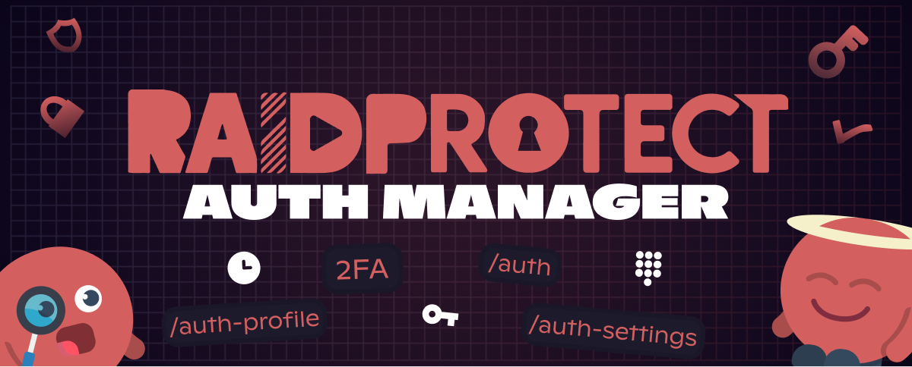

只要一個管理員帳號遭盜用，您的伺服器就可能在幾秒內被摧毀。因此，每當成員需要取得敏感角色時都驗證其身分，就變得不可或缺。**Authentification Manager** 填補了 Discord 這個真正的缺口。

<!--truncate-->

## ❓ 問題所在 {#problem}

一個管理員帳號遭到盜用。短短幾秒內：大量停權、頻道被刪除、資料外洩。而且即使啟用了 Discord 的 2FA，只要權杖被惡意軟體或網路釣魚頁面竊取，就足以繞過這層保護：攻擊者已經處於登入狀態，根本不會被要求進行 2FA。

Discord 沒有提供任何機制來驗證擁有敏感權限角色的背後究竟是誰。任何能存取該帳號的人都能以完整權限行事，沒有任何東西能阻止他。

因管理員帳號被駭而刪除哪怕一個頻道，都已經太多了。

## 🔐 解決方案：Authentication Manager {#solution}

有了 [Authentication Manager](/docs/features/authentication-manager)（AM），擁有敏感權限的角色不再永久指派，而是僅在通過額外一層驗證後才會授予。再結合會自動到期的臨時會話，暴露的時間窗口便大幅縮短：會話結束時，角色會自動移除。

即使攻擊者竊取了 Discord 帳號，也無法使用伺服器的破壞性權限：該角色根本不在帳號上，而取得它需要攻擊者所沒有的驗證。

---

## ✨ 包含的功能 {#features}

### 🛡️ [4 種驗證方式](/docs/features/authentication-manager#methods)

| **方式** | **說明** | **等級** |
| --- | --- | --- |
| 簡易 PIN 碼 | 一般輸入 4 到 12 位數字 | E 到 D |
| 防窺 PIN 碼 | 按鍵隨機排列的數字鍵盤，6 到 12 位數字 | C 到 B |
| OTP（2FA） | 透過 Google Authenticator、Authy、1Password 等產生的 6 位數臨時驗證碼 | A |
| Passkey（WebAuthn） | 指紋、臉部辨識或實體金鑰（YubiKey） | S |

### 🔑 [安全等級](/docs/features/authentication-manager#grades)

每種方式都對應一個等級（E 到 S）。您可以為每個角色選擇所需的最低等級：內部存取用 PIN 就足夠，管理員角色則需要 passkey。

### ⏱️ [臨時會話](/docs/features/authentication-manager#sessions)

角色不再是永久的。每次驗證都會開啟一個有時限的會話（最長可設定為 8 小時）。到期時，角色會自動移除。

### ⚙️ [管理者系統](/docs/features/authentication-manager#users-tab)

將管理員權限交給成員，同時讓他無法動到驗證系統。管理者本身也必須通過驗證，且只能管理低於其上限的角色，從而防止建立後門與提升權限。

### 📋 [稽核日誌與會話](/docs/features/authentication-manager#logs-tab)

每一次驗證、角色指派與動作都會直接記錄在機器人中。與 Discord 的紀錄不同，沒有人能刪除它們：即使是遭盜用的管理員也無法抹除自己的痕跡。

### 🚫 [防暴力破解保護](/docs/features/authentication-manager#auth-security)

失敗 5 次：鎖定一小時。失敗 10 次：完全重設帳號。

---

3.3.2 的完整新功能清單，請參閱[更新日誌](/docs/changelog#3-3-2)。

:::tip 實用資源
- [將 RaidProtect 加入您的伺服器](https://raidprotect.bot/invite)
- [查看完整文件](https://docs.raidprotect.bot/)
- [提交建議或回饋](https://suggestions.raidprotect.bot/)
- [追蹤公告並加入社群](https://raidprotect.bot/discord)
:::
