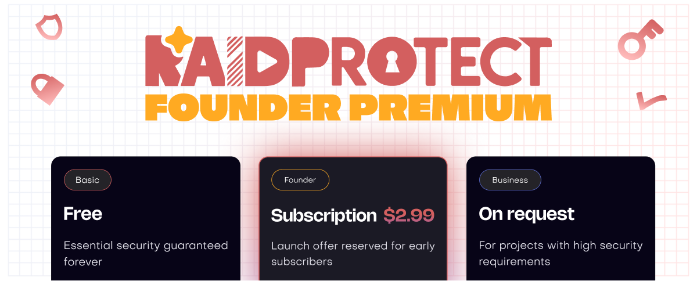

RaidProtect 從第一天起就是免費的，未來也將如此。今天，我們推出 **RaidProtect Premium**：為有需要的伺服器提供擴充功能，也是推動專案前進的具體方式。

<!--truncate-->

## ❓ 為什麼要推出 Premium？ {#why}

RaidProtect 由一家公司開發與維護，而這家公司的收入來自其他專案。從一開始，就是由它負擔機器人的全部費用：伺服器、頻寬、開發、維護。具體來說，是其他客戶在其他服務上所產生的收入，支付了您免費使用的這項服務。

我們做出這個選擇，是因為我們相信這個專案。但一個由不依賴它的預算所資助的機器人，其開發只能在預算允許時才能推進。Premium 的目標就是改變這一點：讓 RaidProtect 自給自足。一個能自負盈虧的專案，就能加快開發腳步、強化穩定性，並在不依賴任何人的情況下持續進化。

不會改變的是：**免費版仍然功能完整**，並將以相同的步調持續進化。Premium 是為需要更多功能的伺服器而設計：擴充的上限、進階自訂、搶先體驗，也提供給想要積極支持專案的人。

---

## 🚀 Founder 方案 {#founder}

Premium 以 **Founder 方案**推出，保留給首批訂閱者。原則是：**您的價格終身鎖定**。

日後將推出新的方案，Founder 方案也會從商店下架。一旦關閉，任何人都無法再取得。

Founder 訂閱者會保有其價格，並持續享有服務的各項進化。您從一開始就押注 RaidProtect，我們會記得。如果未來某項功能特別耗費資源，它可能不會包含在內，但現有的優惠以及未來合理的新增內容都會保留。

:::tip 啟用 Premium
在您的 Discord 伺服器上使用 `/settings` 並點選「Premium」，或直接前往 [Discord 中的 RaidProtect 商店](https://discord.com/discovery/applications/466578580449525760/store)了解方案。
:::

---

## ✨ Premium 目前提供的功能 {#features}

### 🏷️ [可自訂的處罰名稱](/docs/features/sanctions#custom-names)

重新命名每種處罰類型，以符合您伺服器的用語。顯示的名稱、訊息中使用的動詞，以及傳送給受處罰成員的私訊措辭，全都可以自由設定。

### 🔐 [Authentication Manager：擴充上限](/docs/features/authentication-manager)

在免費版中，Authentication Manager 限制為 3 個受保護的角色、20 位使用者，以及最長 8 小時的會話。Premium 提高了這些上限：

| | 免費 | Premium |
| --- | --- | --- |
| 受保護的角色 | 3 | 10 |
| 使用者 | 20 | 50 |
| 最長會話時長 | 8 小時 | 24 小時 |

### 📋 [資訊面板：擴充上限](/docs/features/display)

公開資訊面板從 2 個增加到 4 個（另加保留給 Jail 的欄位），讓您能在伺服器上涵蓋更多內容。

### 🔬 公開測試版存取權

搶先體驗部分實驗性功能，早於正式推出。

---

完整的新功能清單，請參閱[更新日誌](/docs/changelog)。

:::tip 實用資源
- [將 RaidProtect 加入您的伺服器](https://raidprotect.bot/invite)
- [查看完整文件](https://docs.raidprotect.bot/)
- [提交建議或回饋](https://suggestions.raidprotect.bot/)
- [追蹤公告並加入社群](https://raidprotect.bot/discord)
:::
