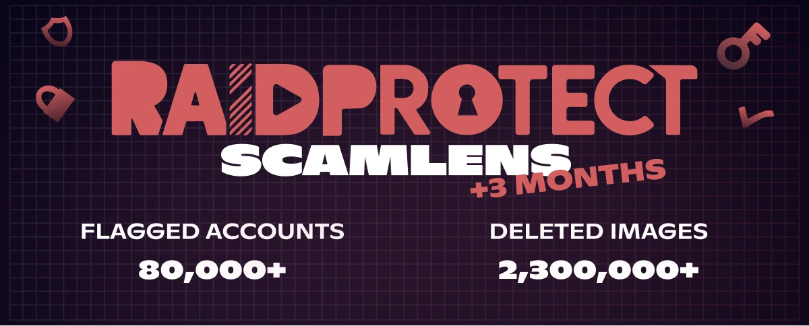

import Timestamp from '@site/src/components/Timestamp';
import Head from '@docusaurus/Head';

受 RaidProtect 保護的 **365,000 個 Discord 伺服器** 2026 年 5 月總結（2026 年 5 月 1 日至 6 月 1 日）：ScamLens **刪除了 230 萬張詐騙圖片**，並識別出 **80,000 個遭駭的 Discord 帳號**。這些詐騙**冒用名人的形象**，例如 MrBeast、Elon Musk 或 Andrew Tate，而他們顯然與這些訊息毫無關係。我們也將涵蓋範圍擴大到一個新的變種：**「3 張圖片」組合**，它是在一次於數分鐘內攔截**超過 2,000 張圖片的高峰**中被發現的。

{/* truncate */}

## 🛰️ 回顧：ScamLens，RaidProtect 的圖片反詐騙 {#what-is-scamlens}

給剛認識 RaidProtect 的伺服器：ScamLens 是處理**詐騙圖片**的模組。每當有圖片被發布，它就會與自身的目錄比對，並自動刪除詐騙圖片：**加密貨幣詐騙**、**假冒名人的贈獎活動**（MrBeast、Elon Musk、Andrew Tate、Kick、Stake……）、**假的線上賭場促銷**。您無需進行任何設定或維護：只要[加入 RaidProtect](https://raidprotect.bot/invite)，ScamLens 就會**預設**運作。

  
  
  
  

## 📊 自 2026 年 2 月 14 日以來的 ScamLens 總結 {#stats}

自 <Timestamp value={1771023600} format="D" /> [ScamLens 提前啟用](/zh-TW/blog/scamlens-early-activation)以來的累計數據：

| **指標（自 2 月 14 日起累計）** | **2026 年 5 月 1 日** | **2026 年 6 月 1 日** | **變化** |
|---|---|---|---|
| 已分析的圖片（不重複） | 890,000 | **1,800,000** | **+100%** |
| 偵測到的詐騙圖片（不重複） | 82,000 | **141,000** | **+72%** |
| 已刪除的詐騙圖片 | 1,400,000 | **2,300,000** | **+64%** |
| 已識別的遭駭 Discord 帳號 | 40,000 | **80,000** | **+100%** |

**已識別的遭駭帳號數量**在一個月內**翻倍**，而刪除的圖片數量現已超過 **230 萬張**。不重複圖片的目錄也在成長（+72%）：這主要表示有**新的視覺群組**出現。所謂視覺群組，是指同一張詐騙圖片**及其所有細微變體**（重新裁切、濾鏡、修圖）；當不重複圖片的數量增加這麼多時，代表推出的確實是**新的圖像**，而不只是舊圖的變化版本。

---

## 🆕 新功能：涵蓋「3 張圖片」組合 {#updates}

詐騙者會將他們的圖像拆分成多種**組合格式**來欺騙偵測：一開始是 4 張圖片，上個月是 2 張圖片（請參閱[「2 張圖片」](/zh-TW/blog/threat-weather-april-2026#stats)），而現在則是 **3 張圖片的組合**。我們是在一次於數分鐘內攔截**超過 2,000 張圖片的高峰**中觀察到這種新格式。

這個 3 張圖片的組合也伴隨著一個**新的視覺群組**出現：一種前所未見、尚未收錄在我們目錄中的詐騙圖像。我們一次就涵蓋了兩者，ScamLens 現在能完整辨識這個組合，您無需採取任何行動。每張圖片的處理時間仍約為 **400 毫秒**，大多數成員甚至還來不及看到它。

---

## ❓ FAQ {#faq}

<Head>
  
</Head>

#### Discord 上的 ScamLens 是什麼？ {#quest-ce-que-scamlens}
ScamLens 是 **Discord 防護機器人** RaidProtect 的**圖片反詐騙模組**。它會即時分析每張被發布的圖片，並**自動刪除**被判定為詐騙的圖片（加密貨幣詐騙、假冒名人的贈獎活動、假的線上賭場促銷），**完全無需設定**。

#### 如何自動刪除 Discord 上的加密貨幣詐騙圖片？ {#supprimer-images-arnaque-crypto}
[將 RaidProtect 加入](https://raidprotect.bot/invite)您的伺服器：**ScamLens 預設為啟用**，會在**約 400 毫秒**內刪除加密貨幣詐騙圖片，大多數成員根本來不及看到。無需撰寫任何規則，也無需維護任何黑名單。

#### 為什麼我的 Discord 帳號會自己發送詐騙訊息？ {#compte-discord-envoie-messages-seul}
您的帳號極有可能已**遭駭**。詐騙者會竊取您的**驗證權杖**（假網站、被植入惡意程式的軟體、惡意擴充功能），然後在您不知情的情況下，利用它在**您所在的所有伺服器**上大量發送詐騙圖片。

#### 如果我 Discord 伺服器上的某位成員散布加密貨幣詐騙，該怎麼辦？ {#membre-diffuse-scam-crypto}
**不要停權他**：這幾乎都是**遭駭的帳號**，而不是惡意使用者。請私下聯絡他，讓他保護好自己的帳號。ScamLens 已經會即時刪除圖片，而不會懲罰合法擁有者。

#### 如何辨識 Discord 上的假贈獎活動或假加密貨幣促銷？ {#reconnaitre-fausse-promo-crypto}
任何加密貨幣**「贈禮」**、帶有名人標誌（MrBeast、Elon Musk、Andrew Tate、Kick、Stake）的**線上賭場**或**「保證獲利」的投資**都是詐騙。**這些名人並不是這些訊息的幕後主使**：詐騙者只是冒用他們的形象與知名度。Discord 從不舉辦加密貨幣發放活動，也沒有任何正派的品牌會在多個伺服器間發送垃圾訊息。

---

:::tip 📚 實用資源
- 🔗 [將 RaidProtect 加入您的伺服器](https://raidprotect.bot/invite)
- 📘 [HoneyPot 文件](https://docs.raidprotect.bot/features/honeypot)
- 💡 [提交建議](https://suggestions.raidprotect.bot/)
- 📣 [加入我們的 Discord 伺服器](https://raidprotect.bot/discord)
:::
