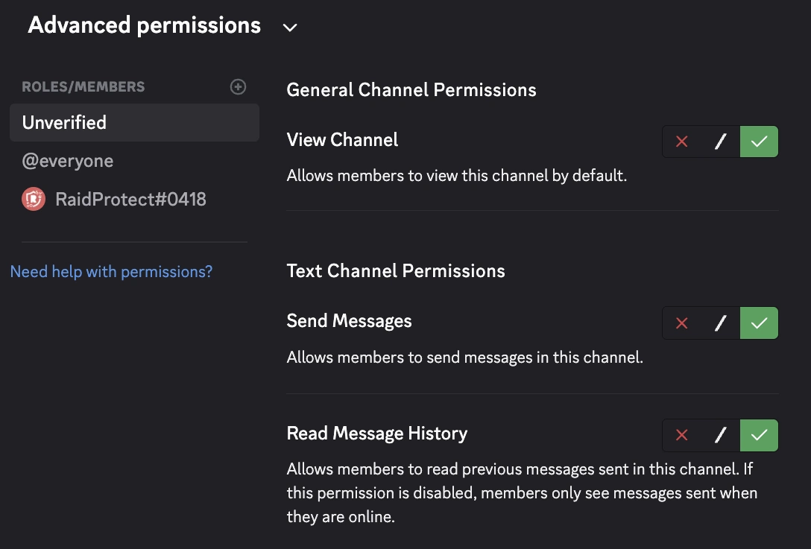

import Settings from '@site/src/components/DiscordMessage/mockups/v2';

如果 `#驗證` 頻道預設對新成員不可見，他們就無法通過[驗證碼](../features/captcha.md)，並會一直卡在那裡。本指南針對的是 **Discord 的新成員引導**（伺服器設定 > 新成員引導）。至於 RaidProtect 的歡迎訊息與自動身分組，請參閱[新成員加入與歡迎](../features/onboarding.md)頁面。

在大多數情況下，RaidProtect 會為您修正這個問題：請先從步驟 1 開始。

## 1️⃣ 讓 RaidProtect 修正 {#auto-fix}

1. 使用 [`/settings` 指令](../setup.md#settings)。
2. 開啟「**新成員加入**」分頁。
3. 點擊「**驗證碼**」旁的「**設定**」。
4. 如果有提示指出驗證頻道**預設不可見**，請點擊：
   - 「**移至** _分類_」，將頻道放入新成員已可看見的分類；
   - 或「**建立新分類**」，由我們建立一個「歡迎」分類並加入預設頻道。

移動頻道時，頻道的權限會保留。

<Settings start="captcha" />

:::tip
同一個畫面也會提示 `@未驗證` 角色的**漏洞**：新成員引導所賦予、可繞過驗證的角色，以及仍對驗證中成員可見的頻道。「**修復**」按鈕會關閉相關頻道。請參閱[驗證碼畫面的警示](../features/captcha.md#alerts)。
:::

## 2️⃣ 檢查頻道權限 {#permissions}

`#驗證` 頻道與 `@未驗證` 角色的權限是由 RaidProtect 自行設定的。如果您修改過，請再檢查一遍：

1. 開啟 `#驗證` 頻道的設定（按右鍵 > **編輯頻道**）。
2. 在「**權限**」分頁中：
   - 確認 `@everyone` **沒有**檢視頻道的權限。
   - 確認 `@未驗證` 角色**具有**「**檢視頻道**」與「**讀取訊息歷史**」權限。
   - 在**面板（互動）**模式（預設模式）下，`@未驗證` **不可**傳送訊息：驗證碼是在視窗中輸入的。在**挑戰（經典）**模式下，它必須能**傳送訊息**才能輸入驗證碼。

{/*  : 顯示「傳送訊息」為允許，僅在挑戰模式下才正確 */}

## 3️⃣ 檢查歡迎分類 {#default-category}

如果您想手動修正：

1. 前往**伺服器設定** > **新成員引導**。
2. 在「**預設頻道**」區段中，確認包含 `#驗證` 的分類已勾選為對新成員可見。
3. 如有需要，將 `#驗證` 移到已勾選的分類中。
4. 儲存變更。

## 4️⃣ 在 RaidProtect 中重新整理設定 {#refresh-config}

1. 使用 [`/settings` 指令](../setup.md#settings)。
2. 開啟「**新成員加入**」分頁。
3. 點擊「**驗證碼**」旁的「**設定**」。
4. 如果仍顯示提示區塊，請點擊「**重新整理**」以重新檢查。當提示區塊消失時，驗證碼就能正常運作了。

## 5️⃣ 使用測試帳號測試 {#test-account}

為確認一切設定無誤：

1. 使用另一個 Discord 帳號加入伺服器。
2. 確認 `#驗證` 頻道在加入時可見。
3. 點擊「**驗證**」並輸入驗證碼（面板模式），或在頻道中輸入驗證碼（挑戰模式）。
4. 驗證後，該帳號應該可以存取其他頻道。

## 🛠️ 常見問題與解決方法 {#common-issues}

| 問題 | 解決方法 |
|---------|----------|
| 🔴 `#驗證` 頻道仍然看不到 | 在驗證碼畫面點擊「**移至** _分類_」，或將頻道放入 Discord 新成員引導中**已勾選的分類**。 |
| 🚫 `@未驗證` 角色無法發言 | 在面板模式下屬正常現象：成員需點擊「**驗證**」。在挑戰模式下，請在 `#驗證` 中授予它**傳送訊息的權限**。 |
| 🔓 未驗證的成員看得到其他頻道 | 在驗證碼畫面的漏洞提示區塊中點擊「**修復**」，並移除新成員引導在加入時賦予的角色。 |
| ❌ 修改後驗證碼無法運作 | 在驗證碼畫面（`/settings` 的「**新成員加入**」分頁）點擊「**重新整理**」。 |

---

✅ 依照這些步驟操作後，您的驗證系統就能完整運作，讓您安心迎接成員，並有效阻擋機器人或突襲。
