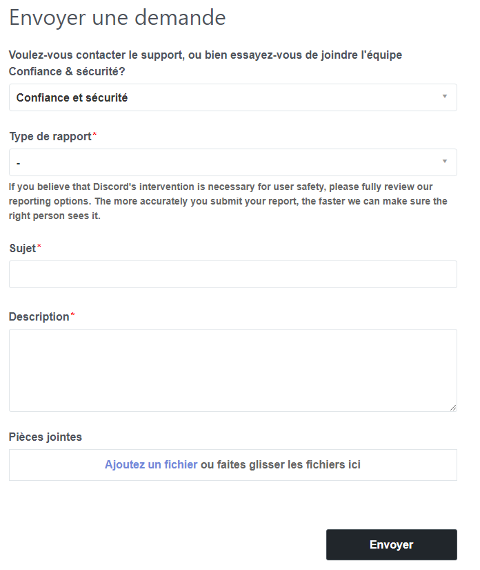
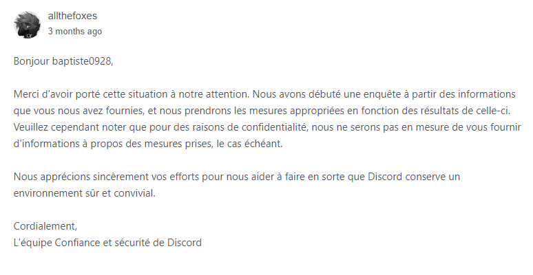

在 Discord 上遇到惡意使用者嗎？請檢舉他，讓他受到處罰。

在 Discord 上，有些使用者並不懷好意。如果他們的行為對社群特別有害，建議**向 Discord 信任與安全團隊檢舉**。若違規屬實，該使用者可能面臨從警告到帳號刪除的處罰。😖 

## 🧐 應該檢舉哪些類型的違規？ {#types-of-violations}

當然，並非所有類型的違規都會導致帳號被刪除。應受處罰的行為都記載於 Discord 的[**社群守則**](https://discord.com/guidelines)（以及[服務條款](https://discord.com/terms)，不過後者更像是法律術語，而不是真正清楚的規範）。對於不想閱讀長篇內容的人來說，檢舉頁面上的檢舉類型清單是很好的摘要。

一般而言，**危害社群**的行為（垃圾訊息、宣傳非法內容等）或**嚴重侵害使用者**的行為（肉搜、騷擾）都應該檢舉。

對於不那麼極端的行為，**建議優先使用停權**（在伺服器內）或[封鎖](https://support.discordapp.com/hc/fr/articles/217916488-Blocage-et-param%C3%A8tres-de-confidentialit%C3%A9)（在整個 Discord）。如果您不是事發伺服器的管理員，請毫不猶豫地向該伺服器的管理團隊回報，他們有責任採取行動。

## 🕵️ 蒐集證據 {#recover-evidences}

要進行檢舉，您需要提供證據。首先請注意，**螢幕截圖沒有用**，因為很容易被偽造。您必須提供一個（或多個，更好）訊息連結。

**這些連結非常容易取得**。在符合您想檢舉之違規行為的訊息上，執行右鍵 > 複製訊息連結（電腦版），或長按 > 分享 > 複製到剪貼簿（手機版）。

## 📪 向*信任與安全*團隊檢舉違規 {#report-to-tns}

檢舉非常簡單，只需幾分鐘。首先，前往**專用表單**，連結為 **https://dis.gd/report**。

根據所選擇的檢舉類型，**會要求填寫不同的資訊**。請將上一步取得的訊息連結填入正確的欄位（其他連結則可選擇寫在說明中）。請盡可能**詳盡完整**，並別忘了基本的禮貌。😇 

### 📨 Discord 的回覆 {#discord-response}

檢舉後幾天內（通常不到一週），您應該會收到 Discord 以**電子郵件寄來的回覆**。請注意，您無法得知被檢舉的使用者是否受到處罰，或受到何種處罰。😒

